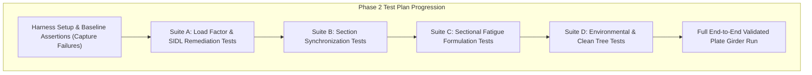

# PHASE 2 REGRESSION TEST PLAN & QUALITY SPECIFICATION

**Workspace:** `F:\FOSSEE internship`  
**Repository:** `F:\FOSSEE internship\source\OsdagBridge`  
**Reference Baseline:** Commit `d74f56dd7f22925fb8148cabf5740ed8d1e39ff3`  
**Environment:** `osdagbridge-py312` (Python 3.12.16, conda-forge + PyPI isolated)  
**Date:** 2026-11-16  
**Status:** **DRAFT SPECIFICATION — PRE-IMPLEMENTATION**  

---

## 1. Scope and Engineering Objectives

During Phase 1D, OsdagBridge completed an end-to-end execution of a Plate Girder Bridge design, but the independent technical audit identified ten critical defects that invalidated the structural results. 

The primary objective of **Phase 2** is to implement a comprehensive, automated regression test harness that detects and isolates each identified defect, verifies mathematical and code-compliant behavior against IRC:6-2017 and IRC:24-2010, and prevents regressions as fixes are developed.

### Core Testing Mandates
1. **Black-Box & White-Box Hybrid Approach:** Test both high-level bridge pipeline outputs and low-level FEM / mathematical subroutines.
2. **Deterministic & Isolated:** Tests must run without network access, without writing ephemeral files into tracked Git folders, and without cross-test state leakage.
3. **Rigorous Assertion Standards:** All assertions must verify physical dimensional consistency and numerical equilibrium rather than merely checking `status == 0`.
4. **No Premature Fixes:** This test suite acts as an independent diagnostic harness to benchmark baseline failure and measure remediation success.

---

## 2. Test Architecture & Harness Design

The Phase 2 test suite will reside in the workspace testing tree:
```
testing/
├── test_cases/
│   ├── regression/
│   │   ├── test_load_factor_propagation.py      # Priority A
│   │   ├── test_section_consistency.py          # Priority B
│   │   ├── test_fatigue_formulation.py          # Priority C
│   │   └── test_missing_loads_integration.py    # Priority D
│   ├── unit/
│   │   └── ...
│   └── integration/
│       └── ...
├── test_data/
│   ├── baseline_inputs/
│   └── reference_solutions/
└── test_logs/
```

### Automation Framework
- **Test Runner:** `pytest` (executed within `osdagbridge-py312`).
- **Assertion Strategy:** Strict floating-point tolerances via `pytest.approx` or `numpy.testing.assert_allclose` with physical bounds.
- **Mocking Strategy:** Offscreen mock contexts for OpenGL/OCC graphics to enable headless CI/CD execution while retaining GPU-specific verification in GUI smoke tests.

---

## 3. Detailed Regression Test Specifications

### Suite A: Load-Factor Propagation & Combination Integrity (Priority A)

**Target Defects:** DEF-01 (`ospgrillage` load factor omission), DEF-02 (SIDL omission).

#### Test Case A.1: Linear Superposition & Load-Factor Scaling Check
- **Identifier:** `TC-REG-A01-FACTOR-SCALING`
- **Objective:** Verify that multiplying an applied load case by a partial safety factor $\gamma_f = 1.35$ or $\gamma_f = 1.50$ scales the resulting OpenSees nodal displacements and member forces by exactly $1.35\times$ and $1.50\times$.
- **Methodology:**
  1. Instantiate an isolated `BridgeGrillageModel`.
  2. Apply a unit uniform line load $w_1 = 10 \text{ kN/m}$ on Girder 1.
  3. Execute `analyze()` and record midspan bending moment $M_{mid, 1}$.
  4. Create a factored load combination with $\gamma_f = 1.35$: `comb = 1.35 * w_1`.
  5. Execute `analyze()` and query $M_{mid, comb}$.
- **Expected Assertion:**
  $$\left| \frac{M_{mid, comb}}{1.35 \times M_{mid, 1}} - 1.0 \right| < 10^{-5}$$
- **Current Baseline Failure:** Returns $1.0000$ (factor 1.35 is dropped in `_distribute_load_types_to_model`).

#### Test Case A.2: Multi-Case ULS Combination Factor Propagation
- **Identifier:** `TC-REG-A02-ULS-COMBINATION-SUM`
- **Objective:** Verify that ULS Basic Combination 1 ($1.35 \text{ DL} + 1.75 \text{ SIDL} + 1.50 \text{ LL}$) equals the exact weighted vector sum of individual load case forces.
- **Methodology:**
  1. Execute individual cases: Dead Load ($DL$), SIDL ($SIDL$), and Live Load ($LL$).
  2. Query member force vectors: $\mathbf{F}_{DL}, \mathbf{F}_{SIDL}, \mathbf{F}_{LL}$.
  3. Query combination force vector $\mathbf{F}_{ULS1}$.
- **Expected Assertion:**
  $$\mathbf{F}_{ULS1} = 1.35 \cdot \mathbf{F}_{DL} + 1.75 \cdot \mathbf{F}_{SIDL} + 1.50 \cdot \mathbf{F}_{LL} \quad (\text{tolerance: } \pm 0.01\%)$$
- **Current Baseline Failure:** $\mathbf{F}_{ULS1} = \mathbf{F}_{DL} + \mathbf{F}_{LL}$ (unfactored and SIDL missing).

#### Test Case A.3: Envelope Peak Concordance
- **Identifier:** `TC-REG-A03-ENVELOPE-CONCORDANCE`
- **Objective:** Ensure the internal envelope extractor identifies the true factored peak moment across all 32 IRC:6 load combinations.
- **Expected Assertion:**
  $$\max(M_{env}) = \max_{k \in \text{combinations}} \left( \max_{e \in \text{elements}} M_k(e) \right)$$

---

### Suite B: Analysis vs. Designed Section Consistency (Priority B)

**Target Defects:** DEF-03 (plate snapping vs. analysis stiffness mismatch), DEF-04 (grillage geometry and edge beam assignment).

#### Test Case B.1: Post-Sizing Property Synchronization
- **Identifier:** `TC-REG-B01-SECTION-PROPERTY-SYNC`
- **Objective:** Ensure that after `_resolve_optimized_bounds_to_mm` snaps plates to SAIL commercial thicknesses, the grillage member properties sent to OpenSees match the snapped geometry.
- **Methodology:**
  1. Supply initial sizing parameters with `top_flange_thickness = "All"` and `web_thickness = "All"`.
  2. Invoke `PlateGirderBridge._resolve_optimized_bounds_to_mm()`.
  3. Extract snapped plate dimensions: $b_f, t_f, d_w, t_w$.
  4. Compute theoretical gross properties:
     $$A_{calc} = 2 b_f t_f + d_w t_w, \quad I_{z, calc} = \frac{t_w d_w^3}{12} + 2 \left( \frac{b_f t_f^3}{12} + b_f t_f \left(\frac{d_w + t_f}{2}\right)^2 \right)$$
  5. Inspect `self.grillage_model.girder_sections[i].A` and `.I_z`.
- **Expected Assertion:**
  $$\left| \frac{I_{z, OpenSees}}{I_{z, calc}} - 1.0 \right| < 10^{-4}, \quad \left| \frac{A_{OpenSees}}{A_{calc}} - 1.0 \right| < 10^{-4}$$
- **Current Baseline Failure:** $I_{z, OpenSees} = 0.0278 \text{ m}^4$ while $I_{z, calc} = 0.0345 \text{ m}^4$ (24% discrepancy).

#### Test Case B.2: Grillage Mesh Width & Spacing Alignment
- **Identifier:** `TC-REG-B02-MESH-GEOMETRY-ALIGN`
- **Objective:** Verify that grillage transverse grid nodes exactly match the user-specified carriageway width ($8.4\text{ m}$) and girder spacing ($2.1\text{ m}$).
- **Expected Assertion:**
  $$\Delta y_{girders} = 2.100 \text{ m} \pm 0.001 \text{ m}, \quad W_{deck} = 8.400 \text{ m} + 2 \times W_{cantilever}$$
- **Current Baseline Failure:** $\Delta y_{girders} = 2.133 \text{ m}$ due to hardcoded $0.45\text{ m}$ crash barrier offset.

#### Test Case B.3: Edge Beam Section Stiffness Sanity Check
- **Identifier:** `TC-REG-B03-EDGE-BEAM-STIFFNESS`
- **Objective:** Ensure edge longitudinal grillage lines are assigned composite slab cantilever properties ($I_{cantilever}$) rather than full plate girder stiffness.
- **Expected Assertion:**
  $$\frac{I_{z, edge}}{I_{z, main\_girder}} \le 0.15$$
- **Current Baseline Failure:** $\frac{I_{z, edge}}{I_{z, main\_girder}} = 1.000$ (line 1115 assigns `edge_longitudinal=self._girder_section()`).

---

### Suite C: Fatigue Formulation & Cross-Section Evaluation (Priority C)

**Target Defects:** DEF-07 (global envelope subtraction in fatigue stress check).

#### Test Case C.1: Single Cross-Section Stress Range Calculation
- **Identifier:** `TC-REG-C01-SECTIONAL-STRESS-RANGE`
- **Objective:** Verify that fatigue cyclic stress range $\Delta \sigma$ is evaluated strictly at a discrete cross-section $x$ as the IRC fatigue vehicle moves across the bridge:
  $$\Delta \sigma(x) = \frac{(\max_t M(x, t) - \min_t M(x, t)) \cdot y}{I_z}$$
- **Methodology:**
  1. Define 10 cross-section evaluation stations along each main girder ($x / L \in [0.1, 0.2, \dots, 0.9]$).
  2. For a traversing 40-tonne IRC:6 Annex A fatigue truck, record bending moment history $M_i(x, t)$ at each station $x$.
  3. Compute localized range: $\Delta M(x) = \max_t M(x, t) - \min_t M(x, t)$.
  4. Compare with global envelope subtraction: $\Delta M_{global} = \max_{x, t} M(x, t) - \min_{x, t} M(x, t)$.
- **Expected Assertion:**
  $$\Delta M(x) \le \Delta M_{global} \quad \text{for all } x, \quad \max_x \Delta M(x) \approx 0.55 \times \Delta M_{global}$$
- **Current Baseline Failure:** Code calculates $\Delta M_{global}$, falsely inflating $\Delta \sigma$ to $163.7\text{ MPa}$ and yielding an invalid DCR of $1.9746$ (FAIL).

#### Test Case C.2: IRC:6 Annex A Fatigue Truck Axle Geometry & Weights
- **Identifier:** `TC-REG-C02-FATIGUE-VEHICLE-AXLES`
- **Objective:** Verify that the moving fatigue vehicle matches IRC:6 Figure A-1 (400 kN gross weight, axle loads $60\text{ kN} + 120\text{ kN} + 120\text{ kN} + 100\text{ kN}$ at spacings $3.6\text{ m}, 1.2\text{ m}, 4.5\text{ m}$).
- **Expected Assertion:**
  $$\sum W_{axle} = 400.0 \text{ kN}, \quad \text{Axle Spacings} = [3.6, 1.2, 4.5] \text{ m}$$

---

### Suite D: Missing Loads & Environmental Parameter Propagation (Priority D)

**Target Defects:** DEF-05 (basic wind speed input drop), DEF-06 (temperature load omission), DEF-08 (LaTeX report errors), DEF-10 (working tree DB creation).

#### Test Case D.1: Basic Wind Speed Input Propagation
- **Identifier:** `TC-REG-D01-WIND-SPEED-PROPAGATION`
- **Objective:** Verify that setting basic wind speed $V_b = 47.0 \text{ m/s}$ in input configuration propagates through `add_wind_load()` and scales wind pressure $P_z$.
- **Methodology:**
  1. Pass `{"basic_wind_speed": 47.0, "KEY_WL_BASIC_WIND_SPEED": 47.0}`.
  2. Run `add_wind_load()`.
  3. Inspect `grillage_model.load_cases["WIND_TRANSVERSE"]`.
- **Expected Assertion:**
  $$P_z = 0.6 \cdot (V_b \cdot k_1 \cdot k_2 \cdot k_3 \cdot k_4)^2 \quad (\text{proportional to } 47.0^2 = 2209.0, \text{ not } 33.0^2 = 1089.0)$$
- **Current Baseline Failure:** Returns pressure based on hardcoded fallback $33.0\text{ m/s}$.

#### Test Case D.2: Temperature Load Case Generation
- **Identifier:** `TC-REG-D02-TEMPERATURE-LOAD-GENERATION`
- **Objective:** Verify that temperature load cases are non-empty and generate non-zero member bending moments in thermal combinations.
- **Expected Assertion:**
  - `grillage_model.load_cases["TEMP_FALL"]` contains valid element loads.
  - No warnings emitted during combination compilation: `"Thermal load is zero or missing"` count $== 0$.
- **Current Baseline Failure:** Emits 27 warnings and skips thermal effects entirely.

#### Test Case D.3: Clean Working Tree Enforcement & DB Path Validation
- **Identifier:** `TC-REG-D03-CLEAN-WORKING-TREE`
- **Objective:** Verify that executing database queries in `project_location` or running the complete bridge design does not create or modify files inside `source/OsdagBridge/`.
- **Methodology:**
  1. Record working tree state via `git status --ignored`.
  2. Execute `test_window_design.py` or full bridge design.
  3. Check working tree state again.
- **Expected Assertion:**
  $$\text{Modified / Untracked files count} == 0$$
- **Current Baseline Failure:** Generates `src/osdagbridge/core/data/project_location/weather.sqlite` (180,224 bytes).

---

## 4. Execution Schedule and Phase 2 Progression



---

## 5. Summary of Highest-Priority Tests for Immediate Execution

The five most urgent regression tests to implement and execute first in Phase 2 are:

1. **`TC-REG-A01-FACTOR-SCALING`** (`osp_grillage.py:1934-2010`): Verify load factor multiplication in OpenSees command assembly.
2. **`TC-REG-B01-SECTION-PROPERTY-SYNC`** (`plategirderbridge.py:497-535`): Verify recalculation of $A, I_z, I_y, J$ after plate thickness snapping.
3. **`TC-REG-C01-SECTIONAL-STRESS-RANGE`** (`designer.py:2983-2985`): Replace global envelope subtraction with discrete cross-section stress-range tracking.
4. **`TC-REG-A02-ULS-COMBINATION-SUM`** (`analyser.py:1516-1551`): Verify inclusion of crash barrier SIDL in dead load combinations.
5. **`TC-REG-D01-WIND-SPEED-PROPAGATION`** (`plategirderbridge.py:1381`): Fix dictionary key binding for basic wind speed.
