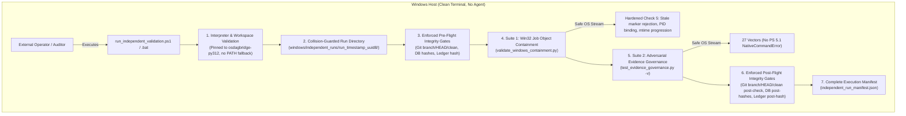

# Phase 2.16 — Independent Windows Execution Guide

**Project:** FOSSEE Winter Internship 2026 — OsdagBridge Testing & Issue Reporting  
**Workspace:** `F:\FOSSEE internship`  
**Application Repo:** `source/OsdagBridge` on branch `dev` @ `d74f56dd7f22925fb8148cabf5740ed8d1e39ff3`  
**Controlling Audit:** Claude's Phase 2.15 Independent Gate Audit ([`reports/PHASE_2_15_FINAL_INDEPENDENT_GATE_AUDIT.md`](file:///F:/FOSSEE%20internship/reports/PHASE_2_15_FINAL_INDEPENDENT_GATE_AUDIT.md))  
**Date:** 2026-11-18  
**Status:** **READY FOR INDEPENDENT OPERATOR EXECUTION**  

---

## 1. Executive Summary & Audit Context

In the Phase 2.15 Independent Gate Audit (§1, §3 F-5.1–F-5.8, and §4), Claude delivered a **CONDITIONALLY ACCEPTED** verdict. The audit identified specific, actionable defects in the independent execution runner (`run_independent_validation.ps1`):
1. **PowerShell 5.1 Stderr Handling (F-5.1):** Invoking native commands with `$ErrorActionPreference = "Stop"` and `2>&1` causes standard stderr writes (such as `unittest` test progress) to throw terminating `NativeCommandError` exceptions on Windows PowerShell 5.1.
2. **Pinned Interpreter Enforcement (F-5.2):** Silent fallback to an arbitrary `python` executable on PATH allowed untracked or misconfigured environments to execute unnoticed.
3. **Pre-Flight Enforcement Gates (F-5.3):** Git status, branch, commit HEAD, and database hashes were printed but not compared or enforced as fatal gates.
4. **Post-Flight Integrity Gates (F-5.4):** Post-test checks were limited to the trust ledger; Git and database states were not re-verified.
5. **Output Directory Collision (F-5.5):** A static `OutputDir` caused subsequent runs to overwrite prior independent evidence.
6. **Manifest Completeness (F-5.6):** Timings, timezone, interpreter versions, harness script hashes, and explicit gate/suite status distinctions were incomplete.

In Phase 2.16, all findings were systematically remediated in [`testing/evidence/phase_2_15/run_independent_validation.ps1`](file:///F:/FOSSEE%20internship/testing/evidence/phase_2_15/run_independent_validation.ps1) and [`run_independent_validation.bat`](file:///F:/FOSSEE%20internship/testing/evidence/phase_2_15/run_independent_validation.bat).

---

## 2. Independent Execution Architecture



### Technical Hardening Details:
1. **Windows PowerShell 5.1 Stderr Compatibility:** Commands are dispatched via `cmd.exe /c "python -u <script> <args> 2>&1" | Tee-Object ...`. Merging file descriptor 2 into descriptor 1 at the Win32 C-runtime boundary delivers plain stdout strings to PowerShell pipeline handlers, preventing PowerShell 5.1 from converting stderr into `NativeCommandError` records while streaming live output to console and recording full raw transcripts to disk.
2. **Pinned Interpreter Enforcement:** The script strictly requires `C:\Users\Subodh\miniconda3\envs\osdagbridge-py312\python.exe`. If missing or invalid, it immediately terminates with exit code 1.
3. **Enforced Integrity Gates:** Compares the active workspace against frozen baseline parameters:
   - Branch: `dev`
   - HEAD: `d74f56dd7f22925fb8148cabf5740ed8d1e39ff3`
   - Working Tree: 0 uncommitted or untracked changes
   - `weather.sqlite`: `1d767658099bef9da035cd8e4c4fdfa5f8e83794a6756a7832bc824b67cd7e98`
   - `Intg_osdag.sqlite`: `25f978575be64a11ce2e00562c7513c215a33ba26ea9da795171343c74d9ea91`
   - Production Ledger: `5a9b9273c26ed92f95a2012ec0b1f890cfee369b2099659da875c00e182f57f1`
4. **Collision Prevention:** Default runs populate dedicated, non-overlapping folders: `testing/evidence/phase_2_15/windows/independent_runs/run_<timestamp>_<uuid8>/`. If an intended target directory already exists, execution aborts immediately fail-closed.
5. **Post-Flight Immutability Re-Check:** Re-verifies Git state, database hashes, and production ledger after all tests conclude. Any drift terminates with exit code 1.

---

## 3. Step-by-Step Operator Instructions

### Step 1: Open a Clean Terminal
Open a fresh, non-elevated PowerShell terminal (PowerShell 5.1 or PowerShell 7+) or standard `cmd.exe`.
> [!IMPORTANT]
> Do NOT run as Administrator. Standard user privileges (`Subodh`) are required to verify userland containment boundaries.

### Step 2: Navigate to Workspace Root
```powershell
Set-Location -Path "F:\FOSSEE internship"
```

### Step 3: Run the Package

#### Using PowerShell:
```powershell
powershell.exe -NoProfile -ExecutionPolicy Bypass -File "testing\evidence\phase_2_15\run_independent_validation.ps1"
```

#### Or Using Command Prompt:
```cmd
cd /d "F:\FOSSEE internship"
testing\evidence\phase_2_15\run_independent_validation.bat
```

---

## 4. Acceptance Criteria & Verifiable Signals

| Validation Phase | Expected Outcome | Failure Condition |
|---|---|---|
| **Interpreter Check** | `osdagbridge-py312` (Python 3.12.16) verified | Missing interpreter or PATH fallback attempted -> FATAL Exit 1 |
| **Pre-Flight Gates** | Branch `dev`, HEAD `d74f56d`, Clean working tree, DB hashes match, Ledger hash matches | Any mismatch -> FATAL Exit 1 before test launch |
| **Suite 1: Containment** | 6 / 6 checks PASS (~68s duration); Part 5A writes 4 files in order; Part 5B rejects stale marker, verifies PID, creates 0 files | Exit code != 0 or check failure -> FATAL |
| **Suite 2: Governance** | 27 / 27 vectors PASS (~17s duration); 0 skips, 0 errors, 0 failures | Exit code != 0 or `NativeCommandError` -> FATAL |
| **Post-Flight Gates** | Pre-run hashes == Post-run hashes; working tree remains clean; ledger unchanged | Any modification -> FATAL Exit 1 |
| **Manifest Generation** | `independent_run_manifest.json` emitted with `overall_status: "PASS"` | Exit code != 0 |

---

## 5. Artifact Inspection

Upon run completion, the operator will inspect the generated run directory under [`testing/evidence/phase_2_15/windows/independent_runs/run_<timestamp>_<uuid8>/`](file:///F:/FOSSEE%20internship/testing/evidence/phase_2_15/windows/independent_runs/):

1. `windows_containment_validation.txt`: Full raw output of the 6 Job Object checks.
2. `governance_test_output.txt`: Full verbose unittest output of the 27 governance attack vectors.
3. `independent_run_manifest.json`: Complete cryptographic execution manifest binding timestamps, durations, exit codes, script hashes, and transcript SHA-256 hashes.
