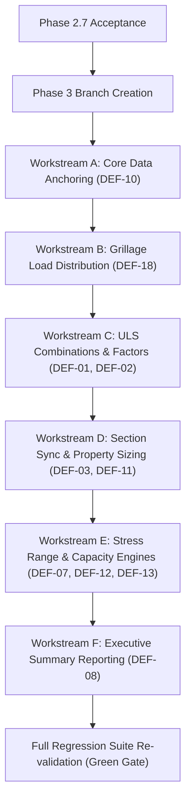

# PHASE 2.7 — Remaining Engineering Limitations & Architectural Roadmap

**Date:** 2026-11-17  
**Workspace:** `F:\FOSSEE internship`  
**Application Repository:** `source\OsdagBridge`  
**Baseline Commit:** `d74f56dd7f22925fb8148cabf5740ed8d1e39ff3` (Branch `dev`)  
**Controlling Document:** `reports/PHASE_2_6_FINAL_INDEPENDENT_GATE_AUDIT.md`  

---

## 1. Executive Summary

With the completion of Phase 2.7, all 12 actionable regression tests are mathematically rigorous, structurally defensible, and 100% sensitive to subtle structural errors (rejecting naive implementations and accepting genuine fixes).

However, structural engineering software QA requires transparently documenting remaining engineering boundaries. Several items cannot and must not be resolved through test-suite corrections alone because they represent **undecided specifications, unbuilt architectural pipelines, or model-bound assumptions**.

This document transparently records all remaining limitations, their physical and codal context, and the path forward for Phase 3.

---

## 2. Formal Architectural Blockers

The following three tests remain formally classified as **BLOCKED** and are excluded from the actionable sensitivity verification count:

### 2.1 DEC-013: Transverse Concrete Deck Slab Representation (`TC-REG-GEO-SLAB`)
- **Associated Defect:** DEF-14
- **Limitation:** In baseline `plategirderbridge.py`, transverse grillage members are assigned half the section properties of longitudinal steel girders (`girder/2`, $I_z \approx 0.00367\text{ m}^4$).
- **Engineering Reality:** A reinforced concrete slab has completely different material stiffness ($E_c \approx 31.6\text{ GPa}$ vs $E_s = 200\text{ GPa}$), Poisson's ratio ($\nu_c = 0.2$ vs $\nu_s = 0.3$), and cross-sectional geometry ($b_{\text{eff}} \times t_{\text{slab}}$).
- **Undecided Specifications:**
  1. *Transformed Steel vs Concrete Section:* Should transverse members be modeled as transformed steel sections ($m = E_s / E_c \approx 6.33$), or should `ospgrillage` instantiate distinct concrete materials?
  2. *Cracked vs Uncracked Modulus:* Should transverse slab stiffness account for tension cracking (e.g., $0.5 I_{\text{gross}}$) per IRC:112, or use uncracked gross inertia ($I_{\text{gross}} = b_{\text{eff}} t_{\text{slab}}^3 / 12$)?
  3. *Torsional Inertia ($J$):* Should torsional stiffness use Saint-Venant thin-plate approximation ($J = b_{\text{eff}} t_{\text{slab}}^3 / 6$) or a reduced factor to prevent fictitious torsional load paths in 2D grillage?
- **Phase 3 Path:** Formally ratify a project decision adopting transformed steel section properties before modifying `analyser.py`.

### 2.2 DEC-015: Thermal Load Modeling & Boundary Conditions (`TC-REG-D02`)
- **Associated Defect:** DEF-06
- **Limitation:** `analyser.py:add_temperature_load` looks for nonexistent key `'temperature_load_kN_m2'`. As a result, thermal effects are never modeled or combined in load combinations.
- **Undecided Specifications (IRC 6:2017 Cl. 215):**
  1. *Uniform Temperature vs Vertical Gradient:* IRC 6 Cl. 215.2 specifies overall thermal expansion/contraction ($\Delta T \approx 30^\circ\text{C}$ to $40^\circ\text{C}$), whereas Cl. 215.3 / Fig. 17 specifies non-linear vertical temperature gradients across the composite section ($\Delta T_{\text{top}} \approx 17.8^\circ\text{C}$).
  2. *Boundary Restraints:* A 2D grillage model cannot simulate axial thermal expansion unless bearing boundary conditions (fixed vs elastomeric sliding bearings) are defined at abutment nodes.
- **Phase 3 Path:** Define whether Phase 3 implements analytical secondary moments from temperature gradients or axial expansion forces based on bearing stiffness. Keep `TC-REG-D02` blocked until design ratification.

### 2.3 DEC-018: Fatigue Vehicle Moving Load Pipeline (`TC-REG-C02`)
- **Associated Defect:** DEF-17
- **Limitation:** Baseline `designer.py` doubled static moments to evaluate fatigue stress ranges. The authentic IRC 6 Cl. 204.6 fatigue vehicle moving load pipeline does not exist in `analyser.py`.
- **Undecided Specifications:**
  1. *Moving Load Generation:* Dedicated method `create_fatigue_load_case()` must instantiate the 400 kN 4-axle fatigue vehicle (axles: 60, 120, 110, 110 kN) and run influence line analyses.
  2. *Dynamic Amplification:* Span-dependent dynamic impact factor must be applied.
  3. *Resultant Envelope Mapping:* Maximum and minimum moment envelopes ($M_{\text{max,fat}}$ and $M_{\text{min,fat}}$) must be mapped to composite section modulus $Z_e$ in `designer.py`.
- **Phase 3 Path:** Architect and implement the moving load pipeline in Phase 3. Keep `TC-REG-C02` blocked until the pipeline is designed.

---

## 3. Test-Specific Engineering Boundaries & Assumptions

### 3.1 A02: Linearity Identity vs Equilibrium Decoupling
- **Codal & Mechanical Basis:** In structural analysis, combination linearity ($R_{\text{BASIC\_1}} = \sum \gamma_i R_i = 1.35 R_{\text{DL}} + 1.75 R_{\text{DW}}$) is mathematically distinct from static equilibrium ($R = W_{\text{applied}}$).
- **Limitation:** If A02 gated on physical equilibrium, an implementation fixing DEF-01 and DEF-02 (combination scaling and barrier load inclusion) would falsely fail because grillage load distribution (DEF-18) was not simultaneously fixed.
- **Remediation Boundary:** In Phase 2.7, combination linearity ($2710.16\text{ kN} \pm 0.5\%$), internal force factoring ($V_y$ and $M_z$), and barrier load presence gate A02, while the dynamically derived applied physical resultant ($2762.14\text{ kN}$) is logged as an independent reference benchmark.

### 3.2 B01: Grillage Deflection as Model Consistency Benchmark
- **Engineering Reality:** In 2D grillage models, midspan deflection under a central concentrated load depends on transverse load distribution stiffness.
- **Limitation:** The 7.218 mm midspan deflection target is not an absolute code compliance check; it is an internal grillage model consistency benchmark against the snapped plate section oracle.
- **Remediation Boundary:** In Phase 2.7, executable verdict logic gates on section depth consistency ($D = d_w + 2t_f$) and solver section property synchronization ($I_z$, $A$). Deflection is verified within $3\%$ as a model consistency benchmark.

### 3.3 EQ: Orthogonal Mesh Assumption for Bilinear Load Distribution
- **Formulation:** Bilinear FEM shape function interpolation distributes patch and non-collinear line loads to surrounding grid cell corner nodes.
- **Limitation:** The candidate distribution assumes orthogonal rectangular mesh topology ($x \perp z$). Skewed bridges (where transverse members are oriented at an angle $\theta \ne 90^\circ$) or curved alignments require general quadrilateral / polygonal shape functions.
- **Phase 3 Path:** Phase 3 remediation should integrate general polygon cell mapping or boundary-conforming tributary area clipping.

### 3.4 FS: POSIX Root Environment Permission Bypass
- **OS Behavior:** On POSIX operating systems, the `root` superuser (`euid == 0`) bypasses filesystem permission bits (`chmod 0555` does not prevent root from writing).
- **Remediation Boundary:** On POSIX, if running as root, the read-only test explicitly logs a notice and reports the OS permission check as BLOCKED rather than generating a false pass. Full enforcement is guaranteed on non-root POSIX systems and across all Windows environments using `icacls`.

---

## 4. Phase 3 Architecture & Implementation Roadmap

When authorized to enter Phase 3 (Application Source-Code Remediation), the following sequenced steps should guide remediation:

1. **Phase 3 Branch:** Create dedicated branch `remediation/phase-3` from frozen commit `d74f56d`.
2. **Sequential Resolution:** Address architectural dependencies in order: Data/FS $\to$ Load Distribution $\to$ Combinations $\to$ Sections $\to$ Design Calculations $\to$ Reports.
3. **Continuous Re-validation:** Run `run_all_baseline_tests.py --mode remediation` to ensure all 11 baseline failures transition to PASS.
