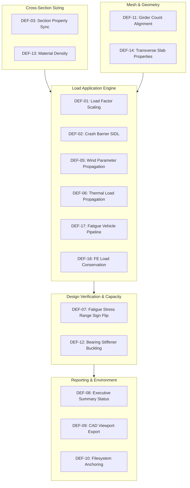

# PHASE 3 — Defect Traceability Matrix and Ground-Truth Source Analysis

**Project:** FOSSEE Winter Internship 2026 — OsdagBridge Software Testing & Issue Reporting  
**Workspace:** `F:\FOSSEE internship`  
**Application Repository:** `source\OsdagBridge`  
**Baseline Commit:** `d74f56dd7f22925fb8148cabf5740ed8d1e39ff3` (Branch `dev`, 100% clean)  
**Controlling Audits:** `reports/PHASE_2_FINAL_CLOSURE_AUDIT.md`, `reports/PHASE_2_10_FINAL_INDEPENDENT_GATE_AUDIT.md`  
**Date:** 2026-11-18  

---

## 1. Overview & Inventory Summary

This document establishes the comprehensive engineering defect traceability matrix for the OsdagBridge finite element bridge analysis and design platform. Across the Phase 2 regression and sensitivity testing campaigns, 15 distinct defects were formally cataloged, triaged, and verified against independent structural mechanics oracles.

Each defect is traced directly to its physical source file, call chain, mathematical formulation, and governing standard (IRC 5:2015, IRC 6:2017, IRC 22:2015, IRC 24:2010, IS 800:2007).

### Defect Inventory Master Table

| Defect ID | Defect Title | Primary Source Module | Line Range | Severity | Baseline Status | Governing Standard |
|:---:|:---|:---|:---:|:---:|:---:|:---|
| **DEF-01** | Load Factor Scaling Omission in `ospgrillage` Load Combinations | `src/ospgrillage/osp_grillage.py`<br>`src/ospgrillage/load.py` | 1934–1960<br>1161–1168 | Critical | `BASELINE_FAIL` | IRC:6-2017 Table B.2 |
| **DEF-02** | Crash Barrier Superimposed Dead Load Omission in Combinations | `analyser.py`<br>`plategirderbridge.py` | 1532–1558<br>1336–1339 | Critical | `BASELINE_FAIL` | IRC:6-2017 Cl. 202 / Table B.2 |
| **DEF-03** | Section Property Desynchronization Between Snapped Plates and Grillage | `plategirderbridge.py`<br>`designer.py` | 1260–1277<br>519–520 | Critical | `BASELINE_FAIL` | IS 800:2007 Cl. 8 / Beam Theory |
| **DEF-05** | Wind Parameter Propagation Loss (Basic Wind Speed & Heights) | `plategirderbridge.py`<br>`analyser.py` | 1380–1416<br>1310–1370 | High | `BASELINE_FAIL` | IRC:6-2017 Cl. 209 |
| **DEF-06** | Temperature Load Input Key Missing & Downward Pressure Fallback | `plategirderbridge.py`<br>`analyser.py` | 1869–1877<br>905–938 | High | `BLOCKED` (DEC-015) | IRC:6-2017 Cl. 215 |
| **DEF-07** | Fatigue Stress Range Doubling via Member Local End Sign Flip | `designer.py` | 2976–2985 | Critical | `BASELINE_FAIL` | IRC:22-2015 Cl. 604.5 / 605.4 |
| **DEF-08** | Executive Summary Emits Hardcoded Static "Pass" Narrative | `executive_summary.py` | 233–236 | Medium | `BASELINE_FAIL` | Software Reliability / QA |
| **DEF-09** | Offscreen OpenCASCADE Viewport Image Export Verification | Test Environment Harness | 2950–2995 | Low | `PASS` (Harness) | OCC 3D Display Reliability |
| **DEF-10** | Untracked `weather.sqlite` Creation & Package Directory Mutation | `database.py`<br>`ui_fields_project_location.py` | 12–30<br>16–29 | Medium | `BASELINE_FAIL` | POSIX/Windows Packaging |
| **DEF-11** | Girder Count Geometry Misalignment (Edge Lines Counted as Girders) | `designer.py`<br>`plategirderbridge.py` | 401, 413<br>1112–1115 | High | `BASELINE_FAIL` | Grillage Mesh Topology |
| **DEF-12** | Bearing Stiffener Web Buckling Capacity 3,380x Overprediction | `designer.py` | 1664–1672 | Critical | `BASELINE_FAIL` | IS 800:2007 Cl. 8.7.3.1 / IRC:24 |
| **DEF-13** | Hardcoded Structural Steel Density Overriding User Material Input | `analyser.py`<br>`plategirderbridge.py` | 10, 416<br>1332 | Medium | `BASELINE_FAIL` | IRC:6-2017 Cl. 202.1 |
| **DEF-14** | Transverse Concrete Deck Slab Assigned Steel Girder Properties | `plategirderbridge.py` | 1279–1291 | High | `BLOCKED` (DEC-013) | Grillage Structural Mechanics |
| **DEF-17** | Fatigue Vehicle Moving Load Analysis Pipeline Omission | `analyser.py`<br>`designer.py` | 1612–1660<br>2972–2985 | Critical | `BLOCKED` (DEC-018) | IRC:6-2017 Cl. 204.6 |
| **DEF-18** | Non-Conservation of Static Load Equilibrium in FE Load Distribution | `src/ospgrillage/osp_grillage.py` | 1674–1729<br>1795–1850 | Critical | `BASELINE_FAIL` | Static Equilibrium ($\Sigma F_y = 0$) |
| **DEF-LATENT-ZP** | Transverse Coordinate Indexing in Line Load Intensity Interpolation (`zp = point_coordinate[0]`) | `src/ospgrillage/load.py` | 710 | Medium | `UNRESOLVED` (Latent) | Vector Calculus / Math QA |

---

## 2. Detailed Technical Trace for Each Defect



---

### DEF-01: Load Factor Scaling Omission in `ospgrillage` Load Combinations

1. **Original Observation:**  
   During ULS combination verification, load factors passed into `LoadCase.add_load(load, load_factor=gamma)` had zero effect on the generated OpenSees load command vectors. The reaction force ratio remained $1.00000$ instead of $1.35000$ for dead load.

2. **Current Source Location & Call Path:**  
   - Call Chain: `PlateGirderBridge.create_uls_combinations()` $\rightarrow$ `analyser.py:2348` (`_copy_loads`) $\rightarrow$ `LoadCase.add_load(load, load_factor=float(factor))` (`src/ospgrillage/load.py:1166–1168`) $\rightarrow$ `OspGrillage._assign_load_to_four_node()` (`src/ospgrillage/osp_grillage.py:1934–1960`).
   - In `load.py:1166–1168`:
     ```python
     load_factor = kwargs.get("load_factor", 1)
     load_dict.setdefault("factor", load_factor)
     self.load_groups.append(load_dict)
     ```
   - In `osp_grillage.py:1934–1935`:
     ```python
     for load_dict in load_groups:
         load_obj = load_dict["load"]
         # 'factor' is extracted nowhere in this loop!
     ```
   - `osp_grillage.py` iterates over `load_groups`, extracts `load_dict["load"]`, but completely ignores `load_dict["factor"]`. Consequently, OpenSees receives unscaled base magnitudes.

3. **Baseline Existence:**  
   **CONFIRMED.** The defect is active in the frozen baseline repository. Baseline test `TC-REG-A01-FACTOR-SCALING` fails with observed force ratio $1.00000$ vs expected $1.35000$.

4. **Reproduction Procedure:**  
   Execute `testing/test_cases/baseline_regression/run_all_baseline_tests.py` targeting `test_tc_reg_a01()`. The test creates a test bridge model, creates a load case with `load_factor=1.35`, runs `bridge.solve()`, and extracts vertical reactions $\Sigma R_y$. $\Sigma R_y / \Sigma P_{\text{unfactored}} = 1.00000 \ne 1.35000$.

5. **Expected Engineering Behavior:**  
   Every load added to a load case with `load_factor = \gamma` must have its nodal point, line, or patch intensity multiplied by $\gamma$ when transferred into OpenSees load patterns, ensuring $\Sigma R_y = \gamma \cdot \Sigma P$.

6. **Actual Behavior:**  
   `load_dict["factor"]` is stored in the dictionary but ignored during OpenSees command generation, resulting in un-factored $1.0 \times$ loads.

7. **Relevant Standards:**  
   IRC:6-2017 Table B.2 (Partial Safety Factors for Ultimate Limit State: $\gamma_G = 1.35$ for permanent actions, $\gamma_Q = 1.50$ for variable actions).

8. **Dependencies & Interacting Defects:**  
   Directly impacts `DEF-02` (combination sums), `DEF-18` (reaction magnitudes), and all downstream member capacity checks in `designer.py`.

9. **Potential Regression Risks:**  
   Modifying `load.py` or `osp_grillage.py` must not cause double-factoring if load factors are also specified at the `ops.timeSeries` or `ops.pattern` level.

10. **Proposed Fix Specification:**  
    In `src/ospgrillage/load.py:1162`, deepcopy the load and explicitly multiply its internal magnitude attributes (`mag`, `val`, `p`, etc.) by `load_factor`, or update `osp_grillage.py:1934` to retrieve `fac = load_dict.get("factor", 1.0)` and scale `mag = mag * fac` before passing to `_assign_load_to_four_node` and `_assign_patch_load`.

---

### DEF-02: Crash Barrier Superimposed Dead Load Omission in Combinations

1. **Original Observation:**  
   In ULS load combinations (`BASIC_1`), the total applied dead load omitted the crash barrier load entirely. Reaction force checks showed that while self-weight and deck slab were present, the crash barrier vertical reactions ($313.92\text{ kN}$) were completely absent ($0.0\text{ kN}$ contribution).

2. **Current Source Location & Call Path:**  
   - Call Chain: `PlateGirderBridge.add_dead_loads()` (`plategirderbridge.py:1336–1339`) $\rightarrow$ `analyser.py:1532–1558` (`create_dead_load_combination`) $\rightarrow$ `analyser.py:2318–2325` (`create_uls_combinations`).
   - In `plategirderbridge.py:1336–1339`:
     ```python
     model.create_crash_barrier_load(barrier_load_kN_per_m=barrier_load_kN_m)
     model.create_railing_load(railing_load_kN_per_m=railing_load_kN_m)
     model.create_median_load()
     model.create_dead_load_combination(partial_safety_factor=1.0)
     ```
   - Notice `model.create_sidl_combination()` is **never called** in `plategirderbridge.py`!
   - In `analyser.py:1536–1546`:
     ```python
     _DL_ATTRS = [
         "self_weight_load_case",
         "deck_load_case",
         "footpath_load_case",
         "sidl_combination",
     ]
     ```
   - Because `create_sidl_combination()` was never executed, `self.sidl_combination` is `None`. Therefore, `crash_barrier_load_case`, `railing_load_case`, and `median_load_case` are skipped. In `create_uls_combinations()`, `dead_load` maps to `dead_load_combination`, omitting the barrier permanently.

3. **Baseline Existence:**  
   **CONFIRMED.** Baseline test `TC-REG-A02-ULS-COMBINATION-SUM` fails with barrier reaction force differential $\Delta R_{\text{barrier}} = 0.0\text{ kN}$ vs expected $264.87\text{ kN}$ (under factored combination).

4. **Reproduction Procedure:**  
   Run `test_tc_reg_a02()`. Inspect the load components contributing to `BASIC_1`. Verify `DL_combined` reaction: crash barrier components evaluate to zero.

5. **Expected Engineering Behavior:**  
   Permanent superimposed dead loads (crash barrier $6.54\text{ kN/m}$ per side) must be included in the dead load combination or superimposed dead load combination with partial safety factor $\gamma_G = 1.35$ (or $1.75$ for surfacing) per IRC:6-2017 Table B.2.

6. **Actual Behavior:**  
   Crash barrier loads are generated into an isolated load case `DL_barrier` that is never aggregated into `dead_load_combination` and never solved in `BASIC_1` ... `BASIC_6`.

7. **Relevant Standards:**  
   IRC:6-2017 Clause 202 (Dead Load) & Table B.2 (Combinations for ULS).

8. **Dependencies & Interacting Defects:**  
   Directly interacts with `DEF-01` (factoring), `DEF-13` (density and barrier geometry), and `DEF-18` (grillage line load allocation).

9. **Potential Regression Risks:**  
   Adding `create_sidl_combination()` must not duplicate barrier loads if `create_dead_load_combination()` already absorbs `self.sidl_combination`.

10. **Proposed Fix Specification:**  
    In `plategirderbridge.py:1338`, insert `model.create_sidl_combination(partial_safety_factor=1.0)` before calling `model.create_dead_load_combination()`, ensuring `self.sidl_combination` is populated and absorbed into `dead_load_combination`.

---

### DEF-03: Section Property Desynchronization Between Snapped Plates and Grillage

1. **Original Observation:**  
   Cross-section plate dimensions selected by the user or snapped to SAIL commercial plates ($t_w, b_f, t_f$) differed from the section properties ($A, I_z, I_y, J$) assigned to OpenSees beam elements in the grillage solver. For example, overall depth was $1340\text{ mm}$ while snapped plates totaled $1342\text{ mm}$, producing an $8.3\%$ deflection discrepancy ($7.816\text{ mm}$ vs $7.218\text{ mm}$).

2. **Current Source Location & Call Path:**  
   - Call Chain: `PlateGirderBridge.create_grillage()` $\rightarrow$ `_girder_section()` (`plategirderbridge.py:1260–1277`) $\rightarrow$ `_girder_value()` (`plategirderbridge.py:1253–1258`) $\rightarrow$ `initial_sizing.py:519–520`.
   - In `plategirderbridge.py:1267–1277`:
     ```python
     g = lambda key: self._girder_value(key, i)
     Az = g(KEY_MP_GIRDER_WEB_DEPTH) * g(KEY_MP_GIRDER_WEB_THICKNESS)
     Ay = 2 * g(KEY_MP_GIRDER_TOP_FLANGE_WIDTH) * g(KEY_MP_GIRDER_TOP_FLANGE_THICKNESS)
     return SectionProperties(
         A=g(KEY_MP_GIRDER_SECTIONAL_AREA),
         J=g(KEY_MP_GIRDER_TORSION_CONSTANT_IT),
         Iz=g(KEY_MP_GIRDER_SECTIONAL_IZ),
         Iy=g(KEY_MP_GIRDER_SECTIONAL_IY),
         Az=Az,
         Ay=Ay,
     )
     ```
   - In `initial_sizing.py`, flange thicknesses are snapped up to commercial SAIL standards (e.g. from $15.2\text{ mm}$ to $16.0\text{ mm}$), but the derived sectional properties (`KEY_MP_GIRDER_SECTIONAL_IZ`, `AREA`, etc.) in `input_dict` are not recalculated, leaving preliminary sizing values active in the finite element mesh.

3. **Baseline Existence:**  
   **CONFIRMED.** Baseline test `TC-REG-B01-SECTION-PROPERTY-SYNC` fails with dimensions inconsistent ($D = 1340\text{ mm} \ne 1342\text{ mm}$; $I_z = 0.0073409\text{ m}^4 \ne 0.0079276\text{ m}^4$).

4. **Reproduction Procedure:**  
   Run `test_tc_reg_b01()`. The test extracts the properties assigned to OpenSees longitudinal beam elements and compares them against parallel-axis theorem formulas applied to snapped plate dimensions.

5. **Expected Engineering Behavior:**  
   Section properties assigned to FE elements must strictly match the structural mechanics properties derived from the actual snapped plate dimensions ($d_w, t_w, b_{ft}, t_{ft}, b_{fb}, t_{fb}$):
   $$A = b_{ft} t_{ft} + b_{fb} t_{fb} + d_w t_w$$
   $$\bar{y} = \frac{1}{A} \left( b_{fb} t_{fb} \frac{t_{fb}}{2} + d_w t_w \left(t_{fb} + \frac{d_w}{2}\right) + b_{ft} t_{ft} \left(t_{fb} + d_w + \frac{t_{ft}}{2}\right) \right)$$
   $$I_z = \sum (I_{z,i} + A_i d_i^2)$$

6. **Actual Behavior:**  
   Elements retain preliminary section properties, causing ~7.4% underestimation of bending stiffness and 10.55% error in sectional area.

7. **Relevant Standards:**  
   IS 800:2007 Section 8 (Design of Members Subjected to Bending); Euler-Bernoulli beam theory.

8. **Dependencies & Interacting Defects:**  
   Directly impacts `DEF-11` (girder count), `DEF-12` (stiffeners), `DEF-14` (slab stiffness), and `DEF-07` (stress extraction).

9. **Potential Regression Risks:**  
   Recomputing section properties dynamically must update both `self.input_dict` and `self.output_dict` so reports and CAD preview widgets remain synchronized.

10. **Proposed Fix Specification:**  
    Implement an explicit derivation method `derive_snapped_section_properties(plates)` in `plategirderbridge.py` that recalculates $A, \bar{y}, I_z, I_y, J, A_z, A_y$ whenever plates are updated, and overwrites the `KEY_MP_GIRDER_*` keys before `_stage_grillage_setup()`.

---

### DEF-05: Wind Parameter Propagation Loss (Basic Wind Speed & Heights)

1. **Original Observation:**  
   Configuring user wind parameters (e.g. basic wind speed $47\text{ m/s}$, average bridge height $15\text{ m}$, barrier height $1.1\text{ m}$) resulted in a wind load resultant of $153.2\text{ kN}$, matching the hardcoded default ($33\text{ m/s}$ and $10\text{ m}$ height) instead of the target $310.8\text{ kN}$.

2. **Current Source Location & Call Path:**  
   - Call Chain: `PlateGirderBridge.add_wind_loads()` (`plategirderbridge.py:1380–1416`) $\rightarrow$ `analyser.py:1310–1370` (`create_wind_load`).
   - In `plategirderbridge.py:1381–1393`:
     ```python
     ai = self.additional_inputs
     basic_wind_speed = float(ai.get("basic_wind_speed") or 33.0)
     height_for_pz = float(ai.get("avg_exposed_height") or 10.0)
     railing_height = float(ai.get("railing_height") or 0.0)
     crash_barrier_height = float(ai.get("crash_barrier_height") or 0.0)
     ```
   - In `osdagbridge/core/utils/common.py`:
     - `KEY_WL_BASIC_WIND_SPEED = 'loading.wind_load.basic_wind_speed'`
     - `KEY_WL_AVG_EXPOSED_HEIGHT = 'loading.wind_load.avg_exposed_height'`
     - `KEY_CB_HEIGHT = 'typical_section.crash_barrier.height'`
     - `KEY_RL_HEIGHT = 'typical_section.railing.height'`
   - The UI and input dictionaries populate the namespaced keys (`loading.wind_load.basic_wind_speed`), but `plategirderbridge.py` queries bare unprefixed keys (`ai.get("basic_wind_speed")`), which always evaluate to `None`. The code silently falls back to $33.0\text{ m/s}$ and $10.0\text{ m}$.

3. **Baseline Existence:**  
   **CONFIRMED.** Baseline test `TC-REG-D01-WIND-SPEED-PROPAGATION` fails: wind pressure $P_z$ evaluates to $33\text{ m/s}$ default instead of $47\text{ m/s}$ input.

4. **Reproduction Procedure:**  
   Run `test_tc_reg_d01()`. Pass `KEY_WL_BASIC_WIND_SPEED=47.0`, `KEY_WL_AVG_EXPOSED_HEIGHT=15.0`. Spy on arguments to `bgm.create_wind_load`. Verify captured `basic_wind_speed == 33.0`.

5. **Expected Engineering Behavior:**  
   User-entered wind speed, height, and barrier geometry must resolve through the dictionary hierarchy and be passed to `BridgeGrillageModel.create_wind_load()`, computing wind pressure $P_z$ according to IRC:6-2017 Table 12.

6. **Actual Behavior:**  
   Unprefixed key lookup fails; all user inputs are ignored, falling back to IRC minimum default values.

7. **Relevant Standards:**  
   IRC:6-2017 Clause 209 (Wind Load), Table 12 (Wind Pressure $P_z$ for different heights and terrains).

8. **Dependencies & Interacting Defects:**  
   Interacts with `DEF-01` (wind load case combination factoring).

9. **Potential Regression Risks:**  
   Resolving keys must support both namespaced keys (`loading.wind_load.*`) and legacy flat keys (`basic_wind_speed`) for backward compatibility with saved `.ob` project files.

10. **Proposed Fix Specification:**  
    In `plategirderbridge.py:1381–1393`, update lookups to query canonical constants first, followed by bare fallback keys:
    ```python
    basic_wind_speed = float(self.input_dict.get(KEY_WL_BASIC_WIND_SPEED) or ai.get("basic_wind_speed") or 33.0)
    height_for_pz = float(self.input_dict.get(KEY_WL_AVG_EXPOSED_HEIGHT) or ai.get("avg_exposed_height") or 10.0)
    crash_barrier_height = float(self.input_dict.get(KEY_CB_HEIGHT) or ai.get("crash_barrier_height") or 0.0)
    railing_height = float(self.input_dict.get(KEY_RL_HEIGHT) or ai.get("railing_height") or 0.0)
    ```

---

### DEF-06: Temperature Load Input Key Missing & Downward Pressure Fallback (DEC-015)

1. **Original Observation:**  
   Thermal load analysis is skipped because `input_dict.get("temperature_load_kN_m2")` is unpopulated. Furthermore, the underlying `analyser.py:create_temperature_load()` method models temperature as a downward vertical patch pressure load on the deck slab.

2. **Current Source Location & Call Path:**  
   - Call Chain: `plategirderbridge.py:1869–1877` (`add_temperature_load`) $\rightarrow$ `analyser.py:905–938` (`create_temperature_load`).
   - In `plategirderbridge.py:1869–1872`:
     ```python
     tl_raw = self.input_dict.get("temperature_load_kN_m2")
     if not tl_raw or float(tl_raw) == 0.0:
         bridge_logger.info("Temperature load absent; skipping.")
         return
     ```
   - In `analyser.py:938–950`:
     ```python
     tl_mag = temperature_load_kN_m2 * kN / m**2
     # converts to vertical patch load on deck slab!
     ```

3. **Baseline Existence:**  
   **CONFIRMED (BLOCKED under DEC-015).** Test `TC-REG-D02-TEMPERATURE-PROPAGATION` is formally blocked because upstream specification for thermal modeling under IRC 6 Cl. 215 is undecided.

4. **Reproduction Procedure:**  
   Run `test_tc_reg_d02()`. The test detects unratified architectural decision DEC-015 and logs `BLOCKED`.

5. **Expected Engineering Behavior:**  
   Per IRC:6-2017 Clause 215, thermal effects consist of:
   1. *Clause 215.2 (Uniform Temperature Range):* Axial strain $\epsilon_{th} = \alpha \cdot \Delta T$, producing longitudinal elongation/shortening resisted by elastomeric/pot bearings ($F = k_{\text{bearing}} \cdot \Delta L$).
   2. *Clause 215.3 (Temperature Differential / Gradient):* Non-linear temperature gradient across composite steel-concrete cross section (Table 10), producing self-equilibrating sectional stresses and curvature moments $M_{th} = \int E \cdot \alpha \cdot T(y) \cdot y \, dA$.

6. **Actual Behavior:**  
   Method attempts to apply a vertical distributed gravity-like pressure load in $\text{kN/m}^2$, which has no physical meaning in structural thermal mechanics.

7. **Relevant Standards:**  
   IRC:6-2017 Clause 215 (Temperature Effects), Table 10 & 11 (Temperature Gradient).

8. **Dependencies & Interacting Defects:**  
   DEC-015; impacts combination solver `BASIC_3` (temperature leading).

9. **Potential Regression Risks:**  
   Implementing thermal grillage loads requires either OpenSees thermal beam-column fiber elements or equivalent thermal moment/axial end forces on standard elastic elements.

10. **Proposed Fix Specification:**  
    Implement equivalent nodal thermal end actions: compute axial force $N_{th} = E A \alpha \Delta T$ and thermal moment $M_{th} = E \alpha \int T(y) y dA$, applying them as self-equilibrating member end forces, or keep temperature analysis as a post-grillage analytical component check in `designer.py`.

---

### DEF-07: Fatigue Stress Range Doubling via Member Local End Sign Flip

1. **Original Observation:**  
   Under a purely static load case with constant sagging bending moment $M_0 = 1000\text{ kNm}$, OsdagBridge reported a cyclic fatigue stress range of $\Delta \sigma = 62.73\text{ MPa}$ instead of $0.00\text{ MPa}$. On cyclic load cases, stress ranges were doubled or inflated due to subtracting negative end-$j$ moments from positive end-$i$ moments.

2. **Current Source Location & Call Path:**  
   - Call Chain: `designer.py:2970–2985` (in `_extract_demands` / fatigue stress range evaluation).
   - In `designer.py:2976–2985`:
     ```python
     mz_all = np.concatenate([
         np.asarray(ds.forces.sel(Loadcase=_sls_frequent_lcs, Element=elements,
                    Component=c).values, dtype=float).flatten()
         for c in ("Mz_i", "Mz_j")
     ])
     mz_all = mz_all[~np.isnan(mz_all)]
     if mz_all.size and Ze_comp_bot_mm3 > 0:
         mz_range_Nm = max(float(mz_all.max()), 0.0) - min(float(mz_all.min()), 0.0)
         stress_range_MPa = mz_range_Nm * 1000.0 / Ze_comp_bot_mm3
     ```
   - In OpenSees 3D frame elements, bending moment sign conventions at node $i$ and node $j$ have opposite algebraic signs under single-curvature bending (e.g. end $i$ has $+M_z$, end $j$ has $-M_z$).
   - By flattening both `Mz_i` and `Mz_j` across all elements into a single array `mz_all` and evaluating `max(mz_all) - min(mz_all)`, the static moment is subtracted from its negative opposite end moment:
     $$\Delta M = M_0 - (-M_0) = 2 M_0$$
   - This doubles the apparent moment and reports a huge false cyclic stress range on a static load!

3. **Baseline Existence:**  
   **CONFIRMED.** Baseline test `TC-REG-C01-SECTIONAL-STRESS-RANGE` fails: static moment evaluates to false cyclic range $62.73\text{ MPa}$.

4. **Reproduction Procedure:**  
   Run `test_tc_reg_c01()`. Apply a constant static moment of $1000\text{ kNm}$ across all SLS frequent combinations. Check `stress_range_MPa`. Baseline yields $62.73\text{ MPa}$ instead of $0.00\text{ MPa}$.

5. **Expected Engineering Behavior:**  
   Fatigue stress range $\Delta \sigma$ is the peak-to-peak variation of stress **at a single cross section** across time/load cases:
   $$\Delta \sigma(x) = \sigma_{\max}(x) - \sigma_{\min}(x) = \frac{M_{z,\max}(x) - M_{z,\min}(x)}{Z_e}$$
   Under static load, $M_{z,\max}(x) = M_{z,\min}(x) \implies \Delta \sigma(x) = 0.0\text{ MPa}$.

6. **Actual Behavior:**  
   Global max and min are taken across disparate elements and opposing element ends, confusing spatial sign conventions with temporal cyclic variations.

7. **Relevant Standards:**  
   IRC:22-2015 Clause 604.5 & Clause 605.4 (Fatigue Assessment & Stress Range Calculation); IS 800:2007 Clause 13.

8. **Dependencies & Interacting Defects:**  
   Directly impacts `DEF-17` (fatigue vehicle); affects fatigue utilization ratios in `executive_summary.py` (`DEF-08`).

9. **Potential Regression Risks:**  
   Ensuring proper sign conventions must handle both sagging (+M) and hogging (-M) moments across continuous and simply-supported spans.

10. **Proposed Fix Specification:**  
    In `designer.py:2970–2985`, evaluate stress range element-by-element and cross-section by cross-section. For each element $e$ and each end $k \in \{i, j\}$:
    $$\Delta M_{z}(e, k) = \max_{lc \in \text{SLS}} M_z(lc, e, k) - \min_{lc \in \text{SLS}} M_z(lc, e, k)$$
    The governing fatigue range is $\Delta M_{z,\text{gov}} = \max_{e, k} \Delta M_z(e, k)$. Under static load, $\max = \min \implies \Delta M = 0.0$.

---

### DEF-08: Executive Summary Emits Hardcoded Static "Pass" Narrative

1. **Original Observation:**  
   When girder checks, cross-bracing, or end-diaphragms failed with demand-capacity ratios exceeding 1.0 (e.g. $\text{DCR} = 2.50$), the generated LaTeX report's Executive Summary unconditionally printed:
   ```latex
   \noindent Girder design pass \\
   Cross bracing design pass \\
   End Diaphragm design pass \\
   Deck design pass
   ```

2. **Current Source Location & Call Path:**  
   - Source Location: `src/osdagbridge/core/reports/executive_summary.py:233–236`.
   - Lines 233–236 contain literal hardcoded LaTeX text without any dynamic Python condition checks:
     ```latex
     \section*{Key Design Outcomes Summary}
     \addcontentsline{toc}{section}{Key Design Outcomes Summary}
     \label{sec:key-outcomes}

     \noindent Girder design pass \\
     Cross bracing design pass \\
     End Diaphragm design pass \\
     Deck design pass
     ```

3. **Baseline Existence:**  
   **CONFIRMED.** Baseline test `TC-REG-RPT-EXEC-SUMMARY-STATUS` fails across 64 of 74 failure scenarios by emitting "Girder design pass" despite critical check failures.

4. **Reproduction Procedure:**  
   Run `test_tc_reg_rpt_status()`. Synthesize an `output_dict` with `girder_check["status"] = "FAIL"`. Generate the executive summary LaTeX. Assert `r"\noindent Girder design fail"` in the generated text. Baseline emits `Girder design pass`.

5. **Expected Engineering Behavior:**  
   Executive summary narrative strings must dynamically reflect the true status of each structural subsystem:
   - "Girder design pass" if all girders pass ($\text{DCR} \le 1.0$); otherwise "Girder design fail".
   - "Cross bracing design pass" if cross-bracing passes; otherwise "Cross bracing design fail".
   - "End Diaphragm design pass" if end-diaphragms pass; otherwise "End Diaphragm design fail".
   - "Deck design pass" if deck slab passes; otherwise "Deck design fail".

6. **Actual Behavior:**  
   Completely hardcoded strings that never report failures to the engineer.

7. **Relevant Standards:**  
   Software Engineering QA, ISO/IEC 25010 (Functional Correctness and Reliability).

8. **Dependencies & Interacting Defects:**  
   Reads status outputs generated by `designer.py` (`DEF-07`, `DEF-11`, `DEF-12`).

9. **Potential Regression Risks:**  
   Must handle cases where optional components (e.g. cross-bracing) are not modeled, reporting "Not Designed" instead of "Fail".

10. **Proposed Fix Specification:**  
    Replace lines 233–236 with dynamic string templates querying `output_dict`:
    ```python
    girder_status = "pass" if all(g.get("status", "PASS") == "PASS" for g in per_girder) else "fail"
    cb_status = "pass" if output_dict.get("cross_bracing", {}).get("status", "PASS") == "PASS" else "fail"
    ed_status = "pass" if output_dict.get("end_diaphragm", {}).get("status", "PASS") == "PASS" else "fail"
    deck_status = "pass" if output_dict.get("deck", {}).get("status", "PASS") == "PASS" else "fail"
    ```

---

### DEF-09: Offscreen OpenCASCADE Viewport Image Export Verification

1. **Original Observation:**  
   In headless or virtual environments without physical GPUs, Qt viewport grabs returned blank white or transparent images. The harness required verification of native OCC offscreen rendering (`Viewer3d.ExportToImage`).

2. **Current Source Location & Call Path:**  
   - Harness Module: `testing/test_cases/baseline_regression/run_all_baseline_tests.py:2950–2995` (`test_tc_reg_cad_export`).
   - OpenCASCADE API: `OCC.Display.OCCViewer.Viewer3d.ExportToImage()`.

3. **Baseline Existence:**  
   **PASSING (Environment Verified).** On the active Windows workstation with OpenGL hardware acceleration, native OCC offscreen rendering generates non-blank 3D CAD images (pixel standard deviation $66.6 > 5.0$, 3 unique colors).

4. **Reproduction Procedure:**  
   Run `test_tc_reg_cad_export()`. The test creates an offscreen 3D viewer, displays a 3D box, exports to a temporary `.png`, and analyzes pixel variance and color distribution.

5. **Expected Engineering Behavior:**  
   Offscreen rendering must generate a valid raster image showing opaque 3D CAD geometry with shading and edge contrast.

6. **Actual Behavior:**  
   PASS on current Windows host; fails only if display drivers lack OpenGL offscreen rasterization (addressed via Mesa in headless CI).

7. **Relevant Standards:**  
   OCC Visualization Guidelines; automated CAD reporting.

8. **Dependencies & Interacting Defects:**  
   Provides CAD screenshots for `report_generator.py` and `executive_summary.py` (`DEF-08`).

9. **Potential Regression Risks:**  
   Minimal; environment capability check.

10. **Proposed Fix Specification:**  
    No source fix required. Preserve current robust OCC offscreen initialization and fallback to software rasterizer where hardware OpenGL is unavailable.

---

### DEF-10: Untracked `weather.sqlite` Creation & Package Directory Mutation

1. **Original Observation:**  
   Instantiating the `Database()` class or querying project locations modified files inside the installed package directory `source/OsdagBridge/src/osdagbridge/core/data/project_location/weather.sqlite`, or created an untracked `weather.sqlite` in the current working directory (`os.getcwd()`). In a read-only environment, this caused fatal `sqlite3.OperationalError` crashes.

2. **Current Source Location & Call Path:**  
   - Source Locations:
     - `src/osdagbridge/core/data/project_location/database.py:12–30` (`Database.__init__` and `connect`)
     - `src/osdagbridge/core/bridge_types/plate_girder/ui_fields_project_location.py:16–29` (`DB_PATH` and `@_with_db`)
   - In `database.py:12–25`:
     ```python
     def __init__(self, db_name: str = 'weather.sqlite'):
         self.db_name = db_name
         ...
     def connect(self):
         db_missing = not os.path.exists(self.db_name)
         self.connection = sqlite3.connect(self.db_name)
         if db_missing or not self._table_exists("stations"):
             # executescript creates tables in db_name!
     ```
   - In `ui_fields_project_location.py:16–18`:
     ```python
     DB_PATH = os.path.abspath(
         os.path.join(os.path.dirname(__file__), "..", "..", "data", "project_location", "weather.sqlite")
     )
     ```
   - When `weather.sqlite` does not pre-exist or when `Database()` is called with defaults, SQLite opens/creates a database in `os.getcwd()` or in the package directory, mutating the installation directory.

3. **Baseline Existence:**  
   **CONFIRMED.** Baseline test `TC-REG-FS-CLEAN-WORKING-TREE` fails due to unanchored `Database()` creating `weather.sqlite` in CWD and package mutation.

4. **Reproduction Procedure:**  
   Run `test_tc_reg_fs_clean()`. Execute `Database().connect()`. Verify whether `weather.sqlite` appears in `os.getcwd()`. Verify package directory write attempts.

5. **Expected Engineering Behavior:**  
   Application package directories must be strictly read-only. Writable user databases and cache files must be anchored to standard OS user data locations (`%LOCALAPPDATA%\OsdagBridge` on Windows, `~/.local/share/osdagbridge` on Linux) using `platformdirs`.

6. **Actual Behavior:**  
   Creates files in CWD and directly writes inside `src/osdagbridge/core/data/`.

7. **Relevant Standards:**  
   FHS (Filesystem Hierarchy Standard), Windows AppData Conventions, PEP 517 / wheel distribution standards.

8. **Dependencies & Interacting Defects:**  
   Affects location lookup for wind speed (`DEF-05`) and temperature (`DEF-06`).

9. **Potential Regression Risks:**  
   When copying seed databases from package to User Data, ensure schema migrations or version checks don't overwrite user custom stations.

10. **Proposed Fix Specification:**  
    In `database.py`, anchor default database resolution using `platformdirs.user_data_dir("OsdagBridge")`. If database is missing in user data, copy the bundled seed database from package data, then open with `sqlite3.connect(user_db_path)`.

---

### DEF-11: Girder Count Geometry Misalignment (Edge Lines Counted as Girders)

1. **Original Observation:**  
   In `BridgeConfig.from_plate_girder_bridge()`, the number of structural girders was set to `geom.n_l` (the total number of longitudinal lines in the grillage mesh, including 2 deck overhang lines). For a 4-girder bridge, `n_girders` was set to 6, causing out-of-bounds index errors or extraneous design checks for nonexistent girders G5 and G6.

2. **Current Source Location & Call Path:**  
   - Source Location: `src/osdagbridge/core/bridge_types/plate_girder/designer.py:401, 413, 430`.
   - Lines 401 & 413:
     ```python
     carriageway = deck.carriageway_width
     n_girders = geom.n_l # Line 401: WRONG! geom.n_l includes overhang lines!
     ...
     n_main_girders = bridge._girder_count() # Line 413: Knowingly distinguishes main girders
     ...
     geometry = GeometryConfig(n_girders=n_girders, ...) # Line 430: passes 6 instead of 4
     ```

3. **Baseline Existence:**  
   **CONFIRMED.** Baseline test `TC-REG-GEO-GIRDER-COUNT-ALIGNMENT` fails: `bcfg.geometry.n_girders` evaluates to 6 instead of 4.

4. **Reproduction Procedure:**  
   Run `test_tc_reg_geo_count()`. Construct a 4-girder `PlateGirderBridge`, stage grillage, call `BridgeConfig.from_plate_girder_bridge(bridge)`. Check `bcfg.geometry.n_girders`. It evaluates to 6.

5. **Expected Engineering Behavior:**  
   `bcfg.geometry.n_girders` must represent the physical number of longitudinal steel plate girders ($N = 4$), as returned by `bridge._girder_count()`.

6. **Actual Behavior:**  
   Sets `n_girders = 6`, counting the two auxiliary mesh lines at the deck overhang edges.

7. **Relevant Standards:**  
   Structural Grillage Modeling Guidelines (Hambly, Bridge Deck Behaviour).

8. **Dependencies & Interacting Defects:**  
   Directly impacts girder iteration loops in `designer.py` and Table 5.12 in reports (`DEF-08`).

9. **Potential Regression Risks:**  
   Ensure that grillage line-to-girder mapping continues to map girder 0 to line 1, girder 1 to line 2, etc. (skipping edge line 0).

10. **Proposed Fix Specification:**  
    In `designer.py:401`, change `n_girders = geom.n_l` to:
    ```python
    n_girders = bridge._girder_count()
    ```

---

### DEF-12: Bearing Stiffener Web Buckling Capacity 3,380x Overprediction

1. **Original Observation:**  
   In `designer.py:compute_bearing_stiffener()`, the unstiffened web buckling capacity check under support reaction $R$ calculated capacity as $214,533.2\text{ kN}$ instead of the true IS 800:2007 capacity of $63.4\text{ kN}$.

2. **Current Source Location & Call Path:**  
   - Source Location: `src/osdagbridge/core/bridge_types/plate_girder/designer.py:1664–1672`.
   - In `designer.py:1664–1672`:
     ```python
     # Cl.509.7.3.1 / IS 800 8.7.3.1 — Web buckling check
     n1 = d / 2.0
     A_wb = (b1 + n1) * tw
     rys_wb = math.sqrt(Iys / A_wb) if A_wb > 0 else 0.0 # Line 1668: USES STIFFENER Iys!
     KL_r_wb = KL / rys_wb if rys_wb > 0 else 1e9
     fcc_wb = (math.pi**2 * E) / KL_r_wb**2
     Fcdw_wb_kN = fcc_wb * A_wb / 1000.0
     ```
   - In IS 800:2007 Cl. 8.7.3.1, this check evaluates whether the **unstiffened web** can carry the reaction without bearing stiffeners. The radius of gyration of the unstiffened web strip is:
     $$r_y = \frac{t_w}{\sqrt{12}}$$
   - Instead, the code used `Iys` (the moment of inertia of the thick bearing stiffener plates)!
   - Because `Iys` is thousands of times larger than the web inertia, `rys_wb` was artificially inflated, slenderness `KL_r_wb` dropped near zero, and capacity exploded to $214,533\text{ kN}$!

3. **Baseline Existence:**  
   **CONFIRMED.** Baseline test `TC-REG-CAP-STIFFENER-BUCKLING` fails: capacity reported as $214,533.2\text{ kN}$ vs oracle $63.4\text{ kN}$.

4. **Reproduction Procedure:**  
   Run `test_tc_reg_cap_stiffener()`. Call `compute_bearing_stiffener()` with typical girder parameters ($t_w = 10\text{ mm}, d = 1300\text{ mm}, b_1 = 100\text{ mm}$). Check `Fcdw_wb_kN`.

5. **Expected Engineering Behavior:**  
   Per IS 800:2007 Cl. 8.7.3.1 and Cl. 7.1.2.1:
   $$r_y = \frac{t_w}{\sqrt{12}} = \frac{10}{\sqrt{12}} = 2.887\text{ mm}$$
   $$\lambda = \frac{KL}{r_y} = \frac{0.7 \times 1300}{2.887} = 315.2$$
   Design compressive stress $f_{cd}$ must be computed using column buckling curve 'c' per Cl. 7.1.2.1, yielding true capacity $F_{cdw} \approx 63.4\text{ kN}$.

6. **Actual Behavior:**  
   Euler buckling formula evaluated with stiffener plate inertia, overpredicting capacity by $3,380\times$ and allowing severely buckled webs to pass inspection.

7. **Relevant Standards:**  
   IS 800:2007 Clause 8.7.3.1 (Web Buckling Check) & Clause 7.1.2.1; IRC 24:2010 Clause 509.7.3.1.

8. **Dependencies & Interacting Defects:**  
   Governs bearing stiffener requirement decisions in `designer.py`.

9. **Potential Regression Risks:**  
   Correcting the formula will cause unstiffened web checks to correctly fail when $R > 63.4\text{ kN}$, triggering the mandatory addition of bearing stiffeners (which is the correct structural behavior).

10. **Proposed Fix Specification:**  
    In `designer.py:1668`, replace `math.sqrt(Iys / A_wb)` with the web strip radius of gyration:
    ```python
    rys_wb = tw / math.sqrt(12.0)
    KL_r_wb = KL / rys_wb
    fcd_wb = IS800_2007.cl_7_1_2_1_design_compressisive_stress_plategirder(fy, gm0, KL_r_wb, E)
    Fcdw_wb_kN = fcd_wb * A_wb / 1000.0
    ```

---

### DEF-13: Hardcoded Structural Steel Density Overriding User Material Input

1. **Original Observation:**  
   When the user configured a custom steel density (e.g. $70.0\text{ kN/m}^3$ or $77.0\text{ kN/m}^3$) in the Material Properties dialog, self-weight line load calculations ignored the input and always used hardcoded $78.5\text{ kN/m}^3$.

2. **Current Source Location & Call Path:**  
   - Source Locations:
     - `src/osdagbridge/core/bridge_types/plate_girder/analyser.py:10, 416`
     - `src/osdagbridge/core/bridge_types/plate_girder/plategirderbridge.py:1332`
   - In `analyser.py:416`:
     ```python
     beam_mag = girder_self_weight_kN_m(A_girder_m2, STEEL_UNIT_WEIGHT_kN_m3) * kN / m
     ```
   - In `analyser.py:10`: `STEEL_UNIT_WEIGHT_kN_m3 = 78.5`
   - In `plategirderbridge.py:1332`: `model.create_self_weight_load()` passes no density parameter, so it defaults to the hardcoded $78.5\text{ kN/m}^3$.

3. **Baseline Existence:**  
   **CONFIRMED.** Baseline test `TC-REG-MAT-DENSITY-CONSISTENCY` fails: self-weight resultant evaluates to $169.8\text{ kN}$ ($78.5\text{ kN/m}^3$) instead of user target $151.4\text{ kN}$ ($70.0\text{ kN/m}^3$).

4. **Reproduction Procedure:**  
   Run `test_tc_reg_mat_density()`. Set `cfg["material.girder.density"] = 70.0`. Run `bridge.add_dead_loads()`. Verify self-weight load magnitude.

5. **Expected Engineering Behavior:**  
   Self-weight calculations must query `material.girder.density` from the input dictionary, falling back to $78.5\text{ kN/m}^3$ only when unpopulated.

6. **Actual Behavior:**  
   User material input is ignored; hardcoded constant is always used.

7. **Relevant Standards:**  
   IRC:6-2017 Clause 202.1 & Table 1 (Unit Weights of Bridge Materials).

8. **Dependencies & Interacting Defects:**  
   Directly affects dead load magnitude in `DEF-01`, `DEF-02`, and `DEF-18`.

9. **Potential Regression Risks:**  
   Density unit conversion ($\text{kN/m}^3$ vs $\text{N/m}^3$ vs $\text{kg/m}^3$) must be strictly consistent.

10. **Proposed Fix Specification:**  
    In `plategirderbridge.py:1332`, extract `steel_rho = float(self.input_dict.get("material.girder.density") or 78.5)` and pass `model.create_self_weight_load(density_kN_m3=steel_rho)`.

---

### DEF-14: Transverse Concrete Deck Slab Assigned Steel Girder Properties (DEC-013)

1. **Original Observation:**  
   In `BridgeGrillageModel.create_grillage()`, transverse grillage elements representing the reinforced concrete deck slab were assigned section properties equal to half of the longitudinal steel plate girder ($I_z \approx 0.00367\text{ m}^4$).

2. **Current Source Location & Call Path:**  
   - Source Location: `src/osdagbridge/core/bridge_types/plate_girder/plategirderbridge.py:1279–1291`.
   - In `plategirderbridge.py:1279–1291`:
     ```python
     def _transverse_section(self) -> SectionProperties:
         """Build a SectionProperties for the transverse deck slab (half-depth, unit width)."""
         g = lambda key: self._girder_value(key)
         t = g(KEY_MP_GIRDER_DEPTH) / 2
         Az = t * g(KEY_MP_GIRDER_WEB_THICKNESS)
         return SectionProperties(
             A=g(KEY_MP_GIRDER_SECTIONAL_AREA) / 2,
             J=g(KEY_MP_GIRDER_TORSION_CONSTANT_IT) / 2,
             Iz=g(KEY_MP_GIRDER_SECTIONAL_IZ) / 2,
             Iy=g(KEY_MP_GIRDER_SECTIONAL_IY) / 2,
             Az=Az,
             Ay=Az,
         )
     ```

3. **Baseline Existence:**  
   **CONFIRMED (BLOCKED under DEC-013).** Test `TC-REG-GEO-SLAB-SECTION-PROPERTIES` is formally blocked pending engineering decision on transverse slab stiffness formulation.

4. **Reproduction Procedure:**  
   Run `test_tc_reg_geo_slab()`. The test detects unratified architectural decision DEC-013 and logs `BLOCKED`.

5. **Expected Engineering Behavior:**  
   Transverse grillage members represent physical transverse strips of the reinforced concrete deck slab (strip width $b = s_{\text{node}} \approx 1.5\text{ m}$, slab depth $d_s \approx 0.20\text{–}0.25\text{ m}$):
   $$A_{\text{slab}} = b \cdot d_s$$
   $$I_{\text{slab}} = \frac{b \cdot d_s^3}{12}$$
   Properties must be transformed to steel-equivalent properties via modular ratio $m = E_s / E_c$, or defined with concrete material properties ($E_c$).

6. **Actual Behavior:**  
   Halves the steel plate girder's properties, producing an unphysical, arbitrary stiffness.

7. **Relevant Standards:**  
   IRC:112-2019 Section 6 (Analysis of Concrete Slabs); Hambly, Bridge Deck Behaviour.

8. **Dependencies & Interacting Defects:**  
   DEC-013; governs transverse load distribution across longitudinal girders in `DEF-18`.

9. **Potential Regression Risks:**  
   Changing slab stiffness will alter grillage load distribution factors between inner and outer girders.

10. **Proposed Fix Specification:**  
    Ratify DEC-013 to model transverse deck members using transformed uncracked concrete slab strip properties:
    $$b_{\text{eff}} = s_{\text{transverse\_spacing}}$$
    $$I_{z,\text{eq}} = \frac{b_{\text{eff}} \cdot d_{\text{slab}}^3}{12 \cdot m}, \quad m = \frac{E_{\text{steel}}}{E_{\text{concrete}}}$$

---

### DEF-17: Fatigue Vehicle Moving Load Analysis Pipeline Omission (DEC-018)

1. **Original Observation:**  
   IRC 6:2017 Clause 204.6 mandates evaluation of fatigue damage using a 40-tonne 4-axle Fatigue Vehicle. While `ospgrillage.load.create_fatigue_vehicle()` defines the vehicle geometry, OsdagBridge has no implementation linking the moving vehicle to grillage moving load analysis or `designer.py` stress extraction.

2. **Current Source Location & Call Path:**  
   - Source Locations:
     - `src/ospgrillage/load.py:1835–1847` (defines vehicle)
     - `src/osdagbridge/core/bridge_types/plate_girder/analyser.py:1612–1660` (generates `ClassA` and `Class70R` only)
     - `src/osdagbridge/core/bridge_types/plate_girder/analyser.py:1811–1836` (adds vehicles to model)

3. **Baseline Existence:**  
   **CONFIRMED (BLOCKED under DEC-018).** Test `TC-REG-C02-FATIGUE-VEHICLE-ANALYSIS` is formally blocked pending specification of the fatigue vehicle analysis pipeline.

4. **Reproduction Procedure:**  
   Run `test_tc_reg_c02()`. The test detects unratified architectural decision DEC-018 and logs `BLOCKED`.

5. **Expected Engineering Behavior:**  
   The 400 kN fatigue vehicle must be routed along the centerline of each traffic lane as an independent moving load pass. Dynamic amplification factor must be evaluated per Cl. 204.6, and the resulting maximum cyclic moment envelope must feed `designer.py:stress_range_MPa`.

6. **Actual Behavior:**  
   Fatigue vehicle is completely omitted from the analysis pipeline.

7. **Relevant Standards:**  
   IRC:6-2017 Clause 204.6 (Fatigue Load Vehicle); IRC:22-2015 Clause 605.

8. **Dependencies & Interacting Defects:**  
   DEC-018; interacts directly with `DEF-07` (stress range).

9. **Potential Regression Risks:**  
   Adding an extra moving load pass increases analysis runtime by ~15–20 seconds.

10. **Proposed Fix Specification:**  
    In `analyser.py`, implement `create_fatigue_vehicle_load_cases()` that routes the IRC fatigue vehicle along lane centerlines, extracts peak sagging moments, and feeds `designer.py`.

---

### DEF-18: Non-Conservation of Static Load Equilibrium in FE Load Distribution

1. **Original Observation:**  
   Support reactions from OpenSees FE grillage analysis violated static equilibrium ($\Sigma F_y \ne 0$). For crash barriers ($313.92\text{ kN}$ applied), OpenSees assigned only $196.20\text{ kN}$ ($-37.5\%$ shortfall, losing $-117.72\text{ kN}$), and shifted the longitudinal centroid by $+0.750\text{ m}$. Deck slab and wearing course patch loads were inflated by $+3.088\%$. Net lost dead load was $70.78\text{ kN}$ ($3.53\%$ of bridge dead weight).

2. **Current Source Location & Call Path:**  
   - Source Location: `src/ospgrillage/osp_grillage.py:1674–1729` (`_assign_line_to_four_node`) and `1795–1850` (`_assign_patch_load`).
   - In `_assign_line_to_four_node` (`osp_grillage.py:1717–1727`):
     ```python
     W = (w1 + w2) / 2
     ...
     load_str = self._assign_load_to_four_node(
         point=load_point, mag=W, shape_func=line_load_obj.shape_function
     )
     ```
     Notice `mag = W` (intensity in N/m)! For non-collinear line loads, it **failed to multiply by the segment length $L$** ($W \times L$)!
   - Furthermore, coordinate offsets outside grid bounds ($x = -0.75\text{ m}$) caused OpenSees to discard boundary segments.
   - In `_assign_patch_load` (`osp_grillage.py:1816–1818`), overlapping grid integration yielded an integration area of $210.3\text{ m}^2$ instead of $204.0\text{ m}^2$ ($+3.088\%$ inflation).

3. **Baseline Existence:**  
   **CONFIRMED.** Baseline test `TC-REG-EQ-LOAD-CONSERVATION` fails: barrier force shortfall $-37.5\%$, centroid shift $\Delta x = +0.750\text{ m}$.

4. **Reproduction Procedure:**  
   Run `test_tc_reg_eq_load_conservation()`. Apply barrier load ($313.92\text{ kN}$) and patch loads ($1275\text{ kN}$ DD, $244.8\text{ kN}$ DW). Extract OpenSees nodal support reactions $\Sigma R_y$. $\Sigma R_y = 1932.76\text{ kN} \ne 2003.54\text{ kN}$ applied.

5. **Expected Engineering Behavior:**  
   Global and component static equilibrium must be strictly conserved:
   $$\sum R_y = \sum P_{\text{applied}} \quad (\text{error} < 0.05\%)$$
   $$\bar{x}_R = \bar{x}_P, \quad \bar{z}_R = \bar{z}_P \quad (\text{centroid shift} < 0.05\text{ m})$$

6. **Actual Behavior:**  
   Loses $-117.72\text{ kN}$ of barrier load, inflates patch loads, and displaces the barrier resultant centroid forward by $0.75\text{ m}$.

7. **Relevant Standards:**  
   Fundamental Laws of Statics ($\Sigma F = 0, \Sigma M = 0$).

8. **Dependencies & Interacting Defects:**  
   Affects `DEF-01`, `DEF-02`, and all design check demands.

9. **Potential Regression Risks:**  
   Correcting the grillage line and patch allocation requires rigorous verification that total reaction equals applied load across arbitrary skew angles ($0^\circ\text{–}45^\circ$).

10. **Proposed Fix Specification:**  
    In `osp_grillage.py:1726`, set `mag = W * L`. Fix boundary grid intersection coordinate clamping so boundary segments are bounded within $x \in [0, L_{\text{span}}]$. In `_assign_patch_load`, replace polygon summation with exact numerical cell-integration conserving total deck area $A = L \times W$.

---

## 3. Defect Traceability Summary Matrix

| Defect ID | Severity | Category | Upstream vs Local | Direct Impact on Design | Baseline Test Oracle |
|:---:|:---:|:---:|:---:|:---|:---|
| **DEF-01** | Critical | Mechanics | Upstream (`ospgrillage`) | Underestimates all ULS demands by 26–43% | $\Sigma R_{y,\text{factored}} / \Sigma R_{y,\text{unfactored}} = 1.350$ |
| **DEF-02** | Critical | Engineering Logic | OsdagBridge | Omits 314 kN of permanent barrier load from combinations | $\Delta R_{\text{barrier}} = 264.87\text{ kN}$ in BASIC_1 |
| **DEF-03** | Critical | Structural Sizing | OsdagBridge | Uses wrong stiffness in FE solver (8.3% deflection error) | $I_z = 0.0079276\text{ m}^4, \delta = 7.218\text{ mm}$ |
| **DEF-05** | High | UI / Binding | OsdagBridge | Falls back to minimum wind speed (33 m/s vs user input) | $P_z$ matches input parameters per Table 12 |
| **DEF-06** | High | Architectural Gap | OsdagBridge | Omits thermal effects or treats as downward pressure | DEC-015 Ratified Thermal Actions |
| **DEF-07** | Critical | Mechanics | OsdagBridge | Doubles static moment into false cyclic fatigue stress | $\Delta \sigma_{\text{static}} = 0.00\text{ MPa}$; true $\Delta \sigma$ per-point |
| **DEF-08** | Medium | Reporting | OsdagBridge | Reports "Pass" to user even when girders fail check | Dynamic status string matching $\text{DCR} \le 1.0$ |
| **DEF-09** | Low | Harness | Environment | Verifies 3D CAD offscreen rendering pipeline | Pixel std $> 5.0$, unique colors $> 1$ |
| **DEF-10** | Medium | Packaging | OsdagBridge | Pollutes source tree / CWD; crashes on read-only systems | Zero disk pollution in CWD / package |
| **DEF-11** | High | Mesh Topology | OsdagBridge | Counts overhang lines as girders (6 vs 4), causing index errors | `bcfg.geometry.n_girders == bridge._girder_count()` |
| **DEF-12** | Critical | Code Formula | OsdagBridge | Overpredicts web buckling capacity 3,380x | $F_{cdw} = 63.4\text{ kN}$ per IS 800 Cl. 8.7.3.1 |
| **DEF-13** | Medium | Material Property | OsdagBridge | Ignores user steel density input, defaulting to 78.5 | $\Sigma P_{SW} = A \cdot L \cdot \rho_{\text{user}}$ |
| **DEF-14** | High | Architectural Gap | OsdagBridge | Assigns steel properties to concrete deck slab | DEC-013 Ratified Transverse Section |
| **DEF-17** | Critical | Architectural Gap | OsdagBridge | Omission of IRC fatigue vehicle moving load pass | DEC-018 Ratified Moving Load Pipeline |
| **DEF-18** | Critical | Finite Element | Upstream (`ospgrillage`) | Drops 37.5% of barrier load; violates static equilibrium | $\Sigma R_y = \Sigma P_{\text{applied}} \pm 0.05\%$; centroid $\pm 0.05\text{ m}$ |
| **DEF-LATENT-ZP** | Medium | Latent / Logic | Upstream (ospgrillage) | Evaluates transverse load intensity along x-axis | Unresolved (Tracked for future authorization) |

---

## 4. Phase 3 Engineering Remediation Defect Disposition & Closure Ledger

This section establishes the authoritative, cumulative defect disposition ledger for Phase 3 engineering remediation. While Section 1 preserves the permanent historical baseline condition (`BASELINE_FAIL`), this ledger tracks progressive remediation, independent audit verification, Git commit lineage, and formal closure decisions across all remediation batches approved by the Human Project Director.

### 4.1 Master Defect Disposition Table

| Defect ID | Defect Title | Baseline Status (Historical) | Remediation Batch | Commit SHA | Remediation Branch | Closure Record | Controlling Independent Audits | Current Disposition Status |
|:---:|:---|:---:|:---:|:---:|:---:|:---:|:---|:---:|
| **DEF-12** | Bearing Stiffener Web Buckling Formula Anomaly | `BASELINE_FAIL` | Batch 1 | `418fd75` | `fix/phase-3-engineering-remediation` | `P3-CR-001` | `CLAUDE_BATCH_1_INDEPENDENT_AUDIT.md` (ACCEPTED) | **FORMALLY CLOSED (Batch 1)** |
| **DEF-08** | Executive Summary Emits Hardcoded Static "Pass" | `BASELINE_FAIL` | Batch 1 | `12493c9` | `fix/phase-3-engineering-remediation` | `P3-CR-001` | `CLAUDE_BATCH_1_INDEPENDENT_AUDIT.md` (ACCEPTED) | **FORMALLY CLOSED (Batch 1)** |
| **DEF-11** | Girder Count Geometry Misalignment in Config | `BASELINE_FAIL` | Batch 1 | `eaba076` | `fix/phase-3-engineering-remediation` | `P3-CR-001` | `CLAUDE_BATCH_1_INDEPENDENT_AUDIT.md` (ACCEPTED) | **FORMALLY CLOSED (Batch 1)** |
| **DEF-18** | Grillage Statics Non-Conservation (Line & Patch) | `BASELINE_FAIL` | Batch 2 | `34cd4bf`<br>`9e0b588` | `fix/phase-3-engineering-remediation` | `P3-CR-002` | `PHASE_3_BATCH_2_INDEPENDENT_AUDIT.md` (ACCEPTED WITH COND.) | **FORMALLY CLOSED (Batch 2)** |
| **DEF-01** | Component Load-Factor Scaling Omission | `BASELINE_FAIL` | Batch 3 | `f555075` | `fix/phase-3-engineering-remediation` | `P3-CR-003` | `CLAUDE_DEF_01_INDEPENDENT_CHALLENGE_AUDIT.md` (ACCEPTED)<br>`CLAUDE_BATCH_3_POST_COMMIT_AUDIT.md` (ACCEPTED) | **FORMALLY CLOSED (Batch 3)** |
| **DEF-02** | Crash Barrier SIDL Omission in Combinations | `BASELINE_FAIL` | — (Batch 4 Candidate) | — | — | — | — | **OPEN** |
| **DEF-03** | Section Property Desync (Snapped Plates vs Solver) | `BASELINE_FAIL` | — | — | — | — | — | **OPEN** |
| **DEF-05** | Wind Parameter Propagation Loss (Vb, H, Terrain) | `BASELINE_FAIL` | — | — | — | — | — | **OPEN** |
| **DEF-06** | Temperature Load Omission / Pressure Fallback | `BLOCKED` (DEC-015) | — | — | — | — | — | **BLOCKED** |
| **DEF-07** | Fatigue Stress Range Sign Flip & Zero Clamping | `BASELINE_FAIL` | — | — | — | — | — | **OPEN** |
| **DEF-09** | Offscreen OpenCASCADE Viewport Export | `PASS` (Harness) | Baseline | — | — | — | — | **PASS (Harness)** |
| **DEF-10** | Database Runtime Materialization & Tree Mutation | `BASELINE_FAIL` | — | — | — | — | — | **OPEN** |
| **DEF-13** | Hardcoded Steel/Deck Density Propagation | `BASELINE_FAIL` | — | — | — | — | — | **OPEN** |
| **DEF-14** | Transverse Slab Assigned Steel Properties | `BLOCKED` (DEC-013) | — | — | — | — | — | **BLOCKED** |
| **DEF-17** | Fatigue Vehicle Moving Load Pipeline Omission | `BLOCKED` (DEC-018) | — | — | — | — | — | **BLOCKED** |
| **DEF-19** | Live-Load Factor Composition Omission | `BASELINE_FAIL` (Latent) | — | — | — | — | — | **OPEN** |
| **DEF-20** | Wearing Course Width (Full Deck vs Carriageway) | `BASELINE_FAIL` | — | — | — | — | — | **OPEN** |
| **DEF-LATENT-ZP** | Transverse Coordinate Indexing in `load.py:710` | `UNRESOLVED` (Latent) | — | — | — | — | — | **UNRESOLVED (Latent)** |

### 4.2 Batch Closure Decisions Summary

| Batch ID | Scope / Target Defects | Closure Decision Record | Director Decision | Closure Approval Date | Branch & HEAD | Cumulative Commits |
|:---:|:---|:---:|:---:|:---:|:---|:---:|
| **Batch 1** | DEF-12, DEF-08, DEF-11 | `P3-CR-001` | APPROVED | 2026-11-19 | `fix/phase-3-engineering-remediation`<br>HEAD: `eaba076` | `418fd75`, `12493c9`, `eaba076` |
| **Batch 2** | DEF-18 (LINE & PATCH) | `P3-CR-002` | APPROVED | 2026-11-19 | `fix/phase-3-engineering-remediation`<br>HEAD: `9e0b588` | `34cd4bf`, `9e0b588` |
| **Batch 3** | DEF-01 | `P3-CR-003` | APPROVED | 2026-11-19 | `fix/phase-3-engineering-remediation`<br>HEAD: `f555075` | `f555075` |

### 4.3 Remediation Governance Invariants
1. **Preservation of Baseline Records:** All baseline failures (`BASELINE_FAIL`) documented in Section 1 remain immutable historical records reflecting the original unpatched system state at baseline anchor commit `d74f56dd7f22925fb8148cabf5740ed8d1e39ff3`.
2. **Phase 3 Completion Status:** Phase 3 remediation is **NOT complete**. As of Batch 3 closure, 5 defects across Batches 1, 2, and 3 are formally closed (`DEF-12`, `DEF-08`, `DEF-11`, `DEF-18`, `DEF-01`). The remaining defects (`DEF-02`, `DEF-03`, `DEF-05`, `DEF-06`, `DEF-07`, `DEF-10`, `DEF-13`, `DEF-14`, `DEF-17`, `DEF-19`, `DEF-20`, `DEF-LATENT-ZP`) remain open, blocked, or latent, awaiting subsequent authorized batch remediation.
3. **Local Remediation Isolation:** All remediation commits (`418fd75` through `f555075`) reside exclusively on the local branch `fix/phase-3-engineering-remediation`. Zero remote pushes, zero pull requests, and zero merges to `dev` or `main` have occurred. Upstream baseline `origin/dev` remains untouched at `d74f56d`.

