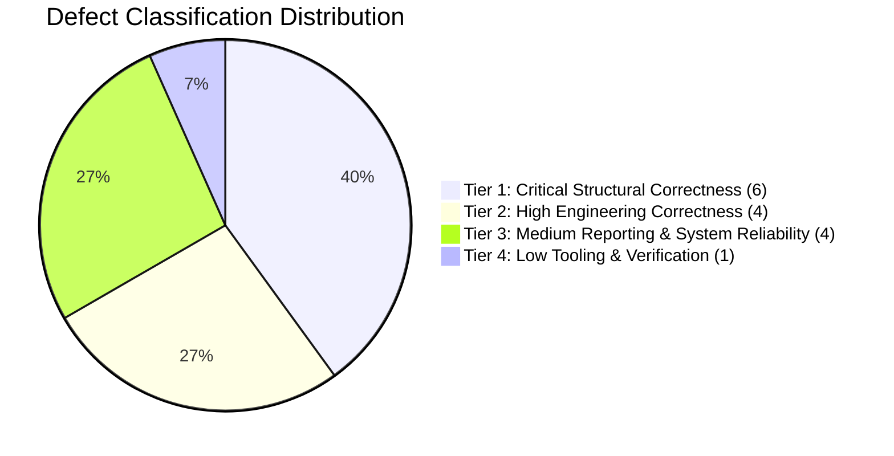
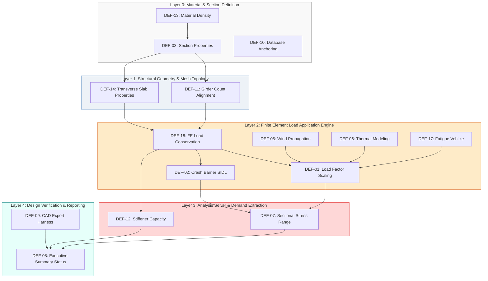

# PHASE 3 — Dependency and Priority Analysis

**Project:** FOSSEE Winter Internship 2026 — OsdagBridge Software Testing & Issue Reporting  
**Workspace:** `F:\FOSSEE internship`  
**Application Repository:** `source\OsdagBridge`  
**Baseline Commit:** `d74f56dd7f22925fb8148cabf5740ed8d1e39ff3` (Branch `dev`, 100% clean)  
**Controlling Document:** `reports/phase_3/PHASE_3_DEFECT_TRACEABILITY_MATRIX.md`  
**Date:** 2026-11-18  

---

## 1. Defect Classification & Severity Hierarchy

To ensure a disciplined, risk-mitigated remediation sequence, the 15 registered engineering defects are classified into four rigorous severity tiers based on structural safety, physical equilibrium, computational correctness, and user risk:



### Classification Breakdown

1. **Tier 1: Critical Structural Correctness (Life-Safety & Statics Invariants)**
   - Defects that violate fundamental equilibrium, omit safety factors, or miscalculate structural capacities by orders of magnitude:
     - `DEF-18`: Non-conservation of static equilibrium in FE load distribution (loses $37.5\%$ barrier load; $+0.75\text{ m}$ centroid shift).
     - `DEF-01`: Load factor scaling omitted in `ospgrillage` combinations ($1.0 \times$ instead of $1.35 \times$).
     - `DEF-02`: Crash barrier superimposed dead load omitted from combinations ($0.0\text{ kN}$ vs $313.9\text{ kN}$).
     - `DEF-12`: Bearing stiffener web buckling capacity overpredicted by $3,380\times$ ($214,533\text{ kN}$ vs $63.4\text{ kN}$).
     - `DEF-07`: Fatigue stress range doubled via member local end sign flip (evaluates static load as $62.73\text{ MPa}$ cyclic range).
     - `DEF-03`: Section property desynchronization between snapped plates and grillage solver ($8.3\%$ deflection error).

2. **Tier 2: High Engineering Correctness (Input Propagation & Architectural Integrity)**
   - Defects that distort structural geometry or drop environmental/moving actions:
     - `DEF-11`: Girder count geometry misalignment (counts overhang lines, $6$ instead of $4$).
     - `DEF-05`: Wind parameter propagation loss (falls back to $33\text{ m/s}$ and $10\text{ m}$ height).
     - `DEF-14`: Transverse concrete deck slab assigned steel plate girder section properties (DEC-013).
     - `DEF-17`: IRC 6 Cl. 204.6 fatigue vehicle moving load analysis pipeline omission (DEC-018).

3. **Tier 3: Medium Reporting & System Reliability (Contract & Environment Compliance)**
   - Defects affecting user reporting truth, material specifications, and filesystem integrity:
     - `DEF-08`: Executive Summary emits hardcoded unconditional "Pass" narrative regardless of failure.
     - `DEF-13`: Hardcoded structural steel density overriding user material input ($78.5$ vs $70.0\text{ kN/m}^3$).
     - `DEF-10`: Untracked `weather.sqlite` creation in CWD and source package directory mutation.
     - `DEF-06`: Thermal load modeling omission / vertical pressure fallback (DEC-015).

4. **Tier 4: Low Tooling & Verification (Harness Robustness)**
   - Environment and harness verification checks:
     - `DEF-09`: Offscreen OpenCASCADE 3D CAD rendering and image export validation.

---

## 2. Structural Mechanics Data Flow & Defect Coupling Graph

The OsdagBridge computational engine follows a strict unidirectional physical pipeline:



---

## 3. Detailed Cross-Defect Interaction Analysis

### 3.1 Sizing to Topology Interactions (`DEF-13` $\rightarrow$ `DEF-03` $\rightarrow$ `DEF-11`)
- **Interaction Mechanism:**  
  `DEF-13` dictates the self-weight per unit length of the plate girders ($w_{SW} = A \cdot \rho$). `DEF-03` calculates the cross-sectional area $A$ and second moments of area $I_z, I_y$. If `DEF-03` is not fixed first, any fix to `DEF-13` will multiply the correct density by the wrong cross-sectional area!
- **Topology Coupling:**  
  `DEF-11` establishes the boundary between structural girders ($N=4$) and auxiliary deck overhang lines ($2$). If `DEF-11` is wrong, the solver loops over 6 girders, attempting to assign snapped plate properties (`DEF-03`) to the edge lines.

### 3.2 Topology to Load Distribution Interactions (`DEF-11`, `DEF-14` $\rightarrow$ `DEF-18`)
- **Interaction Mechanism:**  
  `DEF-18` relies on cell-intersection bilinear shape functions over the grillage grid. The transverse grid spacing and member stiffness (`DEF-14`) determine how loads are shared among the girders.
- If transverse slab properties (`DEF-14`) represent halved steel girders rather than concrete deck strips, the transverse distribution of wheel loads and crash barrier line loads is physically distorted, regardless of whether static equilibrium is conserved.

### 3.3 Load Distribution to Combination Interactions (`DEF-18` $\rightarrow$ `DEF-01`, `DEF-02`)
- **Interaction Mechanism:**  
  `DEF-18` ensures that $100\%$ of crash barrier load ($313.92\text{ kN}$) is assigned to OpenSees without dropping $-117.72\text{ kN}$.
- `DEF-02` ensures that this crash barrier load enters the `BASIC_1` combination.
- `DEF-01` ensures that once inside `BASIC_1`, it is scaled by the ULS factor $\gamma_G = 1.35$.
- **Error Cancellation Risk:**  
  In Phase 2 baseline, dropping $-37.5\%$ of barrier load and omitting the barrier from `BASIC_1` while leaving loads unfactored created partial numerical coincidences that masked errors. All three must be remediated in strict foundational order:
  1. Fix `DEF-18` (assign genuine 100% load magnitude and correct centroid to OpenSees).
  2. Fix `DEF-02` (incorporate barrier SIDL into combinations).
  3. Fix `DEF-01` (scale combination terms by their ULS partial safety factors).

### 3.4 Analysis Demands to Design Checks (`DEF-01`, `DEF-02`, `DEF-18` $\rightarrow$ `DEF-07`, `DEF-12`)
- **Interaction Mechanism:**  
  `DEF-12` checks bearing stiffener buckling against support reaction $R_{\max}$. $R_{\max}$ is produced by the combination of dead load (`DEF-01`, `DEF-02`, `DEF-18`) and live load. Correcting the capacity formula in `DEF-12` ($214,533\text{ kN} \rightarrow 63.4\text{ kN}$) will accurately evaluate whether stiffeners are mandatory.
- `DEF-07` extracts cyclic fatigue stress ranges from the frequent load combinations. If `DEF-01` fails to scale or if sign conventions flip opposing beam ends, `DEF-07` computes meaningless stress ranges.

### 3.5 Design Checks to Reporting Truth (`DEF-07`, `DEF-12` $\rightarrow$ `DEF-08`)
- **Interaction Mechanism:**  
  `DEF-08` is the final presentation layer. If `DEF-08` is modified to dynamically read `output_dict` before `DEF-12` or `DEF-07` are fixed, it will correctly report that `DEF-12` or `DEF-07` failed! Fixing the upstream engineering defects ensures that when the report dynamically reads check statuses, the results reflect genuine structural engineering pass/fail outcomes.

---

## 4. Remediation Order & Dependency Constraints (DAG)

Based on the data-flow analysis, the remediation sequence must strictly follow this Directed Acyclic Graph (DAG) consisting of 6 sequential remediation stages:

```
Stage 0 (Foundations & Environment)
  ├── DEF-10 (User AppData & SQLite Anchoring)
  └── DEF-09 (CAD Offscreen Viewport Harness)
        │
Stage 1 (Cross-Section & Material Physics)
  ├── DEF-13 (Material Density Dynamic Propagation)
  └── DEF-03 (Snapped Plate Section Properties Sync)
        │
Stage 2 (Mesh Topology & Transverse Sizing)
  ├── DEF-11 (Girder Count Alignment: n_l vs n_girders)
  └── DEF-14 (Transverse Concrete Slab Model - DEC-013)
        │
Stage 3 (Finite Element Load Engine & Statics)
  ├── DEF-18 (Bilinear Cell Load Equilibrium & Centroid Conservation)
  ├── DEF-05 (Wind Parameter Namespaced Propagation)
  ├── DEF-02 (Crash Barrier SIDL Combination Integration)
  └── DEF-01 (ospgrillage Load Factor Scaling)
        │
Stage 4 (Moving Loads & Special Analysis Actions)
  ├── DEF-17 (IRC 6 Fatigue Vehicle Moving Load Pipeline - DEC-018)
  └── DEF-06 (IRC 6 Thermal Load Action Specification - DEC-015)
        │
Stage 5 (Design Capacity & Member Verification)
  ├── DEF-12 (Bearing Stiffener Web Buckling Formula per IS 800)
  └── DEF-07 (Point-Wise Sectional Fatigue Stress Range Extraction)
        │
Stage 6 (Executive Reporting & Deliverables)
  └── DEF-08 (Executive Summary Dynamic Outcome Derivation)
```

### Mandatory Invariant:
**No downstream consumer may be modified until all its upstream dependencies are remediated, verified by independent oracles, and regression-tested.**
