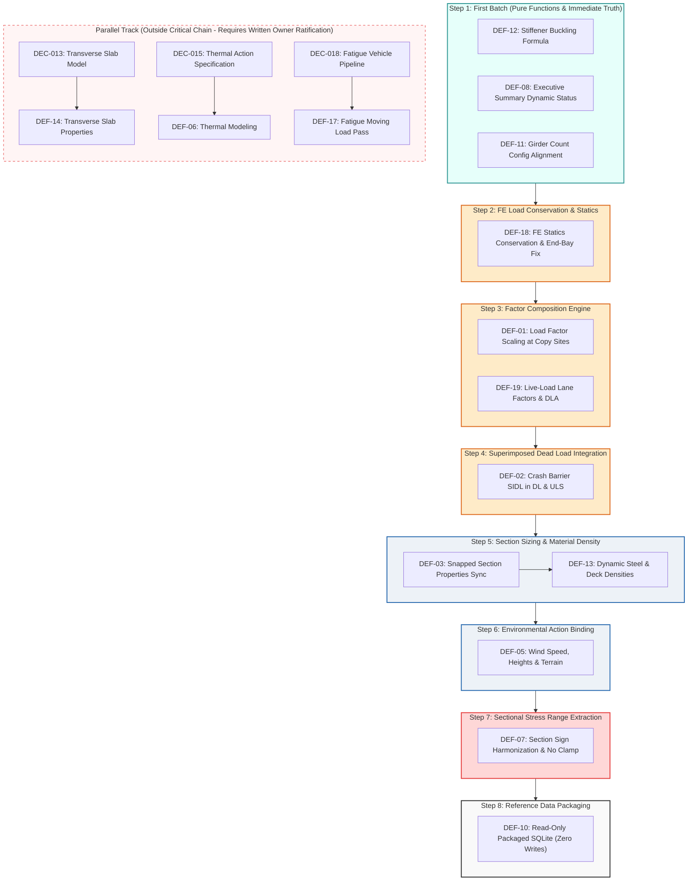

# PHASE 3 — Dependency and Priority Analysis (Revision 2.0)

**Project:** FOSSEE Winter Internship 2026 — OsdagBridge Software Testing & Issue Reporting  
**Workspace:** `F:\FOSSEE internship`  
**Application Repository:** `source\OsdagBridge`  
**Revision:** Revision 2.0 (Post-Audit Re-Baseline)  
**Controlling Audit:** `reports/phase_3/CLAUDE_INDEPENDENT_PHASE_3_PLANNING_AUDIT.md` (by independent auditor Claude)  
**Historical Revision Archive:** `reports/phase_3/v1_original/PHASE_3_DEPENDENCY_AND_PRIORITY_ANALYSIS.md`  
**Date:** 2026-11-18  

---

## 1. Audit Findings & Structural Correction of the Dependency DAG

In the initial Phase 3 planning blueprint, independent auditor Claude identified severe structural flaws in the dependency graph (§6.1–6.5):
1. **Critical Path Blocked by Unratified Decisions:** The plan placed blocked architectural decision `DEC-013 (DEF-14)` in Stage 2, which halted `DEF-18`, `DEF-01`, and `DEF-02`—the three most critical equilibrium and load-combination defects in the entire platform. Similarly, placing `DEF-17` and `DEF-06` before Stage 5 blocked `DEF-12` and `DEF-08`.
2. **Nonexistent Code Dependencies:** Seven claimed dependency edges did not exist in the code (e.g. `DEF-14` does not gate load conservation `DEF-18`; `DEF-11` is a reporting count and does not gate FE distribution; `DEF-18` does not gate the capacity formula `DEF-12`).
3. **Flawed Prioritization of Reporting and Stiffeners:** Placing `DEF-08` (reporting) and `DEF-12` (bearing stiffener buckling) at the very end left the most dangerous unconservative capacity check ($3,380\times$ overprediction) active and masked failures behind hardcoded "Pass" narratives throughout all intermediate builds.

Revision 2.0 completely restructures the Directed Acyclic Graph (DAG) to decouple independent pure functions, remove blocked DEC items from the critical path, and prioritize making failures visible immediately.

---

## 2. Revised Directed Acyclic Graph (DAG)

---

## 3. Detailed Step-by-Step Rationale & Dependency Justification

### Step 1 (First Implementation Batch): `DEF-12`, `DEF-08`, `DEF-11`
- **Technical Justification:**  
  All three are pure mathematical functions or report formatting logic with **zero finite element coupling**:
  - `DEF-12` is a standalone capacity equation in `designer.py:1664–1672`. It does not depend on grillage stiffness or load distribution; its oracle depends only on cross-section dimensions and material yield strength.
  - `DEF-08` is LaTeX report formatting in `executive_summary.py:233–236`.
  - `DEF-11` is a single integer assignment in `designer.py:401`.
- **Engineering Safety Rationale:**  
  Remediating `DEF-12` immediately eliminates the most dangerous unconservative calculation in the software ($214,533\text{ kN} \rightarrow 118.8\text{ kN}$). Remediating `DEF-08` immediately removes the hardcoded "Pass" narrative, ensuring that all subsequent engineering check failures become immediately visible during test execution rather than masked.
- **Rollback Risk:** Exceptionally low; isolated to `designer.py` and `executive_summary.py`.

### Step 2: `DEF-18` (Finite Element Load Conservation & End-Bay Fix)
- **Technical Justification:**  
  `DEF-18` lives inside vendored `src/ospgrillage/osp_grillage.py`. Converting line-load segment intensities to forces ($W \cdot L$), fixing the dropped end-bay, correcting the y/z interpolation index swap, and fixing patch area integration are purely geometric mesh operations.
- **Independence:**  
  Load conservation ($\Sigma R_y = \Sigma P$) is a fundamental statics requirement that holds regardless of girder stiffness (`DEF-03`), transverse deck stiffness (`DEF-14`), or combination scaling (`DEF-01`).

### Step 3: `DEF-01` & `DEF-19` (Load Factor Composition Engine)
- **Technical Justification:**  
  Once the finite element distribution engine conserves $100\%$ of applied load vectors, factor composition is implemented across all load-copy sites in `analyser.py`.
- **Composition Coupling:**  
  `DEF-01` (ULS factors) and `DEF-19` (lane reduction factors and DLA impact allowance) share the identical copy mechanisms in `analyser.py:2025` and `analyser.py:2348`. Fixing them together guarantees that moving vehicle cases, governing live-load cases, and compound combinations all preserve compounded factors.

### Step 4: `DEF-02` (Crash Barrier SIDL in Combinations)
- **Technical Justification:**  
  Inserting `model.create_sidl_combination()` in `plategirderbridge.py:1338` ensures that crash barrier line loads are absorbed into `dead_load_combination`.
- **Verification Decoupling:**  
  `DEF-02` has an isolated presence oracle at $\gamma = 1.0$ (verifying that barrier load objects exist in `dead_load_combination` with un-factored magnitude $313.92\text{ kN}$). Once Step 2 (`DEF-18`) and Step 3 (`DEF-01`) are in place, the combined factored check ($1.35 \times 313.92 = 423.79\text{ kN}$) is evaluated as a milestone assertion.

### Step 5: `DEF-03` & `DEF-13` (Section Sizing & Material Densities)
- **Technical Justification:**  
  `DEF-03` re-synchronizes bare-steel solver section properties ($A, I_z, I_y$) from snapped plates. `DEF-13` propagates user densities for steel and deck slab.
- **Coupling:**  
  The self-weight resultant in `DEF-13` ($P_{SW} = 4 \times L \times A \times \rho_s$) depends mathematically on the cross-sectional area $A$. Sequencing `DEF-03` first ensures that `DEF-13` evaluates against the true derived area $A = 0.032400\text{ m}^2$, yielding $P_{SW} = 217.728\text{ kN}$ at $\rho=70.0\text{ kN/m}^3$.

### Step 6: `DEF-05` (Wind Action Parameter Binding)
- **Technical Justification:**  
  Resolving namespaced wind speed, exposed heights, and terrain keys in `plategirderbridge.py:1381–1393` passes valid inputs to `create_wind_load()`, matching the IRC 6 Table 12 target $P_z = 1039.6\text{ N/m}^2$.

### Step 7: `DEF-07` (Sectional Fatigue Stress Range Extraction)
- **Technical Justification:**  
  Harmonizes local member end signs, eliminates zero-clamping, and adds shear stress range extraction across SLS frequent combinations in `designer.py:2970–2996`. Labelled explicitly as a surrogate extraction until `DEF-17` moving load passes are implemented.

### Step 8: `DEF-10` (Reference Database Read-Only Packaging)
- **Technical Justification:**  
  Eliminates runtime file creation and CWD mutations by pre-building `weather.sqlite` as immutable package data and opening it strictly read-only (`?mode=ro`).

### Parallel Track: Architectural Decisions (`DEC-013`, `DEC-015`, `DEC-018`)
- **Governance Mandate:**  
  An implementation batch cannot ratify an architectural decision. `DEF-14` (transverse slab), `DEF-06` (thermal modeling), and `DEF-17` (fatigue vehicle pipeline) remain **strictly BLOCKED** outside the critical implementation chain until written technical sign-off is provided by the project engineering owner.

---

## 4. Comparison: Original v1 DAG vs. Corrected Rev 2 DAG

| Dimension | Original Planning (v1) | Corrected Architecture (Rev 2) | Audit Compliance Rationale |
|:---|:---|:---|:---|
| **Critical Path Blockers** | Gated by `DEC-013`, `DEC-015`, `DEC-018` | All blocked DEC items placed in parallel track outside critical chain | Unblocks fundamental statics and combination fixes immediately (§6.3) |
| **First Implementation Batch** | Began with `DEF-10` (AppData packaging) | Begins with `DEF-12`, `DEF-08`, `DEF-11` (pure functions & reporting) | Removes $3,380\times$ capacity overprediction and unmasks failure reports immediately (§6.4) |
| **Load Factor Composition** | Loop fix only; missed lane factors & DLA | Compounded factor engine (`DEF-01`) + Latent defect cataloged (`DEF-19`) | Prevents silent ~15% live-load under-design (§3 DEF-01) |
| **Statics Conservation** | Single-line $W \cdot L$ fix; assumed 0.05% tolerance | $W \cdot L$ + End-bay retention + y/z index fix + $\le 10^{-6}$ tolerances | Fixes true physical cause of $+0.75\text{ m}$ centroid displacement (§3 DEF-18) |
| **Sizing & Density Sequence** | `DEF-13` placed before `DEF-03` | `DEF-03` derived area sequenced before `DEF-13` density oracle | Eliminates circular reliance on unsynchronized area (§3 DEF-13) |
