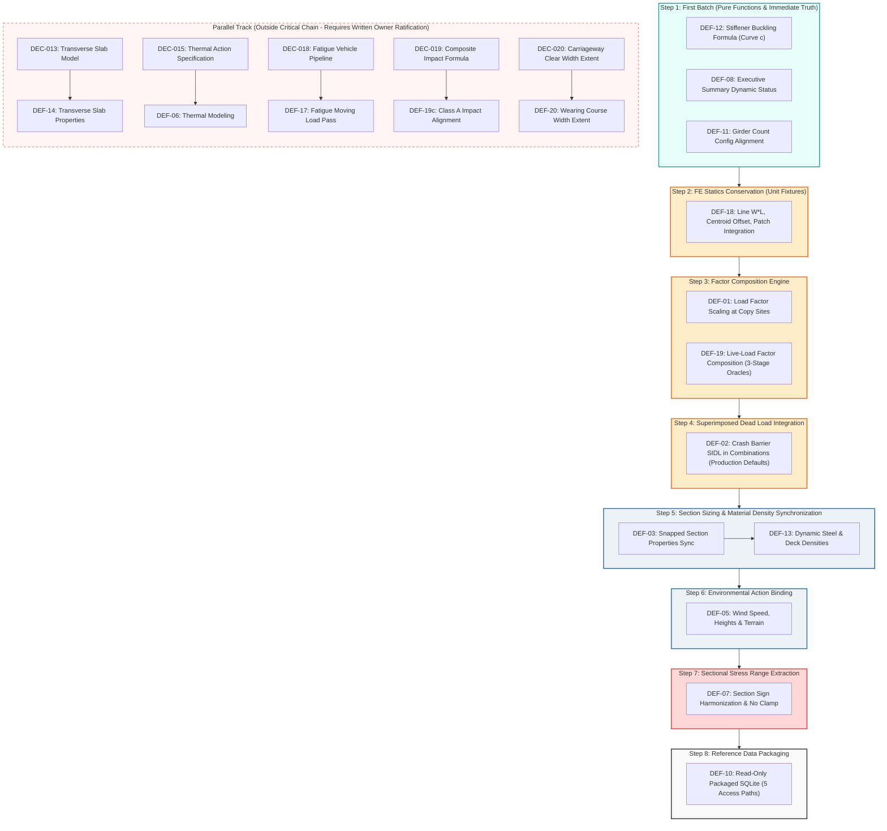

# PHASE 3 — Dependency and Priority Analysis (Revision 3.0)

**Project:** FOSSEE Winter Internship 2026 — OsdagBridge Software Testing & Issue Reporting  
**Workspace:** `F:\FOSSEE internship`  
**Application Repository:** `source\OsdagBridge`  
**Revision:** Revision 3.0 (Post-Re-Audit Re-Baseline)  
**Controlling Documents:**
- `reports/phase_3/CLAUDE_INDEPENDENT_PHASE_3_REV2_REAUDIT.md` (by independent auditor Claude)
- `reports/phase_3/CLAUDE_INDEPENDENT_PHASE_3_PLANNING_AUDIT.md` (by independent auditor Claude)
**Historical Revision Archive:**
- `reports/phase_3/v1_original/PHASE_3_DEPENDENCY_AND_PRIORITY_ANALYSIS.md` (Revision 1.0)
- `reports/phase_3/PHASE_3_DEPENDENCY_AND_PRIORITY_ANALYSIS_REV2.md` (Revision 2.0)
**Date:** 2026-11-18  

---

## 1. Audit Findings & Structural Correction of the Dependency DAG

In the second Phase 3 audit ([`reports/phase_3/CLAUDE_INDEPENDENT_PHASE_3_REV2_REAUDIT.md`](file:///F:/FOSSEE%20internship/reports/phase_3/CLAUDE_INDEPENDENT_PHASE_3_REV2_REAUDIT.md)), independent auditor Claude identified an **ordering and dependency gap** in the Revision 2.0 Directed Acyclic Graph (§8, §11 Finding R2-11):

> **Claude Re-Audit Finding R2-11:**  
> *"Batch 2's fixture total depends on DD 1249.5 (ρ 24.5) and SW at ρ 78.5 with A = 0.0324. Those require DEF-13 (Batch 5) and a DEF-03 fixture mechanism. The Batch 2 gate must use production-default inputs, or Batch 5 must come first."*

In Revision 2.0, Batch 2 attempted to gate the full bridge dead load combination ($2023.586\text{ kN}$) before section sizing desynchronization (`DEF-03`) and material density propagation (`DEF-13`) were implemented in Batch 5. This created an invalid dependency where an early batch asserted numerical properties that depend on code from a future batch.

Revision 3.0 completely resolves this ordering gap by **strictly decoupling unit statics conservation from full-bridge density propagation**:
1. **Batch 2 (DEF-18):** Gates finite element statics conservation strictly on **dedicated unit test fixtures** (a uniform line load $w = 10\text{ kN/m}$, an asymmetric partial line load, and an off-center patch load) with exact closed-form statics conservation ($\Sigma F_y = 0, \Sigma M = 0$). Batch 2 makes zero assertions on full-bridge concrete or steel densities.
2. **Batch 4 (DEF-02):** Gates crash barrier SIDL combination using **production default material densities** ($\rho_s = 78.5\text{ kN/m}^3, \rho_c = 25.0\text{ kN/m}^3$).
3. **Batch 5 (DEF-03 & DEF-13):** Synchronizes snapped section properties (`DEF-03`) and propagates dynamic densities (`DEF-13`). Only at Batch 5 is the full unified bridge dead-load combination asserted across all contributing components.
4. **DEC Parallel Track:** All architectural decisions (`DEC-013`, `DEC-015`, `DEC-018`, `DEC-019`, `DEC-020`) remain strictly segregated on an external track requiring formal engineering owner sign-off.

---

## 2. Revised Directed Acyclic Graph (DAG)

---

## 3. Detailed Step-by-Step Rationale & Dependency Justification

### Step 1 (First Implementation Batch): `DEF-12`, `DEF-08`, `DEF-11`
- **Technical Justification:**  
  All three defects are pure mathematical functions or report formatting logic with **zero finite element coupling**:
  - `DEF-12` is a standalone capacity equation in `designer.py:1664–1672`. It does not depend on grillage stiffness or load distribution; its oracle depends strictly on plate cross-section dimensions and material yield strength ($f_y$). Correcting it immediately eliminates the $3,384\times$ web buckling overprediction ($214,533\text{ kN} \rightarrow 63.40\text{ kN}$ on sealed geometry, $118.79\text{ kN}$ on hand fixture).
  - `DEF-08` is LaTeX report formatting in `executive_summary.py:233–236`. Replacing the static "Pass" narrative with dynamic truth table evaluation immediately unmasks existing design check failures.
  - `DEF-11` is a configuration property mapping in `designer.py:401, 413` that aligns `BridgeConfig.geometry.n_girders` with the physical girders (`bridge._girder_count()`).
- **Prerequisites:** None. Can be implemented and verified immediately.

---

### Step 2: Finite Element Statics Conservation (`DEF-18`)
- **Technical Justification:**  
  Corrects the fundamental statics partition-of-unity in vendored `ospgrillage`: segment line load intensity scaling ($W \cdot L$), end-bay centroid displacement ($x = -0.75\text{ m}$ placement and silent `return []` drop), y/z interpolation coordinate swap, and patch corner double-counting.
- **Dependency Isolation (Finding R2-11 Resolution):**  
  Batch 2 is tested **strictly on dedicated unit test fixtures** (a uniform line load $w = 10.0\text{ kN/m}$ across $24\text{ m}$, an asymmetric partial line load, and an off-center patch load). It achieves bit-level force conservation ($10^{-9}$ tolerance) and centroid accuracy ($|\Delta x| \le 10^{-6} \cdot L$) without asserting full-bridge dead loads.
- **Prerequisites:** Step 1 complete.

---

### Step 3: Load Factor Composition Engine (`DEF-01`, `DEF-19`)
- **Technical Justification:**  
  Ensures that force scaling factors passed to `LoadCase.add_load(load, load_factor=gamma)` and multi-case combinations are correctly compounded into OpenSees nodal loads:
  - `DEF-01`: Multiplies segment and nodal loads by `load_dict["factor"]` in `osp_grillage.py:1934`.
  - `DEF-19`: Preserves lane-reduction factors and DLA impact multiplier across `analyser.py` copy sites.
- **Prerequisites:** Step 2 complete (statics conservation must precede factor scaling).

---

### Step 4: Superimposed Dead Load Integration (`DEF-02`)
- **Technical Justification:**  
  Integrates crash barrier line loads ($313.920\text{ kN}$) into the platform's dead load combinations by calling `create_sidl_combination()` prior to `create_dead_load_combination()`.
- **Dependency Isolation (Finding R2-11 Resolution):**  
  Tested using **production default material densities** ($\rho_s = 78.5\text{ kN/m}^3, \rho_c = 25.0\text{ kN/m}^3$). Gates barrier presence in combinations without requiring dynamic density propagation from Batch 5.
- **Prerequisites:** Steps 2 and 3 complete (barrier line loads require conserved statics and factor scaling).

---

### Step 5: Section Property Sizing & Material Density Synchronization (`DEF-03`, `DEF-13`)
- **Technical Justification:**  
  - `DEF-03`: Updates solver beam elements with synchronized snapped plate properties ($A = 0.032400\text{ m}^2, I_z = 0.0097174\text{ m}^4$).
  - `DEF-13`: Propagates user material densities ($\rho_s, \rho_c$) to `create_self_weight_load` and `create_deck_load`.
- **Full Bridge Unified Dead Load Gate:**  
  With section properties synchronized and material densities fully dynamic, Batch 5 is the **authoritative gate** for the full bridge unified dead load combination (`BASIC_1` = $2818.242\text{ kN}$ at $\rho_c=24.5, DW=216.0\text{ kN}$; or $2868.642\text{ kN}$ at production DW $244.8\text{ kN}$).
- **Prerequisites:** Steps 2, 3, and 4 complete.

---

### Step 6: Environmental Action Binding (`DEF-05`)
- **Technical Justification:**  
  Propagates basic wind speed $V_b$, reference height $H$, and terrain category to `analyser.py`, producing $P_z = 1039.6\text{ N/m}^2$ for $V_b = 47\text{ m/s}, H = 15\text{ m}$.
- **Prerequisites:** Steps 1 through 5 complete.

---

### Step 7: Sectional Stress Range Extraction (`DEF-07`)
- **Technical Justification:**  
  Eliminates local end-sign doubling and zero-clamping in `designer.py:2976–2996`.
- **Prerequisites:** Steps 1 through 6 complete.

---

### Step 8: Reference Data Packaging (`DEF-10`)
- **Technical Justification:**  
  Hardens `weather.sqlite` read-only packaging across all 5 access paths with `Path.resolve().as_uri() + "?mode=ro"`, `PRAGMA quick_check`, and explicit `Path.is_file()` checks.
- **Prerequisites:** Steps 1 through 7 complete.
