# PHASE 3 — Engineering Remediation Blueprint

**Project:** FOSSEE Winter Internship 2026 — OsdagBridge Software Testing & Issue Reporting  
**Workspace:** `F:\FOSSEE internship`  
**Application Repository:** `source\OsdagBridge`  
**Baseline Commit:** `d74f56dd7f22925fb8148cabf5740ed8d1e39ff3` (Branch `dev`, 100% clean)  
**Controlling Audit:** `reports/PHASE_2_FINAL_CLOSURE_AUDIT.md` (by independent auditor Claude)  
**Date:** 2026-11-18  

---

## 1. Executive Summary & Authorization Posture

Phase 2 of the FOSSEE OsdagBridge campaign concluded with complete acceptance and closure, having validated 184 evidence files across six HMAC cryptographic seals and established bit-exact parity between human and automated validation packages.

This **Engineering Remediation Blueprint** delivers the definitive, read-only architectural plan for Phase 3. It synthesizes the physical source code discoveries, structural mechanics requirements, mathematical invariants, dependency constraints, and implementation batches necessary to remediate all 15 cataloged engineering defects in OsdagBridge.

### Core Non-Negotiable Mandates Observed During Planning
- **Zero Application Modifications:** The entire application tree (`source/OsdagBridge`) remains 100% untouched and bit-exact with the frozen baseline `d74f56dd7f22925fb8148cabf5740ed8d1e39ff3`.
- **Zero Database Drift:** Both production databases (`weather.sqlite` and `Intg_osdag.sqlite`) match their authoritative cryptographic digests.
- **Strict Read-Only Posture:** No code changes have been implemented. Phase 3 implementation remains strictly unauthorized pending independent audit review of this blueprint.

---

## 2. Blueprint Architectural Framework

The remediation architecture addresses defects across five core functional tiers of the finite element bridge engineering pipeline:

```mermaid
flowchart LR
    subgraph Data["1. Environment & Data"]
        direction TB
        DEF10["DEF-10: SQLite User AppData"]
        DEF13["DEF-13: Material Density"]
    end
    subgraph Sizing["2. Cross-Section & Sizing"]
        direction TB
        DEF03["DEF-03: Section Properties Sync"]
        DEF11["DEF-11: Girder Count Alignment"]
        DEF14["DEF-14: Transverse Slab Properties"]
    end
    subgraph FE["3. FE Modeling & Statics"]
        direction TB
        DEF18["DEF-18: Bilinear Load Conservation"]
        DEF01["DEF-01: Load Factor Scaling"]
        DEF02["DEF-02: Crash Barrier SIDL"]
    end
    subgraph Actions["4. Actions & Demands"]
        direction TB
        DEF05["DEF-05: Wind Parameter Propagation"]
        DEF06["DEF-06: Thermal Actions (DEC-015)"]
        DEF17["DEF-17: Fatigue Moving Load (DEC-018)"]
    end
    subgraph Design["5. Verification & Reporting"]
        direction TB
        DEF12["DEF-12: Stiffener Buckling Formula"]
        DEF07["DEF-07: Sectional Stress Range"]
        DEF08["DEF-08: Dynamic Executive Summary"]
    end

    Data --> Sizing
    Sizing --> FE
    FE --> Actions
    Actions --> Design
```



### Core Architectural Principles
1. **Physical Conservation Invariants Over Heuristics:**  
   Finite element approximations must strictly conserve statics: vertical reaction sum must balance applied loads within $0.05\%$, and reaction centroids must balance load centroids within $0.05\text{ m}$.
2. **Strict Separation of Structural vs Auxiliary Elements:**  
   Longitudinal steel girders carrying primary bending moments must never be conflated with auxiliary grillage edge lines or deck overhang mesh boundaries.
3. **Point-Wise Stress Verification:**  
   Fatigue stress ranges must be tracked element-by-element and cross-section by cross-section under concurrent moving load configurations, strictly eliminating spatial sign-convention cancellations.
4. **Dynamic Truth in Engineering Reporting:**  
   All summary narratives, tables, and DCR indicators in generated reports must be bound directly to mathematical calculation outputs, eliminating hardcoded outcomes.

---

## 3. Summary of Planning Deliverables

This Blueprint is supported by five specialized engineering reports authored in `reports/phase_3/`:

1. **Baseline Preservation Report (`PHASE_3_BASELINE_PRESERVATION_REPORT.md`):**  
   Certifies that `source/OsdagBridge` is clean on branch `dev` @ `d74f56dd7f22925fb8148cabf5740ed8d1e39ff3`; verifies both SQLite databases; verifies all 6 production HMAC seals (184 files); and confirms zero disk drift.
2. **Defect Traceability Matrix (`PHASE_3_DEFECT_TRACEABILITY_MATRIX.md`):**  
   Provides exhaustive ground-truth documentation for all 15 defects across 10 required dimensions: original observation, exact source file and line numbers, baseline status, reproduction steps, expected behavior, actual behavior, code clauses (IRC 6, IRC 22, IRC 24, IS 800), cross-defect interactions, regression risks, and proposed fix specifications.
3. **Dependency and Priority Analysis (`PHASE_3_DEPENDENCY_AND_PRIORITY_ANALYSIS.md`):**  
   Classifies defects into 4 severity tiers (6 Critical, 4 High, 4 Medium, 1 Low) and formulates a 6-stage Directed Acyclic Graph (DAG) preventing circular dependencies and error masking.
4. **Test Acceptance Criteria (`PHASE_3_TEST_ACCEPTANCE_CRITERIA.md`):**  
   Establishes independent, non-circular physical oracles for each defect, enforcing 5 universal mechanics invariants (force conservation, moment equilibrium, segment equilibrium, parallel-axis consistency, and dimensional analysis).
5. **Implementation Batch Plan (`PHASE_3_IMPLEMENTATION_BATCH_PLAN.md`):**  
   Partitions remediation into 9 discrete, reviewable work batches with single-defect git discipline, explicit exclusions, regression test suites, and rollback strategies.

---

## 4. Architectural Decisions to be Ratified (DEC Register)

Three defects correspond to upstream architectural decisions that must be formally ratified before their implementation batches execute:

### DEC-013: Transverse Concrete Deck Slab Modeling (`DEF-14`)
- **Problem:** Currently, transverse grillage elements are assigned half of the longitudinal steel plate girder properties (`girder/2`, $I_z \approx 0.00367\text{ m}^4$), which is physically ungrounded for a concrete deck.
- **Recommended Ratification:** Model transverse grillage elements as uncracked transformed reinforced concrete slab strips with width equal to transverse nodal spacing ($b = s_{\text{node}} \approx 1.5\text{ m}$) and depth equal to slab thickness ($d_s$):
  $$I_{\text{trans, steel-equiv}} = \frac{b \cdot d_s^3}{12 \cdot m}, \quad m = \frac{E_s}{E_c}$$
- **Impact:** Aligns transverse load sharing with Hambly grillage theory.

### DEC-015: IRC 6 Cl. 215 Thermal Action Formulation (`DEF-06`)
- **Problem:** Thermal effects are currently omitted or modeled as an unphysical downward vertical pressure load.
- **Recommended Ratification:** Implement IRC 6 Cl. 215.2 overall temperature rise/fall as an analytical check evaluating longitudinal thermal expansion $\Delta L = L \alpha \Delta T$ and fixed-bearing shear forces $F = k_{\text{bearing}} \Delta L$, while reserving non-linear vertical temperature gradient (Cl. 215.3) for cross-sectional self-equilibrating stress verification.
- **Impact:** Eliminates spurious vertical bending in simply-supported bridges.

### DEC-018: IRC 6 Cl. 204.6 Fatigue Vehicle Analysis Pipeline (`DEF-17`)
- **Problem:** UI exposes fatigue options and `ospgrillage` defines the 40-tonne 4-axle Fatigue Vehicle, but it is never routed across the bridge as a moving load.
- **Recommended Ratification:** Implement a dedicated single-vehicle moving load pass for the 400 kN fatigue vehicle routed along lane centerlines, extracting maximum sagging moment range $\Delta M$ to feed `designer.py:stress_range_MPa`.
- **Impact:** Satisfies mandatory IRC 6 and IRC 22 fatigue verification.

---

## 5. Execution Roadmap for Authorized Phase 3 Implementation

When formally authorized by the project committee and independent auditor, Phase 3 implementation will proceed according to the 9-batch sequence:

```
┌─────────────────────────────────────────────────────────────────────────┐
│                      PHASE 3 EXECUTION ROADMAP                          │
├─────────┬───────────────────────────────────┬───────────────────────────┤
│ Batch 1 │ DEF-10: Filesystem Anchoring      │ User AppData isolation    │
│ Batch 2 │ DEF-13, DEF-03: Sizing & Density  │ Snapped plates sync       │
│ Batch 3 │ DEF-11, DEF-14: Topology & Slab   │ n_girders & DEC-013       │
│ Batch 4 │ DEF-18: Finite Element Statics    │ Bilinear load allocation  │
│ Batch 5 │ DEF-01, DEF-02: ULS Combinations  │ Factoring & Barrier SIDL  │
│ Batch 6 │ DEF-05, DEF-06: Environmental     │ Wind speed & DEC-015      │
│ Batch 7 │ DEF-12, DEF-07: Design Capacities │ Stiffeners & Fatigue sign │
│ Batch 8 │ DEF-17: Moving Load Pipeline      │ Fatigue vehicle & DEC-018 │
│ Batch 9 │ DEF-08: Executive Reporting       │ Dynamic outcome status    │
└─────────┴───────────────────────────────────┴───────────────────────────┘
```

Each batch will execute in its own atomic commit on branch `fix/phase-3-engineering-remediation`, verified against the tri-state sensitivity test runner before the next batch begins.

---

## 6. Audit Readiness Attestation

This Phase 3 Engineering Remediation Blueprint and its five companion reports are complete, verified against ground-truth source code, and fully ready for independent gate audit.

**POSTURE:** `PHASE 3 PLANNING READY FOR INDEPENDENT CLAUDE AUDIT`
