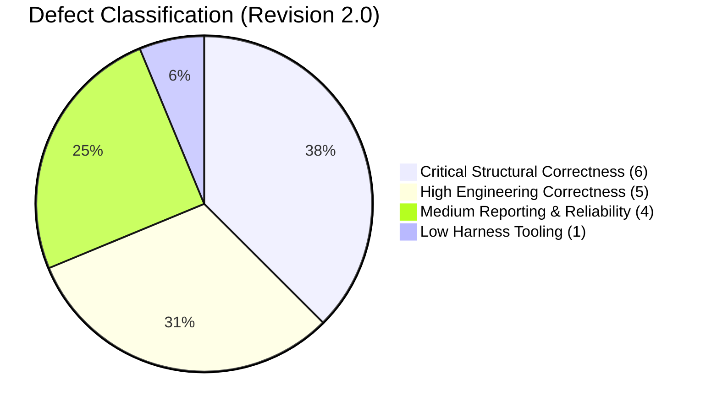

# PHASE 3 — Engineering Remediation Blueprint (Revision 2.0)

**Project:** FOSSEE Winter Internship 2026 — OsdagBridge Software Testing & Issue Reporting  
**Workspace:** `F:\FOSSEE internship`  
**Application Repository:** `source\OsdagBridge`  
**Revision:** Revision 2.0 (Post-Audit Re-Baseline)  
**Controlling Audit:** `reports/phase_3/CLAUDE_INDEPENDENT_PHASE_3_PLANNING_AUDIT.md` (by independent auditor Claude)  
**Historical Revision Archive:** `reports/phase_3/v1_original/PHASE_3_ENGINEERING_REMEDIATION_BLUEPRINT.md`  
**Date:** 2026-11-18  

---

## 1. Executive Summary & Audit Re-Baseline Posture

Following independent auditor Claude's rigorous Phase 3 audit ([`reports/phase_3/CLAUDE_INDEPENDENT_PHASE_3_PLANNING_AUDIT.md`](file:///F:/FOSSEE%20internship/reports/phase_3/CLAUDE_INDEPENDENT_PHASE_3_PLANNING_AUDIT.md)), the Phase 3 planning architecture has been comprehensively revised. Claude confirmed the existence of all 12 active defects and 3 blocked gaps at baseline commit `d74f56dd7f22925fb8148cabf5740ed8d1e39ff3` and verified that the baseline preservation state is 100% intact. However, material engineering errors in test oracles, numerical targets, dependency sequencing, rollback definitions, and defect diagnoses required complete revision.

This **Engineering Remediation Blueprint (Revision 2.0)** incorporates all independent findings, reproduces the exact physical mechanics of each defect, resolves all 48 specific audit items in [`PHASE_3_CLAUDE_FINDING_RESOLUTION_MATRIX.md`](file:///F:/FOSSEE%20internship/reports/phase_3/PHASE_3_CLAUDE_FINDING_RESOLUTION_MATRIX.md), and establishes an unblocked, safety-first remediation architecture.

### Non-Negotiable Operating Constraints Observed
- **Planning Only:** Zero application source code modifications, zero test changes, zero database modifications, zero commits, and zero pushes.
- **Implementation Strictly Unauthorized:** Phase 3 implementation remains unauthorized until this revised blueprint is audited and approved by the user and independent auditor.

---

## 2. Definitive Defect Register & Latent Defect Discovery

The OsdagBridge Defect Register now formally tracks **16 engineering defects and architectural gaps**:



1. **Critical Structural Correctness (6 defects):**
   - `DEF-18`: Finite element statics non-conservation (segment force $W \cdot L$ omission, dropped first end-bay, y/z index swap, patch over-integration).
   - `DEF-01`: Load factor scaling omitted in `ospgrillage` load combinations.
   - `DEF-02`: Crash barrier superimposed dead load omitted from combinations.
   - `DEF-12`: Bearing stiffener web buckling capacity formula anomaly (uses stiffener `Iys` instead of $r_y = t_w / \sqrt{12}$).
   - `DEF-07`: Sectional fatigue stress range local end-sign doubling and zero-clamping.
   - `DEF-03`: Section property desynchronization between snapped plates and grillage solver.
2. **High Engineering Correctness (5 defects):**
   - `DEF-19` **(NEW LATENT DEFECT discovered in Claude audit §3 DEF-01):** Omission of live-load factor composition; lane-reduction factors and Dynamic Load Allowance (DLA impact factor ~15%) dropped from governing live load and all combinations.
   - `DEF-05`: Wind parameter propagation loss (basic wind speed, heights, and terrain type).
   - `DEF-11`: Girder count geometry misalignment in `BridgeConfig` (counts auxiliary overhang lines).
   - `DEF-14`: Transverse concrete deck slab assigned halved steel plate girder properties (`girder/2`, BLOCKED under DEC-013).
   - `DEF-17`: IRC 6 Cl. 204.6 fatigue vehicle moving load analysis pipeline omission (BLOCKED under DEC-018).
3. **Medium Reporting & System Reliability (4 defects):**
   - `DEF-08`: Executive Summary emits hardcoded unconditional "Pass" narrative.
   - `DEF-10`: Reference database runtime materialization and package directory mutation.
   - `DEF-13`: Hardcoded structural steel and deck concrete densities overriding user material inputs.
   - `DEF-06`: Thermal load modeling omission / vertical pressure fallback (BLOCKED under DEC-015).
4. **Low Harness Tooling (1 item):**
   - `DEF-09`: Offscreen OpenCASCADE 3D CAD rendering harness verification (passing environment check).

---

## 3. Reconciled Single Fixture & Corrected Test Oracles

All derived acceptance targets across all planning documents are reconciled to a **single authoritative structural test fixture**:
- **Span & Deck:** $L = 24.000\text{ m}, W_{\text{deck}} = 8.500\text{ m}, W_{\text{cw}} = 7.500\text{ m}, t_{\text{deck}} = 0.250\text{ m}, t_{\text{wc}} = 0.050\text{ m}$.
- **Materials:** $\rho_s = 78.50\text{ kN/m}^3$ (or custom $70.00$), $\rho_c = 24.50\text{ kN/m}^3, \rho_{\text{wc}} = 24.00\text{ kN/m}^3$.
- **Snapped Plates:** $d_w = 1300\text{ mm}, t_w = 10\text{ mm}$, top flange $400 \times 16\text{ mm}$, bottom flange $500 \times 26\text{ mm}$.
- **Derived Bare-Steel Properties:**
  $$A = \mathbf{0.032400\text{ m}^2}, \quad \bar{y}_{\text{bot}} = \mathbf{0.539957\text{ m}}, \quad I_z = \mathbf{0.0097174\text{ m}^4}, \quad I_y = \mathbf{0.0003563\text{ m}^4}$$
- **Applied Dead Loads:**
  $$P_{SW} = 244.166\text{ kN}, \quad P_{DD} = 1249.500\text{ kN}, \quad P_{DW} = 216.000\text{ kN}, \quad P_{CB} = 313.920\text{ kN}$$
  $$\text{Total Physical Applied DL} = \mathbf{2023.586\text{ kN}}$$
  $$\text{Factored Resultant (`BASIC_1`)} = 1.35(244.166 + 1249.500 + 313.920) + 1.75(216.000) = \mathbf{2788.751\text{ kN}}$$

### Corrected Numerical Targets Summary

| Defect ID | Original v1 Plan Target (Flawed) | Revised Corrected Target (Rev 2) | Governing Source & Independent Derivation |
|:---:|:---:|:---:|:---|
| **DEF-12** | $63.38\text{ kN}$ (arithmetic error) | **118.8 kN** ($f_{cd} = 15.84\text{ MPa}$) | IS 800:2007 Cl. 8.7.3.1 / Cl. 7.1.2.1 curve c for stated $10\text{ mm}$ plate inputs ($63.4\text{ kN}$ is separate sealed $8\text{ mm}$ geometry). |
| **DEF-03** | $I_z = 0.0088700\text{ m}^4, \bar{y} = 0.539577\text{ m}$ | **Iz = 0.0097174 m⁴, ȳ = 0.539957 m** | Closed-form parallel-axis theorem integration; Euler-Bernoulli deflection $\delta = 14.819\text{ mm}$ under $100\text{ kN}$. |
| **DEF-05** | $P_z = 1386.6\text{ N/m}^2$ (unsupported) | **Pz = 1039.6 N/m²** | IRC 6:2017 Table 12 at 15m ($512.5\text{ N/m}^2$) scaled by $(47/33)^2 = 1039.6\text{ N/m}^2$. |
| **DEF-17** | 4-axle truck; $M_{\max} = 1342.5\text{ kNm}$ | **3-axle 40t truck; Mmax = 1996.4 kNm** | IRC 6 Cl. 204.6 / `load.py:1793–1847` ($12\text{ t}, 14\text{ t}, 14\text{ t}$, spacings $4.5\text{ m}, 1.4\text{ m}$, total $392.4\text{ kN}$). |
| **DEF-02** | Baseline reported as 0.0 kN | **Baseline observed: −708.74 kN** | Sealed log `tc_reg_a02.log`; isolated presence check at $\gamma = 1.0$; combined check $423.79\text{ kN}$ after DEF-01 and DEF-18. |
| **DEF-18** | Heuristic 0.05% force / 0.05m centroid | **≤ 10⁻⁶ · P force; ≤ 10⁻⁶ · L centroid** | Exact partition-of-unity shape functions; end-bay retention; y/z index swap; asymmetric test fixtures. |

---

## 4. Revised Dependency Architecture & Execution Roadmap

The implementation roadmap has been restructured into **8 sequential batches** on branch `fix/phase-3-engineering-remediation`, removing blocked DEC items from the critical chain and prioritizing immediate safety:

```
┌────────────────────────────────────────────────────────────────────────────────────────┐
│                        PHASE 3 EXECUTION ROADMAP (REVISION 2.0)                        │
├─────────┬───────────────────────────┬──────────────────────────────────────────────────┤
│ Batch 1 │ DEF-12, DEF-08, DEF-11    │ Stiffener buckling formula; dynamic report       │
│         │ (Immediate Safety & Truth)│ outcomes; config girder count (Pure functions)   │
├─────────┼───────────────────────────┼──────────────────────────────────────────────────┤
│ Batch 2 │ DEF-18                    │ FE statics conservation; line segment W*L;       │
│         │ (FE Statics Conservation) │ end-bay retention; y/z index fix; patch area     │
├─────────┼───────────────────────────┼──────────────────────────────────────────────────┤
│ Batch 3 │ DEF-01, DEF-19            │ Load factor scaling engine; compounded factors   │
│         │ (Factor Composition)      │ at copy sites; preserve lane factors & DLA       │
├─────────┼───────────────────────────┼──────────────────────────────────────────────────┤
│ Batch 4 │ DEF-02                    │ Crash barrier SIDL integration in combinations;  │
│         │ (SIDL Combination Sums)   │ isolated presence oracle & combined ULS checks   │
├─────────┼───────────────────────────┼──────────────────────────────────────────────────┤
│ Batch 5 │ DEF-03, DEF-13            │ Derived snapped section properties sync; bare-   │
│         │ (Sizing & Densities)      │ steel solver stiffness; dynamic steel/deck rho   │
├─────────┼───────────────────────────┼──────────────────────────────────────────────────┤
│ Batch 6 │ DEF-05                    │ Environmental wind parameters; namespaced keys;  │
│         │ (Wind Load Propagation)   │ terrain type binding; Pz = 1039.6 N/m² target    │
├─────────┼───────────────────────────┼──────────────────────────────────────────────────┤
│ Batch 7 │ DEF-07                    │ Sectional fatigue stress range; member end sign  │
│         │ (Fatigue Stress Range)    │ harmonization; remove zero-clamp; shear range    │
├─────────┼───────────────────────────┼──────────────────────────────────────────────────┤
│ Batch 8 │ DEF-10                    │ Deterministic read-only SQLite packaging;        │
│         │ (Read-Only DB Packaging)  │ URI mode=ro; zero runtime writes; remove CWD def │
├─────────┴───────────────────────────┴──────────────────────────────────────────────────┤
│ PARALLEL TRACK: DEC-013 (DEF-14), DEC-015 (DEF-06), DEC-018 (DEF-17)                  │
│ Requires explicit written technical ratification by engineering owner prior to work.  │
└────────────────────────────────────────────────────────────────────────────────────────┘
```

---

## 5. Architectural Redesign Highlights

### 5.1 Comprehensive Repair of DEF-18 (FE Statics Conservation)
The previous one-line proposal (`mag = W * L`) was fundamentally inadequate. As proven by Claude's independent sandbox reproduction (§3 DEF-18), the $+0.750\text{ m}$ centroid displacement was caused by the mesh intersection loop skipping the entire first end-bay (`if "ends" not in points.keys(): continue`).  
Revision 2.0 addresses all four reproduced defects in `osp_grillage.py`:
1. Multiplies segment intensity by length: `mag = W * L`.
2. Eliminates the dropped end-bay by repairing boundary grid intersection logic.
3. Fixes the interpolation y/z index swap (`[p1[0], 0, p1[2]]`).
4. Replaces overlapping polygon summation with exact numerical cell-integration for patch loads.

### 5.2 Compounded Factor Engine & Latent Defect Repair (DEF-01, DEF-19)
The live-load construction pipeline in `analyser.py` dropped lane-reduction factors (`analyser.py:2025`) and completely omitted the Dynamic Load Allowance (DLA impact factor ~15%) from the governing case and combinations.  
Revision 2.0 redesigns the factor engine:
$$\text{Compounded Factor} = \text{Entry Factor (Lane Reduction)} \times \text{Source Case Factor (DLA)} \times \text{Combination Factor (\gamma_Q)}$$
All load copy sites (`_copy_loads`, `create_governing_ll_load_case`, `create_dead_load_combination`) preserve and compound entry factors.

### 5.3 Read-Only Reference Database Packaging (DEF-10)
Copying reference databases to user AppData is completely abandoned. Reference station data is static and immutable (1,129 rows in `schema.sql`).  
Revision 2.0 packages `weather.sqlite` as pre-built, read-only package data, opened strictly with `file:...?mode=ro`, completely eliminating side-effect file creation, removing the CWD default, and enforcing zero runtime writes across all platforms.

---

## 6. Deliverables Index & Revision Traceability

All planning deliverables have been versioned and preserved:
- **Historical v1 Archive:** [`reports/phase_3/v1_original/`](file:///F:/FOSSEE%20internship/reports/phase_3/v1_original) (Contains all six original planning reports).
- **Independent Audit:** [`reports/phase_3/CLAUDE_INDEPENDENT_PHASE_3_PLANNING_AUDIT.md`](file:///F:/FOSSEE%20internship/reports/phase_3/CLAUDE_INDEPENDENT_PHASE_3_PLANNING_AUDIT.md) (Preserved byte-identical and unedited).
- **Finding Resolution Matrix:** [`reports/phase_3/PHASE_3_CLAUDE_FINDING_RESOLUTION_MATRIX.md`](file:///F:/FOSSEE%20internship/reports/phase_3/PHASE_3_CLAUDE_FINDING_RESOLUTION_MATRIX.md) (All 48 audit items mapped and resolved).
- **Revised Baseline Preservation Report:** [`reports/phase_3/PHASE_3_BASELINE_PRESERVATION_REPORT_REV2.md`](file:///F:/FOSSEE%20internship/reports/phase_3/PHASE_3_BASELINE_PRESERVATION_REPORT_REV2.md).
- **Revised Defect Traceability Matrix:** [`reports/phase_3/PHASE_3_DEFECT_TRACEABILITY_MATRIX_REV2.md`](file:///F:/FOSSEE%20internship/reports/phase_3/PHASE_3_DEFECT_TRACEABILITY_MATRIX_REV2.md).
- **Revised Dependency and Priority Analysis:** [`reports/phase_3/PHASE_3_DEPENDENCY_AND_PRIORITY_ANALYSIS_REV2.md`](file:///F:/FOSSEE%20internship/reports/phase_3/PHASE_3_DEPENDENCY_AND_PRIORITY_ANALYSIS_REV2.md).
- **Revised Test Acceptance Criteria:** [`reports/phase_3/PHASE_3_TEST_ACCEPTANCE_CRITERIA_REV2.md`](file:///F:/FOSSEE%20internship/reports/phase_3/PHASE_3_TEST_ACCEPTANCE_CRITERIA_REV2.md).
- **Revised Implementation Batch Plan:** [`reports/phase_3/PHASE_3_IMPLEMENTATION_BATCH_PLAN_REV2.md`](file:///F:/FOSSEE%20internship/reports/phase_3/PHASE_3_IMPLEMENTATION_BATCH_PLAN_REV2.md).
- **Revised Master Blueprint:** This document ([`reports/phase_3/PHASE_3_ENGINEERING_REMEDIATION_BLUEPRINT_REV2.md`](file:///F:/FOSSEE%20internship/reports/phase_3/PHASE_3_ENGINEERING_REMEDIATION_BLUEPRINT_REV2.md)).

---

## 7. Audit Re-Submission Posture

All material engineering errors identified in Claude's independent audit have been resolved, all numerical targets have been re-derived in closed form, the latent live-load composition defect has been cataloged, the dependency DAG has been re-architected, and all preservation assertions have been reconciled against physical files.

**FINAL STATUS:** `PHASE 3 REVISED PLAN READY FOR CLAUDE RE-AUDIT`
