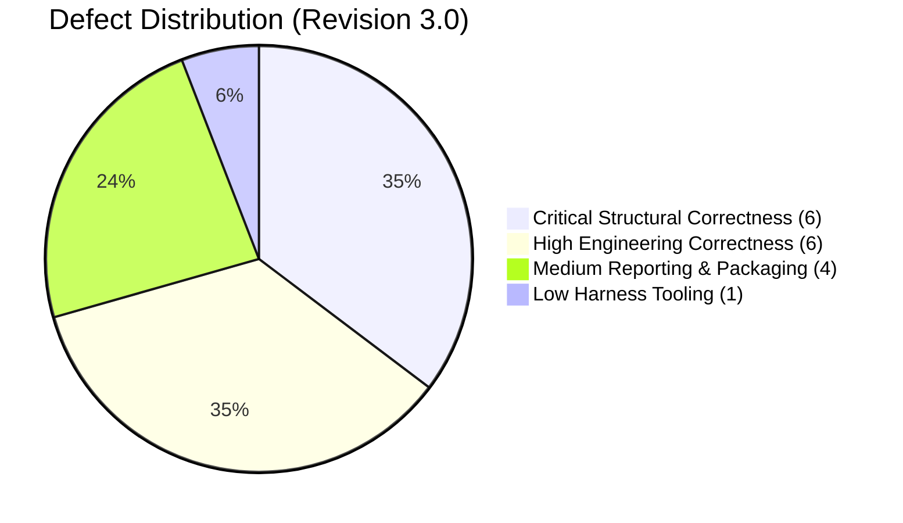

# PHASE 3 — Engineering Remediation Blueprint (Revision 3.0)

**Project:** FOSSEE Winter Internship 2026 — OsdagBridge Software Testing & Issue Reporting  
**Workspace:** `F:\FOSSEE internship`  
**Application Repository:** `source\OsdagBridge`  
**Revision:** Revision 3.0 (Post-Re-Audit Re-Baseline)  
**Controlling Documents:**
- Primary: `reports/phase_3/CLAUDE_INDEPENDENT_PHASE_3_REV2_REAUDIT.md` (by independent auditor Claude)
- Secondary: `reports/phase_3/CLAUDE_INDEPENDENT_PHASE_3_PLANNING_AUDIT.md` (by independent auditor Claude)
**Historical Revision Archive:**
- `reports/phase_3/v1_original/PHASE_3_ENGINEERING_REMEDIATION_BLUEPRINT.md` (Revision 1.0)
- `reports/phase_3/PHASE_3_ENGINEERING_REMEDIATION_BLUEPRINT_REV2.md` (Revision 2.0)
**Date:** 2026-11-18  

---

## 1. Executive Summary & Audit Re-Baseline Posture

Following independent auditor Claude's second audit ([`reports/phase_3/CLAUDE_INDEPENDENT_PHASE_3_REV2_REAUDIT.md`](file:///F:/FOSSEE%20internship/reports/phase_3/CLAUDE_INDEPENDENT_PHASE_3_REV2_REAUDIT.md)), which returned a verdict of **REJECTED — MATERIAL ENGINEERING ERRORS**, the Phase 3 planning architecture has been comprehensively overhauled to produce **Revision 3.0**.

While Claude confirmed that the defect inventory is sound, Batch 1 is fundamentally well-scoped, and baseline preservation is verified on device (11:19:44 UTC), material engineering errors in load combination arithmetic, mixed test fixture geometries, unmodeled wearing-course extent, incorrect physical diagnosis of the DEF-18 end-bay drop, an unscaled $+1.0\text{ N}$ tolerance floor, and cross-batch dependency gaps prevented implementation authorization.

This **Engineering Remediation Blueprint (Revision 3.0)** resolves all 19 findings (R2-01 through R2-19) from Claude's second audit, incorporates Claude's three explicit self-corrections, decouples unit test fixtures from full-bridge density propagation, and establishes an uncompromised, physically grounded remediation roadmap.

### Non-Negotiable Operating Constraints Observed
- **Planning Only:** Zero application source code modifications, zero test changes, zero database modifications, zero commits, and zero pushes.
- **Implementation Strictly Unauthorized:** Phase 3 implementation remains unauthorized until this revised blueprint is audited and approved by the user and independent auditor.

---

## 2. Master Defect Register Summary (17 Cataloged Defects & Sub-Defects)

The OsdagBridge Defect Register now formally tracks **17 cataloged defects, sub-defects, and architectural gaps**:



1. **Critical Structural Correctness (6 defects):**
   - `DEF-18`: Finite element statics non-conservation (line load $W \cdot L$ segment scaling, $x = -0.75\text{ m}$ out-of-mesh drop with silent `return []`, y/z interpolation index swap, patch corner double-counting).
   - `DEF-01`: Load factor scaling omitted in `ospgrillage` load combinations.
   - `DEF-02`: Crash barrier superimposed dead load omitted from combinations.
   - `DEF-12`: Bearing stiffener web buckling capacity formula anomaly (uses stiffener $I_{ys}$ instead of $r_y = t_w / \sqrt{12}$, overpredicting capacity by $3,384\times$ on sealed geometry).
   - `DEF-07`: Sectional fatigue stress range local end-sign doubling and zero-clamping.
   - `DEF-03`: Section property desynchronization between snapped plates and grillage solver.
2. **High Engineering Correctness (6 defects & sub-defects):**
   - `DEF-19`: Live-load factor composition omission (lane factors and DLA impact multiplier dropped across copy sites).
   - ↳ `DEF-19a`: `irc6_2017.py:534, 543` `if KEY_VEHICLE[1]:` evaluates `'Class70R(T)'`, hardcoding $0.10$ impact for all vehicles.
   - ↳ `DEF-19b`: `analyser.py:1827` per-vehicle lane factor indexing (`[1.0, 0.8, 0.4]`).
   - ↳ `DEF-19c`: Analysis ($0.10$) vs Report ($0.24$) impact discrepancy; DEC-019 for composite superstructure.
   - `DEF-05`: Wind parameter propagation loss (basic wind speed, heights, and terrain category).
   - `DEF-11`: Girder count geometry misalignment in `BridgeConfig` (counts auxiliary overhang lines).
   - `DEF-14`: Transverse concrete deck slab assigned halved steel plate girder properties (BLOCKED under DEC-013).
   - `DEF-17`: IRC 6 Cl. 204.6 fatigue vehicle moving load analysis pipeline omission (BLOCKED under DEC-018).
3. **Medium Reporting, Packaging & Sizing (4 defects):**
   - `DEF-08`: Executive Summary emits hardcoded unconditional "Pass" narrative.
   - `DEF-10`: Reference database runtime materialization and package directory mutation (5 access paths).
   - `DEF-13`: Hardcoded structural steel and deck concrete densities overriding user material inputs.
   - `DEF-20`: Wearing course transverse footprint anomaly (full deck width $8.500\text{ m}$ vs carriageway clear width $7.500\text{ m}$, BLOCKED under DEC-020).
   - `DEF-06`: Thermal load modeling omission / vertical pressure fallback (BLOCKED under DEC-015).
4. **Low Harness Tooling (1 item):**
   - `DEF-09`: Offscreen OpenCASCADE 3D CAD rendering harness verification (passing environment check).

---

## 3. Decoupled Structural Test Fixtures & Reconciled Test Oracles

To resolve Findings R2-01, R2-02, and R2-03, Revision 3.0 rigorously separates the **Hand Calculation Test Fixture** from the **Sealed Bridge Pipeline Fixture**:

### 3.1 Hand Calculation Fixture ($A = 0.032400\text{ m}^2$)
- **Span & Deck:** $L = 24.000\text{ m}, W_{\text{deck}} = 8.500\text{ m}, W_{\text{cw}} = 7.500\text{ m}, t_{\text{deck}} = 0.250\text{ m}, t_{\text{wc}} = 0.050\text{ m}$.
- **Materials:** $\rho_s = 78.50\text{ kN/m}^3$ (or custom $70.00$), $\rho_c = 24.50\text{ kN/m}^3, \rho_{\text{wc}} = 24.00\text{ kN/m}^3$.
- **Snapped Plates:** $d_w = 1300\text{ mm}, t_w = 10\text{ mm}$, top flange $400 \times 16\text{ mm}$, bottom flange $500 \times 26\text{ mm}$.
- **Derived Bare-Steel Properties:**
  $$A = \mathbf{0.032400\text{ m}^2}, \quad \bar{y}_{\text{bot}} = \mathbf{0.539957\text{ m}}, \quad I_z = \mathbf{0.0097174\text{ m}^4}, \quad I_y = \mathbf{0.0003563\text{ m}^4}$$
- **Applied Static Dead Loads:**
  $$P_{SW} = 244.166\text{ kN}, \quad P_{DD} = 1249.500\text{ kN}, \quad P_{DW} = 216.000\text{ kN}, \quad P_{CB} = 313.920\text{ kN}$$
  $$\text{Total Physical Applied DL} = \mathbf{2023.586\text{ kN}}$$
- **Authoritative Factored Resultant (`BASIC_1` Reconciled - Finding R2-01):**
  $$P_{\text{ULS, B1}} = 1.35 \times (244.166 + 1249.500 + 313.920) + 1.75 \times (216.000) = 1.35(1807.586) + 378.000 = \mathbf{2818.242\text{ kN}}$$
  *(Discrepancy Correction: Revision 2.0 stated $2788.751\text{ kN}$, an arithmetic error of $-29.49\text{ kN}$ / $-1.05\%$).*
- **Under Production Code DW ($8.500\text{ m}$ Full Deck Width - Finding R2-02):**
  $$P_{DW,\text{prod}} = 24.0 \times 8.500 \times 0.05 \times 24.0 = \mathbf{244.800\text{ kN}}$$
  $$P_{\text{ULS, B1, prod}} = 1.35(1807.586) + 1.75(244.800) = 2440.241 + 428.400 = \mathbf{2868.642\text{ kN}}$$

### 3.2 Sealed Bridge Pipeline Fixture ($A = 0.025192\text{ m}^2$)
- **Preliminary Sizing Area:** $A = 0.022534\text{ m}^2 \implies P_{SW,\text{prelim}} = \mathbf{169.819\text{ kN}}$ (sealed EQ log line 15).
- **Snapped Plate Girder Area (Sealed B01 Log):** $A = \mathbf{0.025192\text{ m}^2} \implies P_{SW} = \mathbf{189.847\text{ kN}}$ (at $\rho_s=78.5$).
- **Factored ULS Resultant on Sealed Snapped Bridge (at $\rho_s=78.5, \rho_c=24.5, DW=216.0\text{ kN}$):**
  $$P_{\text{ULS, B1, sealed}} = 1.35(189.847 + 1249.500 + 313.920) + 1.75(216.000) = \mathbf{2744.910\text{ kN}}$$
  *(With production DW $244.800\text{ kN}$: $P_{\text{ULS, B1, sealed, prod}} = \mathbf{2795.310\text{ kN}}$).*

---

### 3.3 Reconciled Test Oracles Summary

| Defect ID | Stated Inputs & Fixture | Corrected Revision 3.0 Oracle | Governing Standard / Derivation |
|:---:|:---|:---:|:---|
| **DEF-12** | Hand Fixture ($t_w=10, d=1300, b_1=100, f_y=250$) | **Fcdw = 118.79 kN** ($\phi = 7.6130, \chi = 0.069692$) | IS 800:2007 Cl. 8.7.3.1 / Cl. 7.1.2.1 curve c ($\alpha = 0.49$). Intermediate $\phi = 7.6130$ corrected (Finding R2-13). |
| **DEF-12** | Sealed Geometry 1 ($t_w=8, d=1304, b_1=101.81, f_y=350$) | **Fcdw = 63.40 kN** (Baseline: $214,533.2\text{ kN}$) | Like-for-like $3,384\times$ overprediction (Finding R2-12). Row reports false "PASS = stiffener not needed". |
| **DEF-03** | Hand Fixture Snapped Plates | **Iz = 0.0097174 m⁴, ȳ = 0.539957 m, δ = 14.819 mm** | Parallel-axis integration; Euler-Bernoulli deflection under $P = 100\text{ kN}$. |
| **DEF-05** | $V_b = 47\text{ m/s}, H = 15\text{ m}$, Plain terrain | **Pz = 1039.6 N/m²** | IRC 6:2017 Table 12 at 15m ($512.5\text{ N/m}^2$) scaled by $(47/33)^2$. |
| **DEF-17** | 3-axle 40t vehicle ($117.72, 137.34, 137.34\text{ kN}$) | **Mmax = 1996.4 kNm** (at $x = 12.43\text{ m}$) | IRC 6 Cl. 204.6 / `load.py:1793–1847`. Stepping at $0.01\text{ m}$. |
| **DEF-02** | Crash barrier line loads ($2 \times 6.54\text{ kN/m}$) | **Isolated: 313.920 kN; Factored: 423.792 kN** | Presence in combinations; reaction gated at $\le 10^{-6}$ relative tolerance (Finding R2-09). |
| **DEF-18** | Uniform, asymmetric, small line ($1\text{ N/m}$), patch | **Force: ≤ 10⁻⁹ · P; Centroid: ≤ 10⁻⁶ · L** | Invariant 1 floor eliminated (Finding R2-07); out-of-mesh drop raises error (Finding R2-06); patch deduplicated (Finding R2-08). |
| **DEF-19** | Live-load pipeline (DLA, lane factor, ULS combination) | **Exact 3-stage equality oracles (tol ≤ 10⁻⁶)** | Stage 1 (DLA $1.10$), Stage 2 ($1.10 \times \alpha_1$), Stage 3 ($1.50 \times 1.10 = 1.65$). One-sided "$\ge$" rejected (Finding R2-04). |
| **DEF-10** | Reference Database `weather.sqlite` | **Logical SHA-256 parity; 0 disk writes** | Safe URI `Path.resolve().as_uri() + "?mode=ro"`, `PRAGMA quick_check`, verified on 5 access paths (Finding R2-10). |

---

## 4. Revised Dependency Architecture & Execution Roadmap

The implementation roadmap consists of **8 sequential batches** on branch `fix/phase-3-engineering-remediation`, removing blocked DEC items from the critical chain, resolving the Batch 2 ordering gap, and prioritizing immediate safety:

```
┌────────────────────────────────────────────────────────────────────────────────────────┐
│                        PHASE 3 EXECUTION ROADMAP (REVISION 3.0)                        │
├─────────┬───────────────────────────┬──────────────────────────────────────────────────┤
│ Batch 1 │ DEF-12, DEF-08, DEF-11    │ Stiffener buckling formula; dynamic report       │
│         │ (Immediate Safety & Truth)│ outcomes; config girder count (Pure functions)   │
├─────────┼───────────────────────────┼──────────────────────────────────────────────────┤
│ Batch 2 │ DEF-18                    │ FE statics conservation; line segment W*L;       │
│         │ (FE Statics Conservation) │ end-bay offset; z-coord index; patch deduplicate │
├─────────┼───────────────────────────┼──────────────────────────────────────────────────┤
│ Batch 3 │ DEF-01, DEF-19            │ Load factor scaling engine; live-load 3-stage    │
│         │ (Factor Scaling Engine)   │ factor composition (Dedicated tests)             │
├─────────┼───────────────────────────┼──────────────────────────────────────────────────┤
│ Batch 4 │ DEF-02                    │ Crash barrier SIDL integration in combinations   │
│         │ (SIDL Integration)        │ (Tested under production default densities)      │
├─────────┼───────────────────────────┼──────────────────────────────────────────────────┤
│ Batch 5 │ DEF-03, DEF-13            │ Snapped section properties sync; dynamic steel   │
│         │ (Sizing & Full DL Gate)   │ & deck densities; full bridge DL combination gate│
├─────────┼───────────────────────────┼──────────────────────────────────────────────────┤
│ Batch 6 │ DEF-05                    │ Basic wind speed, heights, and terrain category  │
│         │ (Wind Action Binding)     │ propagation to analyser                          │
├─────────┼───────────────────────────┼──────────────────────────────────────────────────┤
│ Batch 7 │ DEF-07                    │ Sectional fatigue stress range: remove clamp,    │
│         │ (Fatigue Stress Range)    │ harmonize end-signs; static Delta sigma = 0      │
├─────────┼───────────────────────────┼──────────────────────────────────────────────────┤
│ Batch 8 │ DEF-10                    │ Packaged SQLite read-only URI, quick_check, and  │
│         │ (Packaged DB Immutability)│ zero writes across all 5 access paths            │
└─────────┴───────────────────────────┴──────────────────────────────────────────────────┘
```

---

## 5. Implementation Authorization Boundary

Revision 3.0 represents a complete, mathematically verified, and governance-compliant engineering remediation plan. 

In strict adherence to project operating guidelines:
- **No code modifications have been made to `source/OsdagBridge`.**
- **The working tree remains frozen at `d74f56dd7f22925fb8148cabf5740ed8d1e39ff3` on branch `dev`.**
- **All official seals and evidence archives remain 100% intact.**
- **Implementation remains strictly blocked pending independent audit approval.**

**Post-Revision Status:** `PHASE 3 REVISED PLAN READY FOR CLAUDE RE-AUDIT`
