# PHASE 3 — Implementation Batch Plan and Rollback Strategy

**Project:** FOSSEE Winter Internship 2026 — OsdagBridge Software Testing & Issue Reporting  
**Workspace:** `F:\FOSSEE internship`  
**Application Repository:** `source\OsdagBridge`  
**Baseline Commit:** `d74f56dd7f22925fb8148cabf5740ed8d1e39ff3` (Branch `dev`, 100% clean)  
**Controlling Documents:** `PHASE_3_DEFECT_TRACEABILITY_MATRIX.md`, `PHASE_3_DEPENDENCY_AND_PRIORITY_ANALYSIS.md`  
**Date:** 2026-11-18  

---

## 1. Batch Implementation Governance & Protocol

Phase 3 application remediation will execute under a strict **Zero-Regression / Single-Defect Branching Protocol**:
1. All changes will be developed on an isolated Git branch: `fix/phase-3-engineering-remediation`.
2. Each batch corresponds to a small, coherent unit of work consisting of 1 to 2 tightly coupled defects.
3. Every commit must be atomic, reviewable, accompanied by its regression test, and pass the full 15-test baseline suite before proceeding.
4. If any regression occurs, the batch must be rolled back immediately via `git revert` or clean branch reset.

---

## 2. Master Implementation Batches Overview

| Batch ID | Target Defects | Focus Area | Complexity | Affected Files | Target Test Cases |
|:---:|:---|:---|:---:|:---|:---|
| **Batch 1** | `DEF-10` | Packaging, Filesystem Anchoring & User AppData | Low | `database.py` `ui_fields_project_location.py` | `TC-REG-FS-CLEAN-WORKING-TREE` `test_evidence_governance.py` |
| **Batch 2** | `DEF-13`, `DEF-03` | Snapped Section Properties & Material Density | Medium | `plategirderbridge.py` `initial_sizing.py` `analyser.py` | `TC-REG-MAT-DENSITY-CONSISTENCY` `TC-REG-B01-SECTION-PROPERTY-SYNC` |
| **Batch 3** | `DEF-11`, `DEF-14` | Grillage Topology & Transverse Deck Slab Model | Medium | `designer.py` `plategirderbridge.py` | `TC-REG-GEO-GIRDER-COUNT-ALIGNMENT` `TC-REG-GEO-SLAB-SECTION-PROPERTIES` |
| **Batch 4** | `DEF-18` | Bilinear FE Load Allocation & Static Equilibrium | High | `src/ospgrillage/osp_grillage.py` | `TC-REG-EQ-LOAD-CONSERVATION` |
| **Batch 5** | `DEF-01`, `DEF-02` | Load Factor Scaling & Crash Barrier SIDL in ULS | High | `src/ospgrillage/load.py` `analyser.py` `plategirderbridge.py` | `TC-REG-A01-FACTOR-SCALING` `TC-REG-A02-ULS-COMBINATION-SUM` |
| **Batch 6** | `DEF-05`, `DEF-06` | Environmental Load Propagation (Wind & Thermal) | Medium | `plategirderbridge.py` `analyser.py` | `TC-REG-D01-WIND-SPEED-PROPAGATION` `TC-REG-D02-TEMPERATURE-PROPAGATION` |
| **Batch 7** | `DEF-12`, `DEF-07` | Bearing Stiffener Buckling & Fatigue Stress Range | High | `designer.py` | `TC-REG-CAP-STIFFENER-BUCKLING` `TC-REG-C01-SECTIONAL-STRESS-RANGE` |
| **Batch 8** | `DEF-17` | IRC 6 Fatigue Vehicle Moving Load Pipeline | High | `analyser.py` `designer.py` | `TC-REG-C02-FATIGUE-VEHICLE-ANALYSIS` |
| **Batch 9** | `DEF-08` | Dynamic Executive Summary & Report Outcomes | Low | `executive_summary.py` | `TC-REG-RPT-EXEC-SUMMARY-STATUS` |

---

## 3. Detailed Batch Specifications

```mermaid
gantt
    title Phase 3 Implementation Batches Schedule
    dateFormat  X
    axisFormat %s
    section Core Infrastructure
    Batch 1 (DEF-10): 0, 1
    section Cross-Section & Topology
    Batch 2 (DEF-13, DEF-03): 1, 3
    Batch 3 (DEF-11, DEF-14): 3, 5
    section Load Application & Statics
    Batch 4 (DEF-18): 5, 8
    Batch 5 (DEF-01, DEF-02): 8, 11
    Batch 6 (DEF-05, DEF-06): 11, 13
    section Design Capacity & Analysis
    Batch 7 (DEF-12, DEF-07): 13, 16
    Batch 8 (DEF-17): 16, 19
    section Deliverables & Reports
    Batch 9 (DEF-08): 19, 21
```

---

### Batch 1: Packaging, Filesystem Anchoring & User AppData (`DEF-10`)
- **Scope:**  
  Anchor `weather.sqlite` and user database caches to OS-standard User AppData (`platformdirs.user_data_dir("OsdagBridge")`), completely eliminating CWD and source package mutations.
- **Exclusions:**  
  No changes to schema queries or project location UI dialogs.
- **Dependencies:** None (foundational).
- **Files Modified:**
  - `source/OsdagBridge/src/osdagbridge/core/data/project_location/database.py`
  - `source/OsdagBridge/src/osdagbridge/core/bridge_types/plate_girder/ui_fields_project_location.py`
- **Verification Tests:**
  - `TC-REG-FS-CLEAN-WORKING-TREE` (must change from `BASELINE_FAIL` to `PASS`).
  - `test_evidence_governance.py` (all 27 tests must continue to pass).
- **Rollback Strategy:**  
  `git checkout HEAD -- database.py ui_fields_project_location.py`.
- **Risks:** Read-only environments during seed database initial copy.

---

### Batch 2: Snapped Section Properties & Material Density (`DEF-13`, `DEF-03`)
- **Scope:**  
  1. Pass user material density (`material.girder.density`) into `analyser.py:STEEL_UNIT_WEIGHT_kN_m3` and self-weight line loads (`DEF-13`).
  2. Implement `derive_snapped_section_properties()` to dynamically recompute $A, \bar{y}, I_z, I_y, J$ from snapped plate dimensions and overwrite preliminary keys before grillage staging (`DEF-03`).
- **Exclusions:**  
  No changes to plate optimization search algorithms.
- **Dependencies:** Batch 1.
- **Files Modified:**
  - `source/OsdagBridge/src/osdagbridge/core/bridge_types/plate_girder/plategirderbridge.py`
  - `source/OsdagBridge/src/osdagbridge/core/bridge_types/plate_girder/initial_sizing.py`
  - `source/OsdagBridge/src/osdagbridge/core/bridge_types/plate_girder/analyser.py`
- **Verification Tests:**
  - `TC-REG-MAT-DENSITY-CONSISTENCY` (PASS: self-weight resultant matches user density).
  - `TC-REG-B01-SECTION-PROPERTY-SYNC` (PASS: $I_z$ and deflection match hand reference within $0.5\%$).
- **Rollback Strategy:**  
  `git checkout HEAD -- plategirderbridge.py initial_sizing.py analyser.py`.
- **Risks:** Dimension snapping must preserve unit conversions ($\text{mm} \leftrightarrow \text{m}$).

---

### Batch 3: Grillage Topology & Transverse Deck Slab Model (`DEF-11`, `DEF-14`)
- **Scope:**  
  1. Correct `bcfg.geometry.n_girders = bridge._girder_count()` in `designer.py:401`, excluding auxiliary overhang edge lines (`DEF-11`).
  2. Ratify DEC-013: Model transverse grillage members using transformed uncracked concrete slab strip properties ($b_{\text{eff}} = s_{\text{trans}}$, $I_{\text{trans}} = b \cdot d_s^3 / (12 \cdot m)$) instead of halved steel girder properties (`DEF-14`).
- **Exclusions:**  
  No changes to longitudinal girder spacing or mesh skew generation.
- **Dependencies:** Batch 2.
- **Files Modified:**
  - `source/OsdagBridge/src/osdagbridge/core/bridge_types/plate_girder/designer.py`
  - `source/OsdagBridge/src/osdagbridge/core/bridge_types/plate_girder/plategirderbridge.py`
- **Verification Tests:**
  - `TC-REG-GEO-GIRDER-COUNT-ALIGNMENT` (PASS: `n_girders == 4`).
  - `TC-REG-GEO-SLAB-SECTION-PROPERTIES` (PASS: concrete slab properties verified).
- **Rollback Strategy:**  
  `git checkout HEAD -- designer.py plategirderbridge.py`.
- **Risks:** Alteration of transverse load distribution ratios.

---

### Batch 4: Bilinear FE Load Allocation & Static Equilibrium (`DEF-18`)
- **Scope:**  
  Remediate vendored `ospgrillage` finite element load distribution:
  1. In `_assign_line_to_four_node()`, multiply equivalent point load by segment length: `mag = W * L`.
  2. Fix boundary grid coordinate clamping to eliminate segment drops ($x \in [0, L]$).
  3. In `_assign_patch_load()`, replace overlapping area integration with exact cell-polygon integration conserving true deck area $A = L \times W$.
- **Exclusions:**  
  No changes to OpenSees node generation or boundary restraint definitions.
- **Dependencies:** Batch 3.
- **Files Modified:**
  - `source/OsdagBridge/src/ospgrillage/osp_grillage.py`
- **Verification Tests:**
  - `TC-REG-EQ-LOAD-CONSERVATION` (PASS: $100\%$ force conservation within $0.05\%$; centroid shift $< 0.05\text{ m}$).
- **Rollback Strategy:**  
  `git checkout HEAD -- src/ospgrillage/osp_grillage.py`.
- **Risks:** Verification across arbitrary skew angles ($0^\circ\text{–}45^\circ$) required.

---

### Batch 5: Load Factor Scaling & Crash Barrier SIDL in ULS (`DEF-01`, `DEF-02`)
- **Scope:**  
  1. In `ospgrillage/load.py` and `osp_grillage.py`, extract `load_factor` from `load_groups` and scale OpenSees nodal loads accordingly (`DEF-01`).
  2. In `plategirderbridge.py`, call `model.create_sidl_combination()` before `create_dead_load_combination()`, ensuring crash barrier SIDL enters `dead_load_combination` and all ULS combinations (`DEF-02`).
- **Exclusions:**  
  No changes to live load vehicle generation (handled in Batch 8).
- **Dependencies:** Batch 4.
- **Files Modified:**
  - `source/OsdagBridge/src/ospgrillage/load.py`
  - `source/OsdagBridge/src/ospgrillage/osp_grillage.py`
  - `source/OsdagBridge/src/osdagbridge/core/bridge_types/plate_girder/analyser.py`
  - `source/OsdagBridge/src/osdagbridge/core/bridge_types/plate_girder/plategirderbridge.py`
- **Verification Tests:**
  - `TC-REG-A01-FACTOR-SCALING` (PASS: force ratio $1.35000$).
  - `TC-REG-A02-ULS-COMBINATION-SUM` (PASS: all 4 component reactions verified within $1.0\%$; total ULS resultant verified).
- **Rollback Strategy:**  
  `git checkout HEAD -- src/ospgrillage/ analyser.py plategirderbridge.py`.
- **Risks:** Ensure no double-factoring at pattern level.

---

### Batch 6: Environmental Load Propagation (Wind & Thermal) (`DEF-05`, `DEF-06`)
- **Scope:**  
  1. Update `plategirderbridge.py:add_wind_loads()` to resolve namespaced keys (`KEY_WL_*`, `KEY_CB_*`, `KEY_RL_*`), passing user wind parameters to `create_wind_load()` (`DEF-05`).
  2. Ratify DEC-015: Implement IRC 6 Cl. 215.2 uniform temperature axial strain and bearing restraining forces, replacing downward vertical pressure fallback (`DEF-06`).
- **Exclusions:**  
  No changes to wind drag coefficient tables (IRC 6 Table 12).
- **Dependencies:** Batch 5.
- **Files Modified:**
  - `source/OsdagBridge/src/osdagbridge/core/bridge_types/plate_girder/plategirderbridge.py`
  - `source/OsdagBridge/src/osdagbridge/core/bridge_types/plate_girder/analyser.py`
- **Verification Tests:**
  - `TC-REG-D01-WIND-SPEED-PROPAGATION` (PASS: spied arguments and wind pressure match user inputs).
  - `TC-REG-D02-TEMPERATURE-PROPAGATION` (PASS: Cl. 215 thermal analysis verified).
- **Rollback Strategy:**  
  `git checkout HEAD -- plategirderbridge.py analyser.py`.
- **Risks:** Bearing stiffness parameters ($k_{\text{fixed}}, k_{\text{free}}$) must have code-compliant defaults.

---

### Batch 7: Bearing Stiffener Buckling & Fatigue Stress Range (`DEF-12`, `DEF-07`)
- **Scope:**  
  1. In `designer.py:compute_bearing_stiffener()`, compute unstiffened web buckling slenderness using $r_y = t_w / \sqrt{12}$ and column curve c per IS 800:2007 Cl. 8.7.3.1 / Cl. 7.1.2.1 (`DEF-12`).
  2. In `designer.py:2970–2985`, evaluate cyclic fatigue stress range cross-section by cross-section without flipping local end signs ($\Delta M_z(e, k) = \max M_z - \min M_z$) (`DEF-07`).
- **Exclusions:**  
  No changes to intermediate transverse stiffener pitch formulas.
- **Dependencies:** Batch 5.
- **Files Modified:**
  - `source/OsdagBridge/src/osdagbridge/core/bridge_types/plate_girder/designer.py`
- **Verification Tests:**
  - `TC-REG-CAP-STIFFENER-BUCKLING` (PASS: capacity reports $63.4\text{ kN} \pm 0.1\text{ kN}$).
  - `TC-REG-C01-SECTIONAL-STRESS-RANGE` (PASS: static load evaluates to $0.00\text{ MPa}$; cyclic history matches $169.36\text{ MPa}$).
- **Rollback Strategy:**  
  `git checkout HEAD -- designer.py`.
- **Risks:** Unstiffened web checks will now correctly fail under heavy reactions, mandating stiffeners.

---

### Batch 8: IRC 6 Fatigue Vehicle Moving Load Pipeline (`DEF-17`)
- **Scope:**  
  Ratify DEC-018: Implement dedicated moving load analysis pass for the 40-tonne 4-axle Fatigue Vehicle (IRC 6 Cl. 204.6). Extract peak sagging moment envelope and feed `designer.py:stress_range_MPa`.
- **Exclusions:**  
  No changes to standard Class A or Class 70R live load vehicle paths.
- **Dependencies:** Batch 7.
- **Files Modified:**
  - `source/OsdagBridge/src/osdagbridge/core/bridge_types/plate_girder/analyser.py`
  - `source/OsdagBridge/src/osdagbridge/core/bridge_types/plate_girder/designer.py`
- **Verification Tests:**
  - `TC-REG-C02-FATIGUE-VEHICLE-ANALYSIS` (PASS: moving vehicle pass produces non-zero envelope and authentic fatigue checks).
- **Rollback Strategy:**  
  `git checkout HEAD -- analyser.py designer.py`.
- **Risks:** Analysis duration increases by ~15s; memory cache must be bounded.

---

### Batch 9: Dynamic Executive Summary & Report Outcomes (`DEF-08`)
- **Scope:**  
  In `executive_summary.py:233–236`, replace hardcoded "Pass" strings with dynamic template logic iterating over `output_dict` component statuses and DCR thresholds ($> 1.0$).
- **Exclusions:**  
  No changes to LaTeX page layout or figure generation.
- **Dependencies:** Batch 7, Batch 8.
- **Files Modified:**
  - `source/OsdagBridge/src/osdagbridge/core/reports/executive_summary.py`
- **Verification Tests:**
  - `TC-REG-RPT-EXEC-SUMMARY-STATUS` (PASS: all 74 failure and edge scenarios verified).
- **Rollback Strategy:**  
  `git checkout HEAD -- executive_summary.py`.
- **Risks:** Missing optional components must display "Not Designed", not "Fail".
