# PHASE 3 — Implementation Batch Plan and Rollback Strategy (Revision 2.0)

**Project:** FOSSEE Winter Internship 2026 — OsdagBridge Software Testing & Issue Reporting  
**Workspace:** `F:\FOSSEE internship`  
**Application Repository:** `source\OsdagBridge`  
**Revision:** Revision 2.0 (Post-Audit Re-Baseline)  
**Controlling Audit:** `reports/phase_3/CLAUDE_INDEPENDENT_PHASE_3_PLANNING_AUDIT.md` (by independent auditor Claude)  
**Historical Revision Archive:** `reports/phase_3/v1_original/PHASE_3_IMPLEMENTATION_BATCH_PLAN.md`  
**Date:** 2026-11-18  

---

## 1. Batch Governance, Commit Discipline & Rollback Architecture

Following independent auditor Claude's audit (§6.4, §9), the implementation plan has been completely overhauled to eliminate invalid rollback commands (e.g. `git checkout HEAD --` is a no-op post-commit), enforce a strict single-defect-per-commit discipline, isolate vendored library modifications, and establish explicit expected-state manifests for every intermediate build.

### Core Non-Negotiable Implementation Rules:
1. **Dedicated Remediation Branch:** All work executes on branch `fix/phase-3-engineering-remediation`, branched from frozen baseline commit `d74f56dd7f22925fb8148cabf5740ed8d1e39ff3`. The `dev` branch remains untouched.
2. **Atomic Single-Defect Commits:** Each defect fix is implemented in an independent, reviewable atomic commit accompanied by its unit verification assertions.
3. **Vendored Library Isolation:** Modifications to vendored `src/ospgrillage/` (`DEF-18`, `DEF-01`) are placed in dedicated commits with full upstream provenance logging.
4. **Governed Rollback Protocol:**
   - *Pre-Commit Rollback (Uncommitted Edits):* `git checkout -- <files>` or `git restore <files>`.
   - *Post-Commit Rollback (Committed Batch Failure):* `git revert --no-edit <commit-hash-range>` on the fix branch, followed by re-execution of the governed test runner to certify return to the prior verified state.
5. **Intermediate Builds Restricted from Production Use:** Intermediate states (e.g. where loads are conserved but combinations remain un-factored) must never be used for engineering design output.

---

## 2. Revised Master Implementation Roadmap

```mermaid
gantt
    title Phase 3 Implementation Batches Schedule (Rev 2)
    dateFormat  X
    axisFormat %s
    section Immediate Safety & Truth
    Batch 1 (DEF-12 Stiffener, DEF-08 Report, DEF-11 Config): 0, 3
    section Statics & Factor Engine
    Batch 2 (DEF-18 FE Conservation & End-Bay): 3, 6
    Batch 3 (DEF-01 Factoring, DEF-19 Lane/DLA): 6, 9
    Batch 4 (DEF-02 Barrier SIDL Integration): 9, 11
    section Cross-Section & Environment
    Batch 5 (DEF-03 Snapped Sizing, DEF-13 Densities): 11, 14
    Batch 6 (DEF-05 Wind Speed, Heights, Terrain): 14, 16
    section Fatigue & Data Packaging
    Batch 7 (DEF-07 Section Sign & Shear Range): 16, 18
    Batch 8 (DEF-10 Read-Only Packaged Database): 18, 20
    section External Track (Requires DEC Sign-Off)
    DEC-013 -> DEF-14 (Transverse Slab): 20, 22
    DEC-015 -> DEF-06 (Thermal Modeling): 22, 24
    DEC-018 -> DEF-17 (Fatigue Vehicle Pipeline): 24, 26
```

---

## 3. Detailed Batch Specifications

---

### Batch 1: Immediate Safety & Reporting Truth (`DEF-12`, `DEF-08`, `DEF-11`)
- **Focus Area:** Standalone capacity formula, dynamic reporting, and configuration geometry.
- **Rationale for First Position:**  
  Pure functions with zero finite element coupling. Immediately corrects the $3,380\times$ web buckling overprediction ($214,533\text{ kN} \rightarrow 118.8\text{ kN}$) and unmasks design check failures in generated reports.
- **Atomic Commits:**
  - *Commit 1.1:* `fix(designer): correct bearing stiffener web buckling formula per IS 800 Cl 8.7.3.1 (DEF-12)`
  - *Commit 1.2:* `fix(reports): dynamic executive summary status derivation across all components (DEF-08)`
  - *Commit 1.3:* `fix(designer): align BridgeConfig geometry girder count with physical girders (DEF-11)`
- **Affected Files:**
  - `source/OsdagBridge/src/osdagbridge/core/bridge_types/plate_girder/designer.py`
  - `source/OsdagBridge/src/osdagbridge/core/reports/executive_summary.py`
- **Target Test Cases & Acceptance State:**
  - `TC-REG-CAP-STIFFENER-BUCKLING` flips to **PASS** ($F_{cdw} = 118.8\text{ kN} \pm 0.1\text{ kN}$).
  - `TC-REG-RPT-EXEC-SUMMARY-STATUS` flips to **PASS** (74/74 scenarios verified).
  - `TC-REG-GEO-GIRDER-COUNT-ALIGNMENT` flips to **PASS** (`n_girders == 4`).
  - Remaining 12 regression tests remain in their expected baseline states.
- **Rollback Procedure:** `git revert HEAD~3..HEAD` on `fix/phase-3-engineering-remediation`.

---

### Batch 2: Finite Element Statics Conservation & End-Bay Fix (`DEF-18`)
- **Focus Area:** Vendored `ospgrillage` line and patch load integration.
- **Rationale:** Foundational statics equilibrium ($\Sigma F_y = 0, \Sigma M = 0$). Must precede all combination scaling.
- **Atomic Commits:**
  - *Commit 2.1:* `fix(ospgrillage): line load segment force scaling, end-bay retention and y/z index fix (DEF-18)`
  - *Commit 2.2:* `fix(ospgrillage): patch load numerical cell integration area conservation (DEF-18)`
- **Affected Files:**
  - `source/OsdagBridge/src/ospgrillage/osp_grillage.py`
- **Target Test Cases & Acceptance State:**
  - `TC-REG-EQ-LOAD-CONSERVATION` flips to **PASS**:
    - Barrier force assigned $= 313.920\text{ kN}$ ($0\%$ shortfall).
    - Centroid displacement $|\Delta x| \le 10^{-6} \cdot L$ ($0.024\text{ mm}$).
    - Verified across asymmetric, non-uniform, and skewed test fixtures.
  - Patch area matches exact deck footprint $204.0\text{ m}^2$ (0% inflation).
- **Rollback Procedure:** `git revert HEAD~2..HEAD`.

---

### Batch 3: Load Factor Composition & Live-Load Scaling (`DEF-01`, `DEF-19`)
- **Focus Area:** Compounded load factoring in `ospgrillage` and `analyser.py`.
- **Atomic Commits:**
  - *Commit 3.1:* `fix(ospgrillage): honour load_dict factor in _distribute_load_types_to_model (DEF-01)`
  - *Commit 3.2:* `fix(analyser): preserve lane reduction factors and DLA impact across copy sites (DEF-19)`
- **Affected Files:**
  - `source/OsdagBridge/src/ospgrillage/osp_grillage.py`
  - `source/OsdagBridge/src/osdagbridge/core/bridge_types/plate_girder/analyser.py`
- **Target Test Cases & Acceptance State:**
  - `TC-REG-A01-FACTOR-SCALING` flips to **PASS** (force ratio $\mathcal{R} = 1.350000 \pm 10^{-6}$).
  - Live load governing case and combinations reflect lane reduction factors and DLA impact multiplier ($1.15\times$).
- **Rollback Procedure:** `git revert HEAD~2..HEAD`.

---

### Batch 4: Superimposed Dead Load Integration (`DEF-02`)
- **Focus Area:** Crash barrier, railing, and median absorption into dead load combinations.
- **Atomic Commits:**
  - *Commit 4.1:* `fix(plategirderbridge): invoke create_sidl_combination prior to dead_load_combination (DEF-02)`
- **Affected Files:**
  - `source/OsdagBridge/src/osdagbridge/core/bridge_types/plate_girder/plategirderbridge.py`
- **Target Test Cases & Acceptance State:**
  - Isolated presence check: Barrier objects exist in `dead_load_combination` with un-factored force $313.920\text{ kN}$ (**PASS**).
  - `TC-REG-A02-ULS-COMBINATION-SUM` flips to **PASS** (Combined milestone assertion with Batches 2 & 3: total factored ULS resultant matches $2788.751\text{ kN} \pm 0.05\%$).
- **Rollback Procedure:** `git revert HEAD`.

---

### Batch 5: Snapped Section Properties & Material Density Propagation (`DEF-03`, `DEF-13`)
- **Focus Area:** Dynamic cross-section derivation from snapped plates and density parameter binding.
- **Atomic Commits:**
  - *Commit 5.1:* `fix(plategirderbridge): derive snapped plate properties and sync solver beam elements (DEF-03)`
  - *Commit 5.2:* `fix(analyser): update create_self_weight_load signature and propagate steel/deck densities (DEF-13)`
- **Affected Files:**
  - `source/OsdagBridge/src/osdagbridge/core/bridge_types/plate_girder/plategirderbridge.py`
  - `source/OsdagBridge/src/osdagbridge/core/bridge_types/plate_girder/analyser.py`
- **Target Test Cases & Acceptance State:**
  - `TC-REG-B01-SECTION-PROPERTY-SYNC` flips to **PASS** ($A = 0.032400\text{ m}^2, I_z = 0.0097174\text{ m}^4$, deflection matches $14.819\text{ mm}$ within $0.5\%$).
  - `TC-REG-MAT-DENSITY-CONSISTENCY` flips to **PASS** ($P_{SW} = 217.728\text{ kN}$ at $\rho=70.0$, matching derived area).
- **Rollback Procedure:** `git revert HEAD~2..HEAD`.

---

### Batch 6: Environmental Action Parameter Propagation (`DEF-05`)
- **Focus Area:** Namespaced wind speed, exposed heights, and terrain type lookups.
- **Atomic Commits:**
  - *Commit 6.1:* `fix(plategirderbridge): resolve namespaced wind speed, heights and terrain type keys (DEF-05)`
- **Affected Files:**
  - `source/OsdagBridge/src/osdagbridge/core/bridge_types/plate_girder/plategirderbridge.py`
- **Target Test Cases & Acceptance State:**
  - `TC-REG-D01-WIND-SPEED-PROPAGATION` flips to **PASS** ($P_z = 1039.6\text{ N/m}^2$, arguments spied match user inputs).
- **Rollback Procedure:** `git revert HEAD`.

---

### Batch 7: Sectional Fatigue Stress Range Extraction (`DEF-07`)
- **Focus Area:** Cross-section sign convention harmonization, zero-clamp removal, and shear range.
- **Atomic Commits:**
  - *Commit 7.1:* `fix(designer): section-wise fatigue bending and shear stress range extraction without zero-clamp (DEF-07)`
- **Affected Files:**
  - `source/OsdagBridge/src/osdagbridge/core/bridge_types/plate_girder/designer.py`
- **Target Test Cases & Acceptance State:**
  - `TC-REG-C01-SECTIONAL-STRESS-RANGE` flips to **PASS** (Static evaluates to $0.000\text{ MPa}$; cyclic control matches $169.363\text{ MPa}$; sign-reversal control passes).
- **Rollback Procedure:** `git revert HEAD`.

---

### Batch 8: Reference Database Read-Only Packaging (`DEF-10`)
- **Focus Area:** Deterministic immutable database packaging and read-only connection mode.
- **Atomic Commits:**
  - *Commit 8.1:* `fix(database): open weather reference database read-only with zero runtime writes (DEF-10)`
- **Affected Files:**
  - `source/OsdagBridge/src/osdagbridge/core/data/project_location/database.py`
  - `source/OsdagBridge/src/osdagbridge/core/bridge_types/plate_girder/ui_fields_project_location.py`
- **Target Test Cases & Acceptance State:**
  - `TC-REG-FS-CLEAN-WORKING-TREE` flips to **PASS** (Zero files created in CWD; zero writes in package directory; verified in read-only sandbox).
- **Rollback Procedure:** `git revert HEAD`.

---

### Parallel Track: Architectural Blockers (External to Implementation Chain)
The three architectural blockers require formal written technical ratification by the engineering owner before implementation batches are scheduled:
1. **DEC-013 (`DEF-14`):** Transverse concrete deck slab strip stiffness ($I_{\text{trans}} = b d_s^3 / (12m)$, $J \approx b d_s^3 / 6$, short vs long-term modular ratio).
2. **DEC-015 (`DEF-06`):** IRC 6 Cl. 215 thermal action specification (uniform axial elongation vs non-linear vertical gradient).
3. **DEC-018 (`DEF-17`):** IRC 6 Cl. 204.6 fatigue vehicle moving load pass (3-axle 40t vehicle, $1996.4\text{ kNm}$ moment envelope extraction).

---

## 4. Per-Batch Expected-State Matrix

The following manifest defines the exact expected state of all 15 registered tests across the 8 sequential batches:

| Test Identifier | Defect ID | Baseline | After B1 | After B2 | After B3 | After B4 | After B5 | After B6 | After B7 | After B8 |
|:---|:---|:---:|:---:|:---:|:---:|:---:|:---:|:---:|:---:|:---:|
| `TC-REG-CAP-STIFFENER-BUCKLING` | DEF-12 | FAIL | **PASS** | PASS | PASS | PASS | PASS | PASS | PASS | PASS |
| `TC-REG-RPT-EXEC-SUMMARY-STATUS` | DEF-08 | FAIL | **PASS** | PASS | PASS | PASS | PASS | PASS | PASS | PASS |
| `TC-REG-GEO-GIRDER-COUNT-ALIGNMENT`| DEF-11 | FAIL | **PASS** | PASS | PASS | PASS | PASS | PASS | PASS | PASS |
| `TC-REG-CAD-EXPORT-VS-SCREENSHOT` | DEF-09 | PASS | PASS | PASS | PASS | PASS | PASS | PASS | PASS | PASS |
| `TC-REG-EQ-LOAD-CONSERVATION` | DEF-18 | FAIL | FAIL | **PASS** | PASS | PASS | PASS | PASS | PASS | PASS |
| `TC-REG-A01-FACTOR-SCALING` | DEF-01 / 19 | FAIL | FAIL | FAIL | **PASS** | PASS | PASS | PASS | PASS | PASS |
| `TC-REG-A02-ULS-COMBINATION-SUM` | DEF-02 | FAIL | FAIL | FAIL | FAIL | **PASS** | PASS | PASS | PASS | PASS |
| `TC-REG-B01-SECTION-PROPERTY-SYNC`| DEF-03 | FAIL | FAIL | FAIL | FAIL | FAIL | **PASS** | PASS | PASS | PASS |
| `TC-REG-MAT-DENSITY-CONSISTENCY` | DEF-13 | FAIL | FAIL | FAIL | FAIL | FAIL | **PASS** | PASS | PASS | PASS |
| `TC-REG-D01-WIND-SPEED-PROPAGATION`| DEF-05 | FAIL | FAIL | FAIL | FAIL | FAIL | FAIL | **PASS** | PASS | PASS |
| `TC-REG-C01-SECTIONAL-STRESS-RANGE`| DEF-07 | FAIL | FAIL | FAIL | FAIL | FAIL | FAIL | FAIL | **PASS** | PASS |
| `TC-REG-FS-CLEAN-WORKING-TREE` | DEF-10 | FAIL | FAIL | FAIL | FAIL | FAIL | FAIL | FAIL | FAIL | **PASS** |
| `TC-REG-D02-TEMPERATURE-PROPAGATION`| DEF-06 | BLOCK | BLOCK | BLOCK | BLOCK | BLOCK | BLOCK | BLOCK | BLOCK | BLOCK |
| `TC-REG-C02-FATIGUE-VEHICLE-ANALYSIS`| DEF-17 | BLOCK | BLOCK | BLOCK | BLOCK | BLOCK | BLOCK | BLOCK | BLOCK | BLOCK |
| `TC-REG-GEO-SLAB-SECTION-PROPERTIES`| DEF-14 | BLOCK | BLOCK | BLOCK | BLOCK | BLOCK | BLOCK | BLOCK | BLOCK | BLOCK |

---

## 5. Harness Governance Prerequisite for Phase 3 Evidence

Before running the governed test runner to generate authentic Phase 3 evidence, the following harness governance prerequisite must be executed and audited as a dedicated test-infrastructure task:
1. Update `evidence_guard.ACTIVE_PHASE = "phase_3"` in `testing/test_cases/baseline_regression/evidence_guard.py`.
2. Configure authorized Phase 3 evidence directory paths and signing keys in `~/.osdagbridge_trust/`.
3. Verify that all 184 Phase 2 historical evidence files remain immutable and sealed.
