# PHASE 3 — Implementation Batch Plan and Rollback Strategy (Revision 3.0)

**Project:** FOSSEE Winter Internship 2026 — OsdagBridge Software Testing & Issue Reporting  
**Workspace:** `F:\FOSSEE internship`  
**Application Repository:** `source\OsdagBridge`  
**Revision:** Revision 3.0 (Post-Re-Audit Re-Baseline)  
**Controlling Documents:**
- `reports/phase_3/CLAUDE_INDEPENDENT_PHASE_3_REV2_REAUDIT.md` (by independent auditor Claude)
- `reports/phase_3/CLAUDE_INDEPENDENT_PHASE_3_PLANNING_AUDIT.md` (by independent auditor Claude)
**Historical Revision Archive:**
- `reports/phase_3/v1_original/PHASE_3_IMPLEMENTATION_BATCH_PLAN.md` (Revision 1.0)
- `reports/phase_3/PHASE_3_IMPLEMENTATION_BATCH_PLAN_REV2.md` (Revision 2.0)
**Date:** 2026-11-18  

---

## 1. Batch Governance, Commit Discipline & Rollback Architecture

Following independent auditor Claude's second audit ([`reports/phase_3/CLAUDE_INDEPENDENT_PHASE_3_REV2_REAUDIT.md`](file:///F:/FOSSEE%20internship/reports/phase_3/CLAUDE_INDEPENDENT_PHASE_3_REV2_REAUDIT.md)), the implementation plan has been restructured to resolve the ordering gap in Batch 2 (Finding R2-11), separate DEF-01 and DEF-19 test assertions (Finding R2-18), and expand DEF-10 coverage across all 5 database access paths (Finding R2-10).

### Core Non-Negotiable Implementation Rules:
1. **Dedicated Remediation Branch:** All work executes on branch `fix/phase-3-engineering-remediation`, branched from frozen baseline commit `d74f56dd7f22925fb8148cabf5740ed8d1e39ff3`. The `dev` branch remains strictly untouched.
2. **Atomic Single-Defect Commits:** Each defect fix is implemented in an independent, reviewable atomic commit accompanied by its unit verification assertions.
3. **Vendored Library Isolation:** Modifications to vendored `src/ospgrillage/` (`DEF-18`, `DEF-01`) are placed in dedicated commits with full upstream provenance logging.
4. **Governed Rollback Protocol:**
   - *Pre-Commit Rollback (Uncommitted Edits):* `git checkout -- <files>` or `git restore <files>`.
   - *Post-Commit Rollback (Committed Batch Failure):* `git revert --no-edit <commit-hash-range>` on the fix branch, followed by re-execution of the governed test runner to certify return to the prior verified state.
5. **Intermediate Builds Restricted from Production Use:** Intermediate states (e.g. where loads are conserved but combinations remain un-factored) must never be used for engineering design output.

---

## 2. Revised Master Implementation Roadmap

```mermaid
gantt
    title Phase 3 Implementation Batches Schedule (Rev 3)
    dateFormat  X
    axisFormat %s
    section Immediate Safety & Truth
    Batch 1 (DEF-12 Stiffener, DEF-08 Report, DEF-11 Config): 0, 3
    section Statics & Factor Engine
    Batch 2 (DEF-18 FE Conservation - Unit Fixtures): 3, 6
    Batch 3 (DEF-01 Factoring, DEF-19 Live-Load Composition): 6, 9
    Batch 4 (DEF-02 Barrier SIDL - Production Defaults): 9, 11
    section Cross-Section & Environment
    Batch 5 (DEF-03 Snapped Sizing, DEF-13 Densities, Full Combination): 11, 14
    Batch 6 (DEF-05 Wind Speed, Heights, Terrain): 14, 16
    section Fatigue & Data Packaging
    Batch 7 (DEF-07 Section Sign & Shear Range): 16, 18
    Batch 8 (DEF-10 Read-Only Packaged Database - 5 Paths): 18, 20
    section External Track (Requires Owner DEC Sign-Off)
    DEC-013 -> DEF-14 (Transverse Slab): 20, 22
    DEC-015 -> DEF-06 (Thermal Modeling): 22, 24
    DEC-018 -> DEF-17 (Fatigue Vehicle Pipeline): 24, 26
    DEC-019 -> DEF-19c (Composite Superstructure Impact): 26, 28
    DEC-020 -> DEF-20 (Wearing Course Transverse Extent): 28, 30
```

---

## 3. Detailed Batch Specifications

---

### Batch 1: Immediate Safety & Reporting Truth (`DEF-12`, `DEF-08`, `DEF-11`)
- **Focus Area:** Standalone capacity formula, dynamic reporting, and configuration geometry.
- **Rationale for First Position (Claude Re-Audit §8, §11):**  
  Pure mathematical functions with zero finite element coupling. Immediately corrects the $3,384\times$ web buckling overprediction ($214,533\text{ kN} \rightarrow 63.40\text{ kN}$ on sealed geometry, $118.79\text{ kN}$ on hand fixture) and unmasks design check failures in generated reports.
- **Atomic Commits:**
  - *Commit 1.1:* `fix(designer): correct bearing stiffener web buckling formula per IS 800 Cl 8.7.3.1 (DEF-12)`
  - *Commit 1.2:* `fix(reports): dynamic executive summary status derivation across all components (DEF-08)`
  - *Commit 1.3:* `fix(designer): align BridgeConfig geometry girder count with physical girders (DEF-11)`
- **Affected Files:**
  - `source/OsdagBridge/src/osdagbridge/core/bridge_types/plate_girder/designer.py`
  - `source/OsdagBridge/src/osdagbridge/core/reports/executive_summary.py`
- **Target Test Cases & Acceptance State:**
  - `TC-REG-CAP-STIFFENER-BUCKLING` flips to **PASS**:
    - Hand fixture: $F_{cdw} = 118.79\text{ kN} \pm 0.01\text{ kN}$ ($\phi = 7.6130$).
    - Sealed geometry 1: $F_{cdw} = 63.40\text{ kN} \pm 0.01\text{ kN}$.
    - Web buckling check row reports FAIL / stiffener required for both geometries.
  - `TC-REG-RPT-EXEC-SUMMARY-STATUS` flips to **PASS** (74/74 scenarios verified).
  - `TC-REG-GEO-GIRDER-COUNT-ALIGNMENT` flips to **PASS** (`n_girders == 4`).
- **Rollback Procedure:** `git revert HEAD~3..HEAD` on `fix/phase-3-engineering-remediation`.

---

### Batch 2: Finite Element Statics Conservation & End-Bay Fix (`DEF-18`)
- **Focus Area:** Vendored `ospgrillage` line and patch load integration.
- **Rationale & Decoupling (Finding R2-11 Resolution):**  
  Corrects fundamental statics equilibrium ($\Sigma F_y = 0, \Sigma M = 0$). To prevent the ordering gap identified by Claude, Batch 2 is evaluated **strictly on dedicated unit test fixtures** without asserting full-bridge concrete or steel densities.
- **Atomic Commits:**
  - *Commit 2.1:* `fix(ospgrillage): line load segment W*L scaling, end-bay offset, and z-coord interpolation (DEF-18)`
  - *Commit 2.2:* `fix(ospgrillage): patch load corner deduplication and list mutation fix (DEF-18)`
- **Affected Files:**
  - `source/OsdagBridge/src/ospgrillage/osp_grillage.py`
- **Target Test Cases & Acceptance State:**
  - `TC-REG-EQ-LOAD-CONSERVATION` flips to **PASS**:
    - Uniform line load ($w = 10\text{ kN/m}$ on $24\text{ m}$): assigned force $= 240.000\text{ kN}$, reaction sum $= 240.000\text{ kN}$, force ratio $= 1.000000000$, $|\bar{x}_{\text{err}}| \le 10^{-13}\text{ m}$.
    - Asymmetric partial line load ($x \in [0, 12\text{ m}]$): force $= 120.000\text{ kN}$, $\bar{x} = 6.000\text{ m}$ ($\pm 10^{-13}\text{ m}$).
    - Small line load ($w = 1.0\text{ N/m}$ on $24\text{ m}$): assigned force $= 24.000\text{ N}$, relative error $\le 10^{-9}$.
    - Patch area matches exact deck footprint $204.0\text{ m}^2$ (0% inflation).
- **Rollback Procedure:** `git revert HEAD~2..HEAD`.

---

### Batch 3: Load Factor Scaling Engine & Live-Load Composition (`DEF-01`, `DEF-19`)
- **Focus Area:** Compounded load factoring in `ospgrillage` and `analyser.py`.
- **Test Separation (Finding R2-18 Resolution):**  
  DEF-01 and DEF-19 are evaluated by dedicated, independent regression tests.
- **Atomic Commits:**
  - *Commit 3.1:* `fix(ospgrillage): honour load_dict factor in _distribute_load_types_to_model (DEF-01)`
  - *Commit 3.2:* `fix(analyser): preserve lane reduction factors and DLA impact across copy sites (DEF-19)`
- **Affected Files:**
  - `source/OsdagBridge/src/ospgrillage/osp_grillage.py`
  - `source/OsdagBridge/src/osdagbridge/core/bridge_types/plate_girder/analyser.py`
- **Target Test Cases & Acceptance State:**
  - `TC-REG-A01-FACTOR-SCALING` (DEF-01) flips to **PASS** (force ratio $\mathcal{R} = 1.350000 \pm 10^{-6}$).
  - `TC-REG-A03-LL-FACTOR-COMPOSITION` (DEF-19) flips to **PASS**:
    - Stage 1 (Vehicle Case): DLA applied once ($1.100000 \pm 10^{-6}$).
    - Stage 2 (Governing Selection): DLA $\times$ lane factor ($1.100000 \times 1.0 = 1.100000 \pm 10^{-6}$).
    - Stage 3 (ULS Combination): $\gamma_Q \times \text{DLA} \times \alpha_1 = 1.50 \times 1.10 = \mathbf{1.650000} \pm 10^{-6}$.
- **Rollback Procedure:** `git revert HEAD~2..HEAD`.

---

### Batch 4: Superimposed Dead Load Integration (`DEF-02`)
- **Focus Area:** Crash barrier, railing, and median absorption into dead load combinations.
- **Dependency Isolation (Finding R2-11 Resolution):**  
  Tested under **production default densities** ($\rho_s = 78.5\text{ kN/m}^3, \rho_c = 25.0\text{ kN/m}^3$).
- **Atomic Commits:**
  - *Commit 4.1:* `fix(plategirderbridge): invoke create_sidl_combination prior to dead_load_combination (DEF-02)`
- **Affected Files:**
  - `source/OsdagBridge/src/osdagbridge/core/bridge_types/plate_girder/plategirderbridge.py`
- **Target Test Cases & Acceptance State:**
  - Isolated presence check: Barrier objects exist in `dead_load_combination` with un-factored force $313.920\text{ kN}$ (**PASS**).
  - Combined factored reaction check: Factored barrier reaction contribution matches $423.792\text{ kN} \pm 10^{-6}$ (**PASS**).
- **Rollback Procedure:** `git revert HEAD~1..HEAD`.

---

### Batch 5: Cross-Section Sizing & Material Density Synchronization (`DEF-03`, `DEF-13`)
- **Focus Area:** Synchronizing solver beam element properties from snapped plates, propagating dynamic material densities, and gating the full bridge unified dead-load combination.
- **Atomic Commits:**
  - *Commit 5.1:* `fix(plategirderbridge): synchronize solver girder properties from final snapped plates (DEF-03)`
  - *Commit 5.2:* `fix(analyser): propagate user steel and deck concrete densities to load methods (DEF-13)`
- **Affected Files:**
  - `source/OsdagBridge/src/osdagbridge/core/bridge_types/plate_girder/plategirderbridge.py`
  - `source/OsdagBridge/src/osdagbridge/core/bridge_types/plate_girder/analyser.py`
- **Target Test Cases & Acceptance State:**
  - `TC-REG-B01-SECTION-PROPERTY-SYNC` (DEF-03) flips to **PASS** ($A = 0.032400\text{ m}^2, I_z = 0.0097174\text{ m}^4$, $\delta = 14.819\text{ mm} \pm 0.5\%$).
  - `TC-REG-MAT-DENSITY-CONSISTENCY` (DEF-13) flips to **PASS** ($P_{SW} = 217.728\text{ kN}$ at $\rho_s = 70.0\text{ kN/m}^3$).
  - `TC-REG-A02-ULS-COMBINATION-SUM` flips to **PASS**:
    - Hand fixture: $P_{\text{ULS, B1}} = \mathbf{2818.242\text{ kN}} \pm 10^{-6}$ (or $2868.642\text{ kN}$ at production DW).
    - Sealed bridge pipeline fixture: $P_{\text{ULS, B1, sealed}} = \mathbf{2744.910\text{ kN}} \pm 10^{-6}$.
- **Rollback Procedure:** `git revert HEAD~2..HEAD`.

---

### Batch 6: Environmental Action Binding (`DEF-05`)
- **Focus Area:** Basic wind speed, reference heights, and terrain category propagation.
- **Atomic Commits:**
  - *Commit 6.1:* `fix(analyser): propagate basic wind speed, reference height, and terrain type (DEF-05)`
- **Affected Files:**
  - `source/OsdagBridge/src/osdagbridge/core/bridge_types/plate_girder/analyser.py`
  - `source/OsdagBridge/src/osdagbridge/core/bridge_types/plate_girder/plategirderbridge.py`
- **Target Test Cases & Acceptance State:**
  - `TC-REG-D01-WIND-SPEED-PROPAGATION` flips to **PASS** ($P_z = 1039.6\text{ N/m}^2 \pm 0.1\%$).
- **Rollback Procedure:** `git revert HEAD~1..HEAD`.

---

### Batch 7: Sectional Stress Range Extraction (`DEF-07`)
- **Focus Area:** Fatigue stress range extraction in `designer.py`.
- **Atomic Commits:**
  - *Commit 7.1:* `fix(designer): remove zero-clamping and harmonize element end-signs for fatigue range (DEF-07)`
- **Affected Files:**
  - `source/OsdagBridge/src/osdagbridge/core/bridge_types/plate_girder/designer.py`
- **Target Test Cases & Acceptance State:**
  - `TC-REG-C01-SECTIONAL-STRESS-RANGE` flips to **PASS**:
    - Static invariant: $\Delta \sigma \equiv 0.000\text{ MPa}$ ($|\Delta \sigma| \le 10^{-9}\text{ MPa}$).
    - Cyclic positive control: $\Delta \sigma = 169.363\text{ MPa} \pm 0.01\text{ MPa}$.
- **Rollback Procedure:** `git revert HEAD~1..HEAD`.

---

### Batch 8: Reference Data Read-Only Packaging (`DEF-10`)
- **Focus Area:** Packaged SQLite database access paths across UI, reports, and calculations (Finding R2-10).
- **Atomic Commits:**
  - *Commit 8.1:* `fix(data): enforce read-only SQLite URI, quick_check, and remove connect writes across all 5 paths (DEF-10)`
- **Affected Files:**
  - `source/OsdagBridge/src/osdagbridge/core/data/project_location/database.py`
  - `source/OsdagBridge/src/osdagbridge/core/bridge_types/plate_girder/ui_fields_project_location.py`
  - `source/OsdagBridge/src/osdagbridge/core/reports/report_generator.py`
  - `source/OsdagBridge/src/osdagbridge/desktop/ui/dialogs/project_location.py`
  - `source/OsdagBridge/src/osdagbridge/core/data/project_location/zone_lookup.py`
- **Target Test Cases & Acceptance State:**
  - `TC-REG-FS-CLEAN-WORKING-TREE` flips to **PASS**:
    - Zero files created, zero sidecars (`-journal`, `-wal`), zero package tree mutations.
    - Verified across all 5 access paths.
    - Database logical content matches sorted `iterdump()` SHA-256 digest.
- **Rollback Procedure:** `git revert HEAD~1..HEAD`.

---

## 4. Master Intermediate Expected-State Manifest

| Test Case Identifier | Baseline | Post-Batch 1 | Post-Batch 2 | Post-Batch 3 | Post-Batch 4 | Post-Batch 5 | Post-Batch 6 | Post-Batch 7 | Post-Batch 8 (Final) |
|:---|:---:|:---:|:---:|:---:|:---:|:---:|:---:|:---:|:---:|
| `TC-REG-CAP-STIFFENER-BUCKLING` (DEF-12) | FAIL | **PASS** | PASS | PASS | PASS | PASS | PASS | PASS | **PASS** |
| `TC-REG-RPT-EXEC-SUMMARY-STATUS` (DEF-08) | FAIL | **PASS** | PASS | PASS | PASS | PASS | PASS | PASS | **PASS** |
| `TC-REG-GEO-GIRDER-COUNT-ALIGNMENT` (DEF-11) | FAIL | **PASS** | PASS | PASS | PASS | PASS | PASS | PASS | **PASS** |
| `TC-REG-EQ-LOAD-CONSERVATION` (DEF-18) | FAIL | FAIL | **PASS** | PASS | PASS | PASS | PASS | PASS | **PASS** |
| `TC-REG-A01-FACTOR-SCALING` (DEF-01) | FAIL | FAIL | FAIL | **PASS** | PASS | PASS | PASS | PASS | **PASS** |
| `TC-REG-A03-LL-FACTOR-COMPOSITION` (DEF-19) | FAIL | FAIL | FAIL | **PASS** | PASS | PASS | PASS | PASS | **PASS** |
| `TC-REG-A02-ULS-COMBINATION-SUM` (DEF-02, DEF-13) | FAIL | FAIL | FAIL | FAIL | PARTIAL | **PASS** | PASS | PASS | **PASS** |
| `TC-REG-B01-SECTION-PROPERTY-SYNC` (DEF-03) | FAIL | FAIL | FAIL | FAIL | FAIL | **PASS** | PASS | PASS | **PASS** |
| `TC-REG-MAT-DENSITY-CONSISTENCY` (DEF-13) | FAIL | FAIL | FAIL | FAIL | FAIL | **PASS** | PASS | PASS | **PASS** |
| `TC-REG-D01-WIND-SPEED-PROPAGATION` (DEF-05) | FAIL | FAIL | FAIL | FAIL | FAIL | FAIL | **PASS** | PASS | **PASS** |
| `TC-REG-C01-SECTIONAL-STRESS-RANGE` (DEF-07) | FAIL | FAIL | FAIL | FAIL | FAIL | FAIL | FAIL | **PASS** | **PASS** |
| `TC-REG-FS-CLEAN-WORKING-TREE` (DEF-10) | FAIL | FAIL | FAIL | FAIL | FAIL | FAIL | FAIL | FAIL | **PASS** |
| `TC-REG-ENV-OPENCASCADE-VIEWPORT` (DEF-09) | PASS | PASS | PASS | PASS | PASS | PASS | PASS | PASS | **PASS** |
| `TC-REG-TH-TEMPERATURE-MODELING` (DEF-06) | BLOCKED | BLOCKED | BLOCKED | BLOCKED | BLOCKED | BLOCKED | BLOCKED | BLOCKED | **BLOCKED** |
| `TC-REG-TR-TRANSVERSE-SLAB-STIFFNESS` (DEF-14) | BLOCKED | BLOCKED | BLOCKED | BLOCKED | BLOCKED | BLOCKED | BLOCKED | BLOCKED | **BLOCKED** |
| `TC-REG-C02-FATIGUE-VEHICLE-ANALYSIS` (DEF-17) | BLOCKED | BLOCKED | BLOCKED | BLOCKED | BLOCKED | BLOCKED | BLOCKED | BLOCKED | **BLOCKED** |

---

## 5. Parallel External Decision Track (Owner DEC Ratification)

The following architectural and provision decisions remain outside the critical implementation sequence and must be ratified in writing by the engineering owner before execution:
1. **DEC-013 (`DEF-14`):** Transverse slab stiffness modeling (effective slab width, transformed section modular ratio, torsion constant $J$).
2. **DEC-015 (`DEF-06`):** Thermal action formulation for simply supported steel-composite superstructures.
3. **DEC-018 (`DEF-17`):** Implementation of dedicated IRC 6 Cl. 204.6 fatigue vehicle moving load pass.
4. **DEC-019 (`DEF-19c`):** Engineering confirmation of applicable IRC 6 Cl. 208 dynamic load allowance formula for composite superstructures.
5. **DEC-020 (`DEF-20`):** Engineering confirmation of wearing course transverse footprint ($7.500\text{ m}$ carriageway clear width vs $8.500\text{ m}$ total bridge width).
