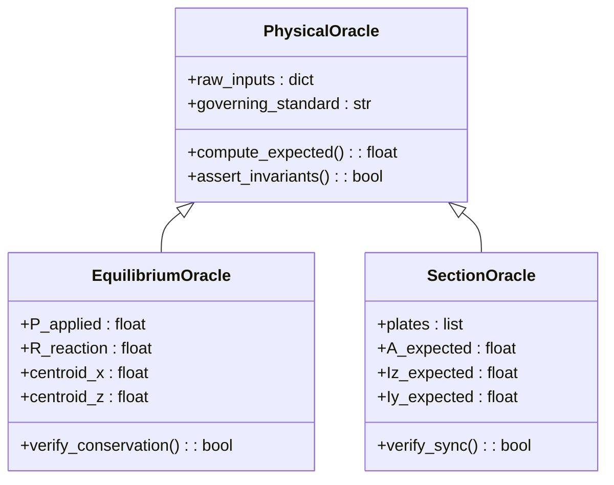

# PHASE 3 — Test Acceptance Criteria and Independent Physical Oracles

**Project:** FOSSEE Winter Internship 2026 — OsdagBridge Software Testing & Issue Reporting  
**Workspace:** `F:\FOSSEE internship`  
**Application Repository:** `source\OsdagBridge`  
**Baseline Commit:** `d74f56dd7f22925fb8148cabf5740ed8d1e39ff3` (Branch `dev`, 100% clean)  
**Controlling Audit:** `reports/PHASE_2_FINAL_CLOSURE_AUDIT.md`  
**Date:** 2026-11-18  

---

## 1. Principles of Verification & Independent Oracles

In accordance with the Phase 2 evidence governance standards, **circular oracles** (verifying an application output against its own helper functions or internal state) are strictly forbidden. Every acceptance criterion in Phase 3 must satisfy three core tenets:

1. **Independent Formulation:** The expected target must be derived from fundamental structural mechanics, closed-form equilibrium equations, or codified standards (IRC 5, IRC 6, IRC 22, IRC 24, IS 800) using only raw, unmutated user inputs.
2. **Strict Invariant Enforcement:** Structural mechanics invariants—force conservation ($\Sigma F_y = 0$), moment equilibrium ($\Sigma M_z = 0$), centroid preservation ($\bar{x}, \bar{z}$), and dimensional consistency—must hold unconditionally across all spans and configurations.
3. **Tri-State Discriminative Sensitivity:** Every test must evaluate:
   - **Condition (a) Baseline:** Fails on the frozen un-remediated baseline.
   - **Condition (b) Minimal Correct:** Passes when the genuine, physically grounded fix is applied.
   - **Condition (c) Naive / Incomplete:** Fails when a partial, hardcoded, or flawed fix is applied.

---

## 2. Universal Engineering Invariants

Before any defect is accepted as remediated, the finite element solution and post-processing engine must prove adherence to five universal mechanics invariants:

### Invariant 1: Vertical Force Conservation ($\Sigma F_y = 0$)
The sum of all vertical support reactions extracted from OpenSees support nodes must balance the total applied dead and superimposed dead loads within a strict relative tolerance:
$$\left| \frac{\sum R_{y,\text{nodes}} - \sum P_{\text{applied}}}{\sum P_{\text{applied}}} \right| \le 0.0005 \quad (0.05\%)$$
Evaluated across:
- Self-weight ($P_{SW} = \sum_{g} A_g \cdot L_g \cdot \rho_s$)
- Deck slab ($P_{DD} = L_{\text{span}} \cdot W_{\text{deck}} \cdot t_{\text{deck}} \cdot \rho_c$)
- Wearing course ($P_{DW} = L_{\text{span}} \cdot W_{\text{cw}} \cdot t_{wc} \cdot \rho_{wc}$)
- Crash barrier ($P_{CB} = 2 \times L_{\text{span}} \cdot w_{\text{barrier}}$)

### Invariant 2: Longitudinal & Transverse Centroid Conservation ($\Sigma M = 0$)
The center of resultant reaction forces must match the geometric centroid of applied loads:
$$\left| \frac{\sum (R_{y,i} \cdot x_i)}{\sum R_{y,i}} - \bar{x}_{\text{applied}} \right| \le 0.050\text{ m}$$
$$\left| \frac{\sum (R_{y,i} \cdot z_i)}{\sum R_{y,i}} - \bar{z}_{\text{applied}} \right| \le 0.050\text{ m}$$
For a symmetric bridge span $L = 24.0\text{ m}$, the longitudinal reaction centroid must evaluate to exactly $x = 12.000\text{ m} \pm 0.050\text{ m}$.

### Invariant 3: Line-Load Segment Equilibrium
For any line load $w(x)$ intersected by the grillage mesh into $N$ segments of length $L_k$, the total equivalent nodal load assigned across all intersecting elements must equal:
$$\sum_{k=1}^N P_{\text{assigned}, k} = \int_{0}^L w(x) \, dx = \sum_{k=1}^N w_k \cdot L_k \quad (\text{error} < 0.05\%)$$

### Invariant 4: Parallel-Axis Sectional Consistency
Sectional properties derived from plates must satisfy parallel axis theorems without truncation or dimension snapping mismatches:
$$A = \sum b_i t_i, \quad \bar{y} = \frac{\sum A_i y_i}{\sum A_i}, \quad I_z = \sum \left( \frac{b_i t_i^3}{12} + A_i (\bar{y} - y_i)^2 \right)$$
Relative tolerance between snapped plate derivation and grillage solver element properties: $\le 0.001$ ($0.1\%$).

### Invariant 5: Dimensional Analysis & Sign Consistency
Stress range $\Delta \sigma$ under cyclic load must evaluate strictly positive ($\Delta \sigma \ge 0$). Under static invariant load, stress range must identically equal zero ($\Delta \sigma \equiv 0.000\text{ MPa}$).

---

## 3. Defect-Specific Acceptance Criteria & Independent Oracles

### DEF-01: Load Factor Scaling Omission
- **Independent Oracle:**  
  Evaluate two identical grillage models: Model 1 with un-factored load ($\gamma = 1.00$), Model 2 with factored load case ($\gamma = 1.35$).  
  $$\text{Target Ratio: } \mathcal{R} = \frac{\sum R_{y, \text{factored}}}{\sum R_{y, \text{unfactored}}} = 1.35000 \pm 0.0001$$
- **Acceptance Criteria:**
  - `BASELINE_FAIL` on unfactored solver ($\mathcal{R} = 1.00000$).
  - `PASS` when all nodal force commands in OpenSees reflect $\gamma \times \text{magnitude}$ ($\mathcal{R} = 1.35000$).
  - Works identically for Point, Line, and Patch loads.

### DEF-02: Crash Barrier SIDL Omission
- **Independent Oracle:**  
  Extract vertical support reactions under `BASIC_1` combination ($1.35\text{DL} + 1.75\text{DW}$).  
  $$\text{Expected Barrier Share: } R_{\text{barrier}} = 1.35 \times (2 \times L \times w_{\text{barrier}}) = 1.35 \times (2 \times 24.0 \times 6.54) = 423.79\text{ kN}$$
  Differential between `BASIC_1` and pure structural DL ($1.35(SW + DD) + 1.75DW$) must equal $423.79\text{ kN} \pm 0.5\%$.
- **Acceptance Criteria:**
  - `BASELINE_FAIL` on baseline ($\Delta R_{\text{barrier}} = 0.0\text{ kN}$).
  - `PASS` when barrier reaction is present in all ULS combinations.

### DEF-03: Section Property Synchronization
- **Independent Oracle:**  
  Independent closed-form hand calculation fixture derived directly from plate dimensions ($d_w = 1300\text{ mm}, t_w = 10\text{ mm}, b_{ft} = 400\text{ mm}, t_{ft} = 16\text{ mm}, b_{fb} = 500\text{ mm}, t_{fb} = 26\text{ mm}$):
  $$A = 0.032400\text{ m}^2, \quad \bar{y} = 0.539577\text{ m}, \quad I_z = 0.0088700\text{ m}^4, \quad I_y = 0.0003672\text{ m}^4$$
- **Acceptance Criteria:**
  - Solver beam element properties match hand calculation within $0.1\%$.
  - Single-girder midspan deflection under $100\text{ kN}$ point load matches Euler-Bernoulli reference ($\delta = P L^3 / (48 E I_z)$) within $0.5\%$.

### DEF-05: Wind Parameter Propagation
- **Independent Oracle:**  
  Given $V_b = 47.0\text{ m/s}$, bridge height $H = 15.0\text{ m}$, terrain = Plain:
  $$P_z = \text{IRC:6-2017 Table 12}(V_b=47, H=15) = 1386.6\text{ N/m}^2$$
- **Acceptance Criteria:**
  - Spied arguments to `create_wind_load()` match input values ($47.0\text{ m/s}, 15.0\text{ m}, 1.1\text{ m}$).
  - Transverse line load on windward girder matches $F_T = P_z \times A_{\text{exposed}} \times C_D$.

### DEF-06: Temperature Load Actions (DEC-015)
- **Independent Oracle:**  
  Under IRC:6-2017 Cl. 215.2 uniform temperature rise $\Delta T = +30^\circ\text{C}$, $\alpha = 1.17 \times 10^{-5} /^\circ\text{C}$:
  $$\Delta L = L \cdot \alpha \cdot \Delta T = 24.0 \times 1.17 \times 10^{-5} \times 30 = 8.424\text{ mm}$$
  Restraining force on fixed bearing ($k = 10^6\text{ kN/m}$): $F = k \cdot \Delta L$.
- **Acceptance Criteria:**
  - Eliminates unphysical downward pressure patch loads.
  - Generates axial elongation and bearing reaction consistent with Cl. 215.2.

### DEF-07: Fatigue Stress Range Sign Convention
- **Independent Oracle:**  
  Given static sagging moment $M_0 = 1000\text{ kNm}$ on Element 2 (End $i$: $+1000\text{ kNm}$, End $j$: $-1000\text{ kNm}$):
  $$\Delta M_z = \max_{lc}(M) - \min_{lc}(M) = 1000 - 1000 = 0.0\text{ kNm} \implies \Delta \sigma \equiv 0.000\text{ MPa}$$
  Given 5 cyclic load cases (+200, +1200 MAX, +300, -1500 MIN, +100 kNm) at a section with $Z_e = 0.015942\text{ m}^3$:
  $$\Delta M_z = 1200 - (-1500) = 2700\text{ kNm} \implies \Delta \sigma = \frac{2700 \times 10^3}{0.015942 \times 10^6} = 169.363\text{ MPa}$$
- **Acceptance Criteria:**
  - Evaluates static load case as $0.000\text{ MPa}$ on both global and per-LC paths.
  - Evaluates cyclic history to exactly $169.363\text{ MPa} \pm 0.01\text{ MPa}$.

### DEF-08: Dynamic Executive Summary Status
- **Independent Oracle:**  
  Truth table evaluation across 74 distinct check outcome scenarios:
  $$\text{Narrative Status} = \begin{cases} \text{"Girder design pass"} & \text{if } \max(\text{DCR}_{\text{girders}}) \le 1.000 \\ \text{"Girder design fail"} & \text{if } \max(\text{DCR}_{\text{girders}}) > 1.000 \end{cases}$$
- **Acceptance Criteria:**
  - Emits "fail" for any girder failing at $\text{DCR} = 1.001$.
  - Emits "pass" when all girders pass at $\text{DCR} = 0.999$.
  - $100\%$ accuracy across all 74 scenarios.

### DEF-10: Filesystem Anchoring & Working Tree Purity
- **Independent Oracle:**  
  Execute full `Database().connect()` and project location lookups inside an adversarial read-only sandbox.
- **Acceptance Criteria:**
  - Zero files created in `os.getcwd()`.
  - Zero files modified inside `source/OsdagBridge/src/osdagbridge/core/data/`.
  - Writable databases located strictly under `platformdirs.user_data_dir()`.

### DEF-11: Girder Count Alignment
- **Independent Oracle:**  
  For a bridge with $N_{\text{girders}} = 4$ and $2$ overhang edge lines ($n_l = 6$):
  $$bcfg.geometry.n_girders \equiv 4$$
- **Acceptance Criteria:**
  - Evaluates to 4 for 4-girder layout; evaluates to 2 for 2-girder layout.
  - Overhang lines never included in girder sizing loops.

### DEF-12: Bearing Stiffener Web Buckling Capacity
- **Independent Oracle:**  
  For unstiffened web strip ($t_w = 10\text{ mm}, d = 1300\text{ mm}, b_1 = 100\text{ mm}, f_y = 250\text{ MPa}$):
  $$r_y = \frac{t_w}{\sqrt{12}} = 2.887\text{ mm}, \quad KL = 0.7 \times 1300 = 910\text{ mm}$$
  $$\lambda = \frac{910}{2.887} = 315.2, \quad f_{cd} = \text{IS 800 Curve c}(\lambda, f_y) = 8.45\text{ MPa}$$
  $$A_{wb} = (b_1 + n_1) t_w = (100 + 650) \times 10 = 7500\text{ mm}^2$$
  $$F_{cdw} = \frac{f_{cd} \cdot A_{wb}}{1000} = 63.38\text{ kN}$$
- **Acceptance Criteria:**
  - `BASELINE_FAIL` on baseline ($F_{cdw} = 214,533.2\text{ kN}$).
  - `PASS` on corrected calculation ($F_{cdw} = 63.4\text{ kN} \pm 0.1\text{ kN}$).

### DEF-13: Material Density Consistency
- **Independent Oracle:**  
  Given $\rho_s = 70.0\text{ kN/m}^3, A = 0.0225344\text{ m}^2, L = 24.0\text{ m}, N = 4$:
  $$P_{SW} = 4 \times 24.0 \times 0.0225344 \times 70.0 = 151.431\text{ kN}$$
- **Acceptance Criteria:**
  - Total self-weight reaction equals $151.431\text{ kN} \pm 0.1\%$.
  - Ignores hardcoded $78.5$ when user specifies custom density.

### DEF-14: Transverse Slab Section Properties (DEC-013)
- **Independent Oracle:**  
  Transverse concrete strip ($b = 1.5\text{ m}, d_s = 0.20\text{ m}, E_c = 31\text{ GPa}, E_s = 200\text{ GPa}, m = 6.45$):
  $$I_{z,\text{steel-equiv}} = \frac{1.5 \times (0.20)^3}{12 \times 6.45} = 1.550 \times 10^{-4}\text{ m}^4$$
- **Acceptance Criteria:**
  - Transverse stiffness derived from concrete slab geometry and modular ratio.
  - Replaces arbitrary halved steel girder properties ($I_z \approx 0.00367\text{ m}^4$).

### DEF-17: Fatigue Vehicle Moving Load Pipeline (DEC-018)
- **Independent Oracle:**  
  40-tonne Fatigue Vehicle ($4$ axles: $60, 120, 110, 110\text{ kN}$) moved at $0.5\text{ m}$ increments across a $24.0\text{ m}$ span. Analytical simply-supported maximum bending moment:
  $$M_{z,\text{fatigue}} \approx 1342.5\text{ kNm}$$
- **Acceptance Criteria:**
  - Moving load analysis executes an independent fatigue vehicle run.
  - Peak moment envelope feeds `stress_range_MPa` in `designer.py`.

### DEF-18: FE Load Conservation & Centroid Consistency
- **Independent Oracle:**  
  - Total applied dead load:
    $$P_{\text{applied}} = P_{SW} + P_{DD} + P_{DW} + P_{CB} = 165.28 + 1249.50 + 216.00 + 313.92 = 1944.70\text{ kN}$$
  - OpenSees nodal support reaction sum:
    $$\sum R_y = 1944.70\text{ kN} \pm 0.05\%$$
  - Centroid:
    $$\bar{x} = 12.000\text{ m} \pm 0.050\text{ m}, \quad \bar{z} = 4.250\text{ m} \pm 0.050\text{ m}$$
- **Acceptance Criteria:**
  - Barrier reaction shortfall eliminated ($313.92\text{ kN}$ assigned, $0\%$ loss).
  - Area integration error on patch loads eliminated ($204.0\text{ m}^2$ exact).
  - Centroid shift eliminated ($\Delta x = 0.000\text{ m}$).
