# PHASE 3 — Test Acceptance Criteria and Independent Physical Oracles (Revision 3.0)

**Project:** FOSSEE Winter Internship 2026 — OsdagBridge Software Testing & Issue Reporting  
**Workspace:** `F:\FOSSEE internship`  
**Application Repository:** `source\OsdagBridge`  
**Revision:** Revision 3.0 (Post-Re-Audit Re-Baseline)  
**Controlling Documents:**
- `reports/phase_3/CLAUDE_INDEPENDENT_PHASE_3_REV2_REAUDIT.md` (by independent auditor Claude)
- `reports/phase_3/CLAUDE_INDEPENDENT_PHASE_3_PLANNING_AUDIT.md` (by independent auditor Claude)
**Historical Revision Archive:**
- `reports/phase_3/v1_original/PHASE_3_TEST_ACCEPTANCE_CRITERIA.md` (Revision 1.0)
- `reports/phase_3/PHASE_3_TEST_ACCEPTANCE_CRITERIA_REV2.md` (Revision 2.0)
**Date:** 2026-11-18  

---

## 1. Principles of Independent Verification & Strict Tolerances

In accordance with Claude's second audit ([`reports/phase_3/CLAUDE_INDEPENDENT_PHASE_3_REV2_REAUDIT.md`](file:///F:/FOSSEE%20internship/reports/phase_3/CLAUDE_INDEPENDENT_PHASE_3_REV2_REAUDIT.md)), all test acceptance criteria in Revision 3.0 have been purged of unscaled tolerance floors, one-sided inequality bounds, mixed test geometries, and arithmetic errors.

Every acceptance criterion in Revision 3.0 satisfies seven strict engineering rules:
1. **Explicit Inputs & Units:** All physical dimensions, material properties, and boundary conditions are stated unambiguously.
2. **Governing Equation:** Rooted in fundamental statics, elasticity, or Indian Road Congress standards.
3. **Independent Derivation:** Calculated in closed form from raw inputs, completely decoupled from application helper routines.
4. **Exact Numerical Value:** Derived with double-precision floating-point arithmetic.
5. **Scale-Appropriate Justified Tolerance:** Tied to machine double-precision limits ($\le 10^{-9}$ relative for assignment and reactions; $\le 10^{-6}$ for grillage discretizations), with **zero constant floors** that could mask dropped loads.
6. **Sealed Baseline Evidence Citation:** Grounded in authoritative Phase 2.12–2.13 baseline logs (SE).
7. **Mandatory Discriminative Negative Control (Naive Fix):** Each defect specifies a concrete flawed or partial fix that must fail the acceptance gate.

---

## 2. Universal Structural Mechanics Invariants

```mermaid
classDiagram
    class Invariant1_ForceConservation {
        +Assignment tolerance: 1e-9 * max(Sigma P, Sigma |Pi|)
        +FE reaction tolerance: 1e-6 * Sigma P (Relative)
        +Zero constant floor (Catches small 1 N/m loads)
        +Evaluated per load object & load type
    }
    class Invariant2_CentroidEquilibrium {
        +Tolerance: 1e-6 * L for line and point loads
        +Documented h-dependent bound for non-uniform patch
        +Mandatory asymmetric fixtures (No symmetric cancellation)
    }
    class Invariant3_SegmentEquilibrium {
        +Preserves integral w dx
        +Preserves integral w*x dx
        +Evaluated across 13/17/25 line meshes & skew angles
    }
    class Invariant4_SectionalDerivation {
        +Tolerance: 0.1% on A, Iz, Iy, J
        +Scope: Bare steel elasticBeamColumn
        +Euler-Bernoulli deflection verification: 14.819 mm
    }
    class Invariant5_FatigueSignConsistency {
        +Static load: Delta sigma == 0.000 MPa
        +Mandatory cyclic positive control: 169.363 MPa
        +Mandatory sign-reversal control
    }
```

### Invariant 1: Vertical Force Conservation ($\Sigma F_y = 0$)
- **Formulation (Finding R2-07 Resolution):**  
  Load assignment via finite element shape functions represents a partition of unity. Force conservation is mathematically exact:
  - *Load Assignment Level (OpenSees Pattern Commands):*
    $$\left| \sum F_{\text{assigned}} - P_{\text{applied}} \right| \le 10^{-9} \times \max\left(\sum P_{\text{applied}}, \sum |P_i|\right)$$
    Evaluated independently for each individual load object and each load type (Point, Line, Patch). The arbitrary constant $+1.0\text{ N}$ floor from Revision 2.0 is completely eliminated.
  - *FE Global Support Reaction Level:*
    $$\left| \frac{\sum R_{y,\text{nodes}} - \sum P_{\text{applied}}}{\sum P_{\text{applied}}} \right| \le 10^{-6}$$
- **Discriminative Small-Load Fixture (Finding R2-07):**  
  A line load of $w = 1.0\text{ N/m}$ across $L = 24.0\text{ m}$ (total force $24.0\text{ N}$). On the buggy baseline, the first bay is dropped, yielding $23.0\text{ N}$ (shortfall $1.0\text{ N}$ / $4.17\%$). Under the Revision 2.0 gate ($10^{-6} \times 24 + 1.0 = 1.000024\text{ N}$), the bug falsely passed. Under Revision 3.0 ($\text{tol} = 2.4 \times 10^{-8}\text{ N}$), the baseline is correctly rejected.

### Invariant 2: Resultant Moment & Centroid Conservation ($\Sigma M = 0$)
- **Formulation:**  
  Global moment equilibrium about transverse ($z$) and longitudinal ($x$) axes requires:
  $$\left| \bar{x}_{\text{reactions}} - \bar{x}_{\text{applied}} \right| \le 10^{-6} \cdot L_{\text{span}} \quad (0.024\text{ mm for } L=24\text{ m})$$
  $$\left| \bar{z}_{\text{reactions}} - \bar{z}_{\text{applied}} \right| \le 10^{-6} \cdot W_{\text{deck}}$$
- **Mandatory Asymmetric Test Fixtures:**  
  Symmetric test fixtures (such as two identical crash barriers on opposite edges) are strictly forbidden as sole acceptance gates. Acceptance suites must include:
  1. A single partial-length line load ($x \in [0.0, 12.0\text{ m}]$ at $z = 0.25\text{ m}$, total $P = 78.48\text{ kN}$, $\bar{x} = 6.000\text{ m}$).
  2. An asymmetric off-center patch load ($x \in [4.0, 16.0\text{ m}], z \in [1.0, 4.0\text{ m}]$).
- **Patch Load Discretization Tolerance (Finding R2-08):**  
  For uniform patch loads, centroid and force conservation must satisfy $\le 10^{-9}$. For non-uniform patches ($w(x, z) = w_0 + k_x x + k_z z$), where cell-mean assignment introduces a bounded order $|\nabla p| h^2$ discretization error on coarse meshes, the tolerance is defined analytically as $\le \frac{1}{12} |\nabla p| h^2 A_{\text{patch}}$, or exact polygon-clipping integration must be implemented.

### Invariant 3: Segmental Force and First-Moment Conservation
- **Formulation:**  
  For each line-load segment $k$ intersected by the grillage mesh:
  $$P_k = \int_{x_{k,1}}^{x_{k,2}} w(x) \, dx = w_k \cdot L_k \quad (\text{tolerance } \le 10^{-9} \cdot P_k)$$
  $$M_{z,k} = \int_{x_{k,1}}^{x_{k,2}} w(x) \cdot x \, dx \quad (\text{tolerance } \le 10^{-9} \cdot M_{z,k})$$
- Evaluated with non-uniform linear loading $w(x) = w_0 + k x$ across mesh densities ($7\times 13$, $7\times 17$, $7\times 25$) and skew angles ($0^\circ, 15^\circ, 30^\circ$).

### Invariant 4: Parallel-Axis Sectional Consistency
- **Formulation:**  
  Bare-steel section properties derived from plates must satisfy parallel axis theorems without dimension snapping:
  $$A = \sum b_i t_i, \quad \bar{y} = \frac{\sum A_i y_i}{\sum A_i}, \quad I_z = \sum (I_{z,i} + A_i d_i^2), \quad I_y = \sum (I_{y,i} + A_i d_{z,i}^2), \quad J = \sum \frac{b_i t_i^3}{3}$$
- Relative tolerance: $\le 0.001$ ($0.1\%$).
- Euler-Bernoulli bare-beam deflection under midspan point load $P = 100\text{ kN}$ on span $L = 24.0\text{ m}$ ($E = 200\text{ GPa}$):
  $$\delta = \frac{P L^3}{48 E I_z} = \frac{100 \times 10^3 \times 24^3}{48 \times (200 \times 10^9) \times 0.0097174} = \mathbf{14.819\text{ mm}} \quad (\text{tolerance } \le 0.5\%)$$

### Invariant 5: Dimensional Analysis & Sign Consistency
- **Formulation:**  
  Under invariant static load, cyclic fatigue stress range must evaluate strictly to zero:
  $$\Delta \sigma_{\text{static}} \equiv 0.000\text{ MPa} \quad (\text{absolute tolerance } \le 10^{-9}\text{ MPa})$$
  $$\Delta \tau_{\text{static}} \equiv 0.000\text{ MPa}$$
- Mandatory Positive Controls:
  - Cyclic positive history producing governing $\Delta M_z = 2700\text{ kNm} \implies \Delta \sigma = 169.363\text{ MPa}$.
  - Sign-reversal history (+1000 kNm to -1000 kNm) verifying un-clamped stress range $\Delta \sigma = 2000 / Z_e$.

---

## 3. Defect-Specific Acceptance Profiles & Oracles

---

### DEF-01: Load Factor Scaling in `ospgrillage` Combinations
1. **Inputs & Units:** Point load $P = 100.0\text{ kN}$; Line load $w = 10.0\text{ kN/m}$ over $L = 24.0\text{ m}$; Combination load factor $\gamma_G = 1.35$.
2. **Governing Equation:** $\Sigma R_{y,\text{factored}} = \gamma \cdot \Sigma P_{\text{unfactored}}$.
3. **Independent Derivation:**
   - Unfactored point reaction: $R_1 = 100.000\text{ kN}$.
   - Factored point reaction: $R_{1,\text{factored}} = 1.35 \times 100.000 = \mathbf{135.000\text{ kN}}$.
   - Force scaling ratio: $\mathcal{R} = 135.000 / 100.000 = \mathbf{1.350000}$.
4. **Expected Value:** $\mathcal{R} = 1.350000$.
5. **Tolerance:** $\le 10^{-6}$ relative tolerance.
6. **Baseline Evidence Citation:** Sealed log `tc_reg_a01_factor_scaling.log` (baseline force ratio $= 1.00000$).
7. **Negative Test (Finding R2-14 Resolution):** Naive fix hard-coding $1.15\times$ multiplier in `LoadCase.add_load`. Naive fix produces $\mathcal{R} = \mathbf{1.150000} \ne 1.350000$, correctly rejected.

---

### DEF-02: Crash Barrier SIDL in Combinations
1. **Inputs & Units:** Two crash barrier line loads, each $w = 6.540\text{ kN/m}$ across $L = 24.000\text{ m}$ ($z = 0.250\text{ m}$ and $z = 8.250\text{ m}$).
2. **Governing Equation:** $P_{\text{CB}} = 2 \times L \times w$; in `BASIC_1`, factored contribution $= 1.35 \times P_{\text{CB}}$.
3. **Independent Derivation:**
   - Isolated Presence Oracle ($\gamma = 1.0$): Barrier objects must exist in `dead_load_combination` with un-factored force $P_{\text{CB}} = 2 \times 24.0 \times 6.54 = \mathbf{313.920\text{ kN}}$.
   - Combined Factored Oracle (`BASIC_1` after DEF-01 and DEF-18 fixed):
     $$R_{\text{CB, ULS}} = 1.35 \times 313.920 = \mathbf{423.792\text{ kN}}$$
4. **Expected Values:** Isolated: $313.920\text{ kN}$; Combined: $423.792\text{ kN}$.
5. **Tolerance (Finding R2-09 Resolution):** $\le 10^{-6}$ relative tolerance across all combination assertions. The loose $\pm 0.05\%$ tolerance is eliminated.
6. **Baseline Evidence Citation:** Sealed log `tc_reg_a02_uls_combination_sum.log` (observed barrier contribution $-708.74\text{ kN}$).
7. **Negative Test:** Fix `plategirderbridge.py` but retain defective `ospgrillage` line allocation. Baseline FE reaction yields $196.20\text{ kN}$ instead of $313.92\text{ kN}$, correctly rejected.

---

### DEF-03: Section Property Synchronization & Deflection
1. **Inputs & Units (Hand Calculation Fixture):** Bare steel I-girder ($L = 24.000\text{ m}, E = 200\text{ GPa}$). Snapped plates: $d_w = 1300\text{ mm}, t_w = 10\text{ mm}$, top flange $400 \times 16\text{ mm}$, bottom flange $500 \times 26\text{ mm}$.
2. **Governing Equations:** Invariant 4 formulations.
3. **Independent Derivation:**
   - $A = 500(26) + 1300(10) + 400(16) = \mathbf{0.032400\text{ m}^2}$.
   - $\bar{y}_{\text{bot}} = [13000(13) + 13000(676) + 6400(1334)] / 32400 = \mathbf{0.539957\text{ m}}$.
   - $I_z = \mathbf{0.0097174\text{ m}^4}, \quad I_y = \mathbf{0.0003563\text{ m}^4}$.
   - Midspan deflection under $P = 100\text{ kN}$: $\delta = 14.819\text{ mm}$.
4. **Expected Values:** $A = 0.032400\text{ m}^2, \bar{y} = 0.539957\text{ m}, I_z = 0.0097174\text{ m}^4, I_y = 0.0003563\text{ m}^4, \delta = 14.819\text{ mm}$.
5. **Tolerance:** Section properties $\le 0.1\%$; deflection $\le 0.5\%$.
6. **Baseline Evidence Citation:** Sealed log `tc_reg_b01_section_property_sync.log` (observed $I_z = 0.0073409\text{ m}^4$).
7. **Negative Test:** Update `bcfg.girder_props` metadata without updating solver beam elements. Element tags retain preliminary $I_z = 0.0073409\text{ m}^4$, correctly rejected.

---

### DEF-05: Wind Parameter Propagation
1. **Inputs & Units:** $V_b = 47.0\text{ m/s}, H = 15.0\text{ m}$, terrain = Plain (`KEY_WL_TERRAIN_TYPE`), $H_{cb} = 1.1\text{ m}, H_{rl} = 1.2\text{ m}$.
2. **Governing Equation:** IRC:6-2017 Clause 209 Table 12: $P_z(V_b) = P_z(33) \times (V_b / 33)^2$.
3. **Independent Derivation:**
   - Table 12 basic pressure at $H = 15.0\text{ m}$ for $V_b = 33.0\text{ m/s}$: $P_{z,33} = 512.5\text{ N/m}^2$.
   - Scaled for $V_b = 47.0\text{ m/s}$:
     $$P_z = 512.5 \times \left(\frac{47.0}{33.0}\right)^2 = 512.5 \times 2.028466 = \mathbf{1039.589\text{ N/m}^2} \approx \mathbf{1039.6\text{ N/m}^2}$$
4. **Expected Value:** $P_z = 1039.6\text{ N/m}^2$.
5. **Tolerance:** $\le 0.1\%$ relative tolerance.
6. **Baseline Evidence Citation:** Sealed log `tc_reg_d01_wind_speed_propagation.log` (baseline evaluated $P_z = 463.7\text{ N/m}^2$).
7. **Negative Test:** Map wind speed but omit height. Yields $H = 10.0\text{ m} \implies P_z = 463.7 \times (47/33)^2 = 940.6\text{ N/m}^2 \ne 1039.6\text{ N/m}^2$, correctly rejected.

---

### DEF-07: Sectional Fatigue Stress Range Extraction
1. **Inputs & Units:** Simply supported beam; bottom fiber composite section modulus $Z_e = 0.015942\text{ m}^3$.
   - Static test case: $M_0 = 1000.0\text{ kNm}$ on Element 2 (End i: $+1000\text{ kNm}$, End j: $-1000\text{ kNm}$).
   - 5-case cyclic test history with extrema: LC2 $M = +1200\text{ kNm}$, LC4 $M = -1500\text{ kNm}$.
2. **Governing Equation:** $\Delta \sigma(x) = [\max_{lc} M(lc, x) - \min_{lc} M(lc, x)] / Z_e$.
3. **Independent Derivation:**
   - Static Case: $\Delta M = 1000.0 - 1000.0 = 0.0\text{ kNm} \implies \Delta \sigma \equiv \mathbf{0.000\text{ MPa}}$.
   - Cyclic Case: $\Delta M = 1200.0 - (-1500.0) = 2700.0\text{ kNm} \implies \Delta \sigma = 2700.0 \times 10^3 / (0.015942 \times 10^6) = \mathbf{169.363\text{ MPa}}$.
4. **Expected Values:** Static $\Delta \sigma = 0.000\text{ MPa}$; Cyclic $\Delta \sigma = 169.363\text{ MPa}$.
5. **Tolerance:** Static: absolute tolerance $\le 10^{-9}\text{ MPa}$; Cyclic: $\le 0.01\text{ MPa}$.
6. **Baseline Evidence Citation:** Sealed log `tc_reg_c01_sectional_stress_range.log` (static yielded $62.73\text{ MPa}$ and $125.46\text{ MPa}$).
7. **Negative Test:** Fix end-sign doubling but retain zero-clamp. Zero-clamp turns static sagging into $M_0 / Z_e = 62.73\text{ MPa} \ne 0.000\text{ MPa}$, correctly rejected.

---

### DEF-08: Executive Summary Dynamic Status
1. **Inputs & Units:** 74 synthetic design check scenarios spanning girders G1–G4, cross-bracing, end-diaphragms, and deck slab, with DCRs at exact $0.999$, $1.000$, and $1.001$ thresholds.
2. **Governing Logic:** Status is "Pass" if $\max(\text{DCR}) \le 1.000$, "Fail" if $\max(\text{DCR}) > 1.000$, "Not Evaluated" if result dictionary is absent.
3. **Expected Value:** 100% agreement (74/74) with dynamic truth table.
4. **Tolerance:** Exact string match (0 failures).
5. **Baseline Evidence Citation:** Sealed log `tc_reg_rpt_exec_summary_status.log` (failed in 64 of 74 scenarios).
6. **Negative Test:** Evaluate G1 only, ignoring G2–G4. Fails on scenarios where G1 passes but G2 fails, correctly rejected.

---

### DEF-10: Reference Database Read-Only Packaging
1. **Inputs & Units:** `weather.sqlite` seed database; test executed in a read-only sandboxed filesystem (`chmod 0555` / Win32 read-only security attribute).
2. **Governing Rules (Finding R2-10 Resolution):**
   - Connect URI: `Path(DB_PATH).resolve().as_uri() + "?mode=ro"` with `sqlite3.connect(..., uri=True)`.
   - File Presence: `Path.is_file()` pre-check raising `FileNotFoundError` if missing.
   - Integrity: `PRAGMA quick_check` at open.
   - Zero Writes: Connect executes zero schema scripts, zero commits.
   - Coverage: Verified across all 5 access paths (`ui_fields_project_location.py`, `report_generator.py`, `desktop/ui/dialogs/project_location.py`, `zone_lookup.py`, `database.py`).
3. **Expected Values:** Query results match reference stations; acceptance hash defined as logical SHA-256 of sorted `iterdump()`; $\Delta \text{Files} = 0, \Delta \text{Bytes} = 0$.
4. **Tolerance:** 0 byte drift; exact logical content hash match.
5. **Baseline Evidence Citation:** Sealed log `tc_reg_fs_clean_working_tree.log`.
6. **Negative Test:** Copy database to user AppData. Mutates filesystem during read, correctly rejected.

---

### DEF-11: Girder Count Alignment in Config
1. **Inputs & Units:** 4-girder bridge model ($N=4$, $n_l = 6$ grillage lines).
2. **Governing Equation:** `bcfg.geometry.n_girders == bridge._girder_count()`.
3. **Expected Value:** `bcfg.geometry.n_girders == 4`.
4. **Tolerance:** Exact integer equality.
5. **Baseline Evidence Citation:** Sealed log `tc_reg_geo_girder_count_alignment.log` (observed 6).
6. **Negative Test:** Set `n_girders = 0`. Fails assertion, correctly rejected.

---

### DEF-12: Bearing Stiffener Web Buckling Capacity
1. **Inputs & Units:**
   - *Hand Fixture Inputs:* $t_w = 10.0\text{ mm}, d = 1300.0\text{ mm}, b_1 = 100.0\text{ mm}, f_y = 250.0\text{ MPa}, \gamma_{m0} = 1.10, E = 200,000\text{ MPa}, KL = 0.7d = 910.0\text{ mm}$.
   - *Sealed Geometry 1 Inputs:* $t_w = 8.0\text{ mm}, d = 1304.0\text{ mm}, b_1 = 101.81\text{ mm}, f_y = 350.0\text{ MPa}, \gamma_{m0} = 1.10, E = 200,000\text{ MPa}, KL = 0.7d = 912.8\text{ mm}$.
2. **Governing Equations:** IS 800:2007 Cl. 8.7.3.1, Cl. 7.1.2.1 curve c ($\alpha = 0.49$):
   $$r_y = \frac{t_w}{\sqrt{12}}, \quad \lambda = \frac{KL}{r_y}, \quad f_{cc} = \frac{\pi^2 E}{\lambda^2}, \quad \bar{\lambda} = \sqrt{\frac{f_y}{f_{cc}}}, \quad \phi = 0.5[1 + \alpha(\bar{\lambda} - 0.2) + \bar{\lambda}^2]$$
   $$\chi = \frac{1}{\phi + \sqrt{\phi^2 - \bar{\lambda}^2}}, \quad f_{cd} = \frac{\chi f_y}{\gamma_{m0}}, \quad A_{wb} = \left(b_1 + \frac{d}{2}\right) t_w, \quad F_{cdw} = \frac{f_{cd} \cdot A_{wb}}{1000}$$
3. **Independent Derivation:**
   - *Hand Fixture:*
     - $r_y = 10.0 / \sqrt{12} = 2.8868\text{ mm}, \quad \lambda = 910.0 / 2.8868 = 315.23$.
     - $f_{cc} = \pi^2 (200000) / (315.23^2) = 19.864\text{ MPa}$.
     - $\bar{\lambda} = \sqrt{250 / 19.864} = 3.5476$.
     - Intermediate Parameter (Finding R2-13 Resolution):
       $$\phi = 0.5 [1 + 0.49(3.5476 - 0.2) + 3.5476^2] = 0.5 [1 + 1.6403 + 12.5855] = \mathbf{7.6130}$$
       *(Correction Note R2-13: Revision 2.0 printed $\phi = 7.1141$. The correct intermediate is $\phi = 7.6130$).*
     - $\chi = 1 / [7.6130 + \sqrt{7.6130^2 - 3.5476^2}] = \mathbf{0.069692}$.
     - $f_{cd} = 0.069692 \times 250.0 / 1.10 = \mathbf{15.839\text{ MPa}}$.
     - $A_{wb} = (100.0 + 650.0) \times 10.0 = 7500.0\text{ mm}^2$.
     - **Web Buckling Capacity (Hand Fixture):**
       $$F_{cdw} = \frac{15.839\text{ MPa} \times 7500.0\text{ mm}^2}{1000} = \mathbf{118.79\text{ kN}}$$
   - *Sealed Geometry 1 (Finding R2-12 Resolution):*
     - $r_y = 8.0 / \sqrt{12} = 2.3094\text{ mm}, \quad \lambda = 912.8 / 2.3094 = 395.25$.
     - $f_{cc} = \pi^2 (200000) / (395.25^2) = 12.636\text{ MPa}, \quad \bar{\lambda} = \sqrt{350 / 12.636} = 5.2631$.
     - $\phi = 0.5 [1 + 0.49(5.2631 - 0.2) + 5.2631^2] = 15.591, \quad \chi = 0.033040$.
     - $f_{cd} = 0.033040 \times 350.0 / 1.10 = 10.513\text{ MPa}, \quad A_{wb} = (101.81 + 652.0) \times 8.0 = 6030.48\text{ mm}^2$.
     - **Web Buckling Capacity (Sealed Geometry 1):**
       $$F_{cdw} = \frac{10.513\text{ MPa} \times 6030.48\text{ mm}^2}{1000} = \mathbf{63.40\text{ kN}}$$
     - **Like-for-Like Baseline Ratio:** Baseline calculated $214,533.2\text{ kN}$ on sealed geometry 1. Ratio $= 214,533.2 / 63.40 = \mathbf{3,384\times}$ overpredicted.
4. **Expected Values:** Hand fixture: $F_{cdw} = 118.79\text{ kN} \pm 0.01\text{ kN}$; Sealed geometry: $F_{cdw} = 63.40\text{ kN} \pm 0.01\text{ kN}$.
5. **Tolerance:** $\pm 0.01\text{ kN}$.
6. **Baseline Evidence Citation:** Sealed log `tc_reg_cap_stiffener_buckling.log` (baseline calculated $214,533.2\text{ kN}$).
7. **Negative Test:** Substitute $r_y = t_w / \sqrt{12}$ into Euler formula without column curve c reduction. Yields $F_{cdw} = 19.864 \times 7500 / 1000 = 148.98\text{ kN} \ne 118.79\text{ kN}$, correctly rejected.

---

### DEF-13: Material Density Consistency
1. **Inputs & Units:** Custom girder steel density $\rho_s = 70.0\text{ kN/m}^3$; hand fixture derived area $A = 0.032400\text{ m}^2$; $L = 24.000\text{ m}$; 4 girders.
2. **Governing Equation:** $P_{SW} = 4 \times L \times A \times \rho_s$.
3. **Independent Derivation:**
   $$P_{SW} = 4 \times 24.0 \times 0.032400 \times 70.0 = \mathbf{217.728\text{ kN}}$$
   *(On sealed bridge snapped girder $A = 0.025192\text{ m}^2 \implies P_{SW} = 4 \times 24.0 \times 0.025192 \times 70.0 = \mathbf{169.290\text{ kN}}$).*
4. **Expected Values:** Hand fixture: $217.728\text{ kN}$; Sealed bridge snapped girder: $169.290\text{ kN}$.
5. **Tolerance:** $\le 0.1\%$ relative tolerance.
6. **Baseline Evidence Citation:** Sealed log `tc_reg_mat_density_consistency.log` (baseline evaluated to $169.819\text{ kN}$).
7. **Negative Test:** Retain hardcoded constant in `analyser.py`. Evaluates to $244.166\text{ kN}$, correctly rejected.

---

### DEF-17: IRC 6 Cl. 204.6 Fatigue Vehicle Analysis (DEC-018)
1. **Inputs & Units:** 40-tonne 3-axle truck per IRC:6-2017 Cl. 204.6 / `load.py:1793–1847`:
   - Axle 1: $P_1 = 12 \times 9.81 = 117.72\text{ kN}$ at $x = 0.0\text{ m}$
   - Axle 2: $P_2 = 14 \times 9.81 = 137.34\text{ kN}$ at $x = 4.5\text{ m}$
   - Axle 3: $P_3 = 14 \times 9.81 = 137.34\text{ kN}$ at $x = 5.9\text{ m}$
   - Total Weight: $392.40\text{ kN}$. Span $L = 24.000\text{ m}$.
2. **Governing Equation:** Moving load envelope: $M(x) = R_L x - \sum P_i (x - x_i)$.
3. **Independent Derivation:**
   - Numerical stepping of vehicle across span at $0.01\text{ m}$ intervals:
   - Maximum bending moment occurs under middle axle (Axle 2) at section $x = 12.430\text{ m}$ when front axle is at $x = 7.930\text{ m}$:
     $$R_L = \frac{117.72(24 - 7.93) + 137.34(24 - 12.43) + 137.34(24 - 13.83)}{24} = 203.231\text{ kN}$$
     $$M_{\max} = R_L(12.43) - 117.72(12.43 - 7.93) = 2526.16 - 529.74 = \mathbf{1996.415\text{ kNm}} \approx \mathbf{1996.4\text{ kNm}}$$
4. **Expected Value:** Maximum simply-supported bending moment envelope $= 1996.4\text{ kNm}$.
5. **Tolerance:** $\le 0.1\%$ relative tolerance.
6. **Baseline Evidence Citation:** Sealed log `tc_reg_c02_fatigue_vehicle_analysis.log` (baseline logged BLOCKED).
7. **Negative Test:** Apply 4-axle 400 kN truck model ($60, 120, 110, 110\text{ kN}$). Yields $1342.5\text{ kNm} \ne 1996.4\text{ kNm}$, correctly rejected.

---

### DEF-18: FE Load Conservation & Statics Invariants
1. **Inputs & Units:**
   - Uniform barrier line load: $w = 6.540\text{ kN/m}$ on $L = 24.000\text{ m}$ ($P = 156.960\text{ kN}$ per side, $\bar{x} = 12.000\text{ m}$).
   - Asymmetric partial line load: $w = 6.540\text{ kN/m}$ from $x = 0.0$ to $x = 12.0\text{ m}$ ($P = 78.480\text{ kN}, \bar{x} = 6.000\text{ m}$).
   - Small-magnitude line load: $w = 1.0\text{ N/m}$ on $L = 24.000\text{ m}$ ($P = 24.000\text{ N}, \bar{x} = 12.000\text{ m}$).
2. **Governing Equations:** Universal Invariants 1, 2, and 3.
3. **Independent Derivations:**
   - Uniform Barrier: Assigned force $= 156.960\text{ kN}$ per side ($313.920\text{ kN}$ total); Centroid $\bar{x} = 12.000\text{ m}$.
   - Asymmetric Partial: Assigned force $= 78.480\text{ kN}$; Centroid $\bar{x} = 6.000\text{ m}$.
   - Small Line Load: Assigned force $= 24.000\text{ N}$; Centroid $\bar{x} = 12.000\text{ m}$.
4. **Tolerances (Finding R2-07 Resolution):**
   - Assignment force: $\le 10^{-9} \times \max(\sum P, \sum |P_i|)$. (Zero constant floor).
   - FE Support Reactions: $\le 10^{-6}$ relative error.
   - Centroid displacement: $\le 10^{-6} \cdot L$ ($0.024\text{ mm}$). Prototype achieves $|\bar{x}_{\text{err}}| \le 10^{-13}\text{ m}$.
5. **Baseline Evidence Citation:** Sealed log `tc_reg_eq_load_conservation.log` (baseline assigned $196.200\text{ kN}$, shortfall $-117.72\text{ kN}$, centroid shifted to $12.750\text{ m}$).
6. **Negative Test:** Apply $W \cdot L$ segment scaling but retain buggy $x_{\text{bar}}$ offset relative to $p_2$. First bay lands at $x = -0.75\text{ m}$ and is silently dropped, yielding $147.15\text{ kN}$ per side ($-6.25\%$) and centroid displaced to $x = 12.750\text{ m}$, correctly rejected.

---

### DEF-19: Live-Load Factor Composition (Lane Factors & DLA)
1. **Inputs & Units:** Multi-lane Class A traffic; span $L = 24.000\text{ m}$.
2. **Governing Three-Stage Equations (Finding R2-04 Resolution):**
   - Stage 1 (Vehicle Case Level): $P_{\text{vehicle, DLA}} = \text{DLA} \times P_{\text{nominal}}$.
   - Stage 2 (Governing Case Selection): $P_{\text{gov}} = \text{DLA} \times \alpha_i \times P_{\text{nominal}}$.
   - Stage 3 (ULS Load Combination): $P_{\text{ULS}} = \gamma_Q \times \text{DLA} \times \alpha_i \times P_{\text{nominal}}$.
3. **Independent Derivations:**
   - Under current analysis code ($\text{DLA} = 1.10$, $\alpha_1 = 1.0$, $\gamma_Q = 1.50$):
     - Stage 1 Factor: $1.100000 \pm 10^{-6}$.
     - Stage 2 Factor: $1.100000 \times 1.0 = 1.100000 \pm 10^{-6}$.
     - Stage 3 Factor: $1.50 \times 1.100000 = \mathbf{1.650000} \pm 10^{-6}$.
   - Under DEC-019 Ratified Options (e.g. RCC DLA $1.15$ or Steel DLA $1.24$):
     - RCC DLA: Stage 3 Factor $= 1.50 \times 1.150000 = \mathbf{1.725000} \pm 10^{-6}$.
     - Steel DLA: Stage 3 Factor $= 1.50 \times 1.240000 = \mathbf{1.860000} \pm 10^{-6}$.
4. **Expected Values:** Strict equality at each stage with bilateral tolerance $\le 10^{-6}$. One-sided "$\ge$" bounds are strictly forbidden.
5. **Baseline Evidence Citation:** Inspection of `analyser.py:1803, 1836, 1841, 2025, 2348` (unscaled raw loads copied).
6. **Negative Test:** Compound DLA twice (e.g. $1.10^2 \times 1.50 = 1.815$). Fails equality check, correctly rejected.

---

### DEF-20: Wearing Course Transverse Extent (DEC-020)
1. **Inputs & Units:** $L = 24.000\text{ m}, t_{\text{wc}} = 0.050\text{ m}, \rho_{\text{wc}} = 24.00\text{ kN/m}^3 \implies w_{\text{wc}} = 1.200\text{ kPa}$.
2. **Dual-Oracle Specification:**
   - *Production Baseline Oracle (Full Deck Width $8.500\text{ m}$):*
     $$P_{DW,\text{prod}} = 24.0 \times 8.500 \times 1.200 = \mathbf{244.800\text{ kN}}$$
   - *Intended Carriageway Clear Width Oracle ($7.500\text{ m}$ per IRC:5 / DEC-020):*
     $$P_{DW,\text{cw}} = 24.0 \times 7.500 \times 1.200 = \mathbf{216.000\text{ kN}}$$
3. **Tolerance:** $\le 10^{-6}$ relative tolerance.
4. **Baseline Evidence Citation:** Sealed EQ log line 17 ("Expected 216.000 … Applied 244.800").
5. **Negative Test:** Arbitrary extent width (e.g. $8.0\text{ m} \implies 230.4\text{ kN}$). Fails both oracles, correctly rejected.
