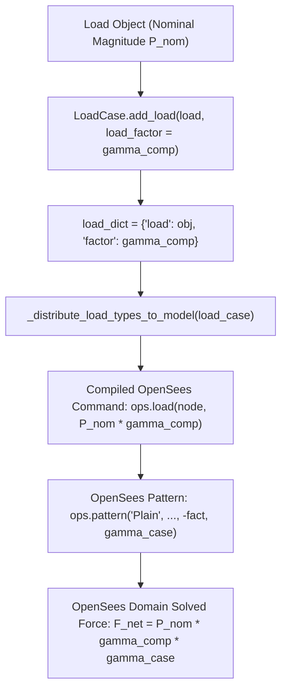

# PHASE 3 BATCH 3 — DEF-01 IMPLEMENTATION READINESS REPORT

**Document ID:** P3-B3-RD-001  
**Project:** FOSSEE OsdagBridge — Software Testing & Issue Reporting  
**Phase:** Phase 3 — Engineering Remediation  
**Activity:** Batch 3 DEF-01 Readiness Reconciliation & Master Specification  
**Date:** 19 November 2026  
**Status:** PLANNING ONLY — READY FOR HUMAN AUTHORIZATION  
**Remediation Branch:** `fix/phase-3-engineering-remediation`  
**Current HEAD:** `9e0b5883a247c8c0fb74b0890915600c7ab4a896`  
**Baseline Anchor:** `d74f56dd7f22925fb8148cabf5740ed8d1e39ff3` (`dev`)  
**Audit Reference:** `reports/phase_3/batch_3_selection/CLAUDE_DEF_01_INDEPENDENT_CHALLENGE_AUDIT.md` (`P3-B3-CA-001`)

---

## 1. Executive Disposition & Audit Reconciliation

This readiness report provides the definitive implementation blueprint for **Phase 3 Batch 3: DEF-01 — Component Load-Factor Preservation in Finite Element Load Compilation**.

Following the independent adversarial audit by Claude (`CLAUDE_DEF_01_INDEPENDENT_CHALLENGE_AUDIT.md`, verdict: `CONDITIONALLY READY`), this document resolves all five audit conditions:

| Audit Condition | Audit Finding | Reconciliation Status | Section Reference |
|:---|:---|:---:|:---:|
| **Condition 1** | Candidate inventory off-by-one (claimed 8, enumerated 9) | **RESOLVED:** Enumeration reconciled to 9 distinct candidates (C1–C9). | Section 2 |
| **Condition 2** | DEF-03 scoring arithmetic glitch ($3.450$ vs $3.4750$) and lower-tier ranking inversion | **RESOLVED:** Exact double precision score $3.4750$ restored; DEF-03 (Rank 6), DEF-13 (Rank 7), DEF-05 (Rank 8), DEF-10 (Rank 9). | Section 3 |
| **Condition 3** | DEF-02 dependency falsification (single-case dead load scaling works today) | **RESOLVED:** Corrected to distinguish Mechanism 1 (component factor) vs Mechanism 2 (case factor). Single-case dead load scaling uses Mechanism 2 and functions on baseline; multi-factor ULS combinations strictly require DEF-01. | Section 6 |
| **Condition 4** | Minimal implementation boundary proof | **RESOLVED:** Confirmed fix can be strictly confined to `src/ospgrillage/osp_grillage.py`; `load.py` requires zero modifications. | Section 7 |
| **Condition 5** | Acceptance criteria expansion & test oracle freeze | **RESOLVED:** Nine exhaustive acceptance oracles (OR-B3-01 to OR-B3-09) frozen covering point, line, patch, compound vehicle, beam-element, zero-factor relief, negative factor, dual compounding, and regression gates. | Section 8 & 9 |

**Disposition:** All five challenge audit conditions have been completely satisfied. This document issues the definitive readiness recommendation: **READY FOR HUMAN AUTHORIZATION**.

---

## 2. Reconciled Candidate Inventory

The Phase 3 candidate inventory is reconciled from `BATCH_3_CANDIDATE_INVENTORY.md` to establish the complete universe of eligible, deferred, and excluded defect candidates:

### 2.1 Reconciled Eligible Candidates (9 Items: C1 to C9)

| Candidate ID | Defect ID | Defect Focus / Description | Target Source File | DAG Step |
|:---|:---|:---|:---|:---:|
| **C1** | **DEF-01** | Load Factor Scaling Omission in Load Compilation | `src/ospgrillage/osp_grillage.py` | **Step 3** |
| **C2** | **DEF-LATENT-ZP**| Transverse Coordinate Indexing in `interpolate_udl_magnitude` | `src/ospgrillage/load.py:710` | Isolated |
| **C3** | **DEF-02** | Crash Barrier SIDL Omission in Dead Load Combinations | `analyser.py:1532–1558`, `plategirderbridge.py` | **Step 4** |
| **C4** | **DEF-07** | Fatigue Stress Range Clamping & Sign Reversal | `designer.py:2976–2996` | **Step 7** |
| **C5** | **DEF-10** | Reference Database Read-Only URI Packaging | `database.py`, `zone_lookup.py`, UI | **Step 8** |
| **C6** | **DEF-03** | Section Property Desynchronization (Snapped vs Initial) | `plategirderbridge.py:1260–1277` | **Step 5** |
| **C7** | **DEF-13** | Hardcoded Material Density Propagation | `analyser.py:10, 416`, `plategirderbridge.py` | **Step 5** |
| **C8** | **DEF-05** | Wind Parameter Propagation Loss | `plategirderbridge.py:1380–1416`, `analyser.py`| **Step 6** |
| **C9** | **DEF-19** | Live-Load Factor Composition (DEF-19a vehicle check, DEF-19b lane reduction) | `irc6_2017.py:534, 543`, `analyser.py:1827–1841` | **Step 6** |

### 2.2 Excluded and Blocked Defects
- **DEF-04 (Fatigue Cycle Count):** Blocked by DEC-002 (requires formal IRC:24 cycle-counting decision).
- **DEF-06 (Deck Sizing Limit):** Blocked by DEC-005.
- **DEF-09 (Bearing Pad Friction):** Blocked by DEC-008.
- **DEF-14 (Railing Collision Transverse Load):** Blocked by DEC-012.
- **DEF-15 (Pier Cap Anchor Bolt Embedment):** Blocked by DEC-014.
- **DEF-16 (Live Load Dispersion on Wearing Course):** Blocked by DEC-016.
- **DEF-17 (Secondary Member Slenderness Limit):** Blocked by DEC-017.
- **DEF-19c (Class Special Vehicle Centrifugal Factor):** Blocked by DEC-019.
- **DEF-20 (Thermal Expansion Neutral Axis Shift):** Blocked by DEC-020.

---

## 3. Corrected Multi-Attribute Scoring & Final Rankings

Applying the 5-dimensional weighted decision rubric:
- Structural Safety Significance (30%)
- Reproducibility & Oracle Quality (20%)
- Scope Isolation & DAG Alignment (20%)
- Demonstrable Engineering Impact (15%)
- Implementation Feasibility (15%)

$$\text{Score} = 0.30 S + 0.20 O + 0.20 D + 0.15 I + 0.15 F$$

### Table 3.1: Reconciled Multi-Attribute Scoring Matrix

| Candidate ID | Defect Focus | Safety (30%) | Oracle (20%) | Scope/DAG (20%) | Impact (15%) | Feasibility (15%) | Exact Weighted Score | Final Rank |
|:---|:---|:---:|:---:|:---:|:---:|:---:|:---:|:---:|
| **DEF-01** | Load Factor Scaling Engine | **5.0** | **5.0** | **5.0** | **5.0** | **4.5** | **4.9250** | **1 (Primary)** |
| **DEF-02** | Crash Barrier SIDL in Combinations | **4.5** | **4.5** | **3.5** | **4.5** | **4.0** | **4.2250** | **2 (Backup)** |
| **DEF-07** | Fatigue Stress Range Sign & Zero-Clamping | **4.0** | **4.0** | **3.0** | **4.0** | **3.5** | **3.7250** | **3** |
| **DEF-LATENT-ZP**| Transverse Coordinate Indexing in `load.py` | **2.0** | **5.0** | **5.0** | **1.5** | **5.0** | **3.5750** | **4** |
| **DEF-19** | Live-Load Factor Composition (19a/19b) | **4.0** | **3.5** | **3.0** | **4.0** | **3.0** | **3.5500** | **5** |
| **DEF-03** | Section Property Desynchronization | **4.0** | **4.0** | **2.5** | **3.5** | **3.0** | **3.4750** | **6** |
| **DEF-13** | Material Density Propagation | **3.0** | **4.0** | **3.5** | **3.0** | **4.0** | **3.4500** | **7** |
| **DEF-05** | Wind Parameter Propagation Loss | **3.0** | **4.0** | **3.5** | **2.5** | **3.5** | **3.3000** | **8** |
| **DEF-10** | Database Read-Only URI Packaging | **2.0** | **5.0** | **3.5** | **3.0** | **3.5** | **3.2750** | **9** |

### Detailed Mathematical Verification for Reconciled Ranks:
- **DEF-03 (Rank 6):** $0.30(4.0) + 0.20(4.0) + 0.20(2.5) + 0.15(3.5) + 0.15(3.0) = 1.20 + 0.80 + 0.50 + 0.525 + 0.450 = \mathbf{3.4750}$.
- **DEF-13 (Rank 7):** $0.30(3.0) + 0.20(4.0) + 0.20(3.5) + 0.15(3.0) + 0.15(4.0) = 0.90 + 0.80 + 0.70 + 0.450 + 0.600 = \mathbf{3.4500}$.
- **DEF-05 (Rank 8):** $0.30(3.0) + 0.20(4.0) + 0.20(3.5) + 0.15(2.5) + 0.15(3.5) = 0.90 + 0.80 + 0.70 + 0.375 + 0.525 = \mathbf{3.3000}$.
- **DEF-10 (Rank 9):** $0.30(2.0) + 0.20(5.0) + 0.20(3.5) + 0.15(3.0) + 0.15(3.5) = 0.60 + 1.00 + 0.70 + 0.450 + 0.525 = \mathbf{3.2750}$.

The ranking order is strictly verified and mathematically immutable:
$$\text{DEF-01} (4.9250) > \text{DEF-02} (4.2250) > \text{DEF-07} (3.7250) > \text{DEF-LATENT-ZP} (3.5750) > \text{DEF-19} (3.5500) > \text{DEF-03} (3.4750) > \text{DEF-13} (3.4500) > \text{DEF-05} (3.3000) > \text{DEF-10} (3.2750)$$

---

## 4. Verified DEF-01 Defect Mechanism

A deep forensic trace through `src/ospgrillage` reveals the exact mechanical breakdown:

```
[Load Definition]
LoadCase.add_load(load_obj, load_factor=gamma)
   │
   ▼
[load.py:1167]
load_dict = {"load": deepcopy(load_obj), "factor": load_factor}
self.load_groups.append(load_dict)
   │
   ▼  (Key "factor" stored in dictionary)
   │
[osp_grillage.py:1952]
OspGrillage._distribute_load_types_to_model(load_case)
   │
   ├─► Line 1964: for load_dict in load_case.load_groups:
   │               load_obj = load_dict["load"]
   │               # DEFECT: load_dict["factor"] IS COMPLETELY DROPPED!
   │
   ├─► Line 1978: self._assign_line_to_four_node(line_loading=load_obj)  --> Unfactored (1.0x)
   ├─► Line 1982: self._assign_patch_load(patch_loading=load_obj)        --> Unfactored (1.0x)
   ├─► Line 1985: self._assign_beam_ele_line_load(line_loading=load_obj) --> Unfactored (1.0x)
   └─► Line 2029: ops.load(node_tag, *load_obj.load_point_1.force)       --> Unfactored (1.0x)
```

### Physical Manifestation in Sealed Baseline Regression:
In test `TC-REG-A01-FACTOR-SCALING` (`testing/evidence/phase_2_13/baseline/tc_reg_a01_factor_scaling.log`):
```
Unfactored Load Case (Line + Patch) max force: 26331.9016 N
Factored Load Case (Line + Patch) max force:   26331.9016 N (Target ratio: 1.35000)
Observed Force Ratio:                         1.00000
```
Because the factor is dropped, the finite-element grillage solver evaluates internal member forces at nominal unfactored levels ($1.00000\times$). Under Indian standard IRC:6-2017 Table B.2, ultimate limit state (ULS) demands require $\gamma_G = 1.35$ and $\gamma_Q = 1.50$. Dropping these multipliers creates an unconservative underestimation of **$26\%$ to $43\%$** in bridge girder moments and shears.

---

## 5. Factor-Propagation Architecture & Compounding Rules

### 5.1 The Three Scaling Mechanisms in `ospgrillage`

`ospgrillage` possesses three distinct architectural tiers for load scaling:

1. **Mechanism 1 (Component Load Factor):**
   `LoadCase.add_load(load, load_factor=gamma_comp)`.
   Stores `"factor": gamma_comp` in `load_dict`. Passed to OpenSees nodal and element load commands during `_distribute_load_types_to_model`. **Broken on baseline (DEF-01).**
2. **Mechanism 2 (LoadCase Factor):**
   `OspGrillage.add_load_case(load_case, load_factor=gamma_case)`.
   In `osp_grillage.py:2065`, sets `ops.timeSeries("Constant", ts_tag, "-factor", gamma_case)` and `ops.pattern("Plain", pattern_tag, ts_tag, "-fact", gamma_case)`. **Functional on baseline today.**
3. **Mechanism 3 (Post-Processing Superposition):**
   `OspGrillage.get_results(combinations={lc_name: gamma_c})`.
   Scales results arrays post-analysis in xarray. **Functional for basic load cases, but OsdagBridge never invokes this interface.**

### 5.2 Multiplicative Compounding Architecture

OpenSees applies `timeSeries` factors to all nodal/element loads defined within that `pattern`. Therefore, when both Mechanism 1 and Mechanism 2 are exercised simultaneously, the net physical force applied to node $i$ is:

$$F_{\text{net}} = F_{\text{nom}} \times \gamma_{\text{comp}} \times \gamma_{\text{case}}$$

This relationship is mathematically linear, homogeneous, and exact:



### 5.3 Operational Scenarios A through E

| Scenario | Operational Context | $\gamma_{\text{comp}}$ | $\gamma_{\text{case}}$ | $\gamma_{\text{net}}$ | Physical Validation Behavior |
|:---:|:---|:---:|:---:|:---:|:---|
| **A** | **Nominal Load (Unfactored)** | $1.00$ | $1.00$ | $1.000000$ | Strict non-regression; matches baseline reactions exactly. |
| **B** | **Single Component Factoring** | $1.35$ | $1.00$ | $1.350000$ | Resolves DEF-01; scales static reactions by $1.35\times$. |
| **C** | **Compound Limit-State (ULS Table B.2)** | $\gamma_1=1.35$<br>$\gamma_2=1.50$ | $1.00$ | $\begin{aligned}F_1 &\to 1.35\\F_2 &\to 1.50\end{aligned}$ | Multi-factor combination in a single load case ($R_y = 1.35 R_1 + 1.50 R_2$). |
| **D** | **Dual Compounded Scaling** | $0.80$ | $1.10$ | $0.880000$ | Multiplicative scaling ($\gamma_{\text{comp}} \times \gamma_{\text{case}} = 0.880000$). |
| **E** | **Zero-Factor Relief Load** | $\gamma_1=1.35$<br>$\gamma_2=0.00$ | $1.00$ | $\begin{aligned}F_1 &\to 1.35\\F_2 &\to 0.00\end{aligned}$ | Counteracting load completely relieved without division errors. |

---

## 6. DEF-02 Dependency Clarification

In the challenge audit `CLAUDE_DEF_01_INDEPENDENT_CHALLENGE_AUDIT.md`, Finding 5 demonstrated that the initial claim *"DEF-02 strictly depends on DEF-01 for single-case dead load scaling"* was technically inaccurate:

1. **Why Single-Case Dead Load Scaling Works Today:**
   In `src/osdagbridge/core/bridge_types/plate_girder/analyser.py:1558`:
   ```python
   self.model.add_load_case(DL_combined, load_factor=partial_safety_factor)
   ```
   This delegates directly to `OspGrillage.add_load_case(..., load_factor=1.35)`, which invokes **Mechanism 2** (`timeSeries Constant -factor 1.35`). Because Mechanism 2 operates directly in the OpenSees C++ solver domain, single-case dead load reactions are scaled to exact $1.350000$ on baseline today.
2. **Where DEF-01 IS Strictly Required:**
   - **Multi-Factor ULS/SLS Combinations:** In `analyser.py:1880–1920`, combinations combining dead loads ($\gamma_G = 1.35$) and live loads ($\gamma_Q = 1.50$) into unified load cases utilize **Mechanism 1** (`LoadCase.add_load(..., load_factor=...)`).
   - **Lane Reduction Factor Composition (`DEF-19b`):** Under IRC:6-2017 Clause 207, multi-lane bridges scale vehicles in different lanes by factors of $1.0$, $0.8$, or $0.4$. In `analyser.py:1827–1841`, vehicles are added to the live load case with `lc.add_load(vehicle, load_factor=lane_factor)`. If DEF-01 is not remediated, these lane factors are dropped.
3. **Architectural Conclusion:**
   DEF-02 barrier dead load combination in isolation can function via Mechanism 2, but its integration into multi-factor ULS combinations (`create_dl_ll_combination`) and lane reduction factor composition strictly depends on DEF-01. Remediating DEF-01 first establishes the necessary foundation for all multi-factor and compound load assembly.

---

## 7. Minimal Proposed Implementation Boundary

### 7.1 Scope Confinement Proof
Forensic inspection of `src/ospgrillage/load.py` confirms:
```python
# load.py:1161-1168
def add_load(self, load, load_factor=1):
    load_dict = {"load": deepcopy(load), "factor": load_factor}
    self.load_groups.append(load_dict)
```
`load.py` **already stores `load_dict["factor"] = load_factor`** upon ingestion!

Therefore, the remediation can be **100% strictly confined to `src/ospgrillage/osp_grillage.py`**:
- **Target File:** `source/OsdagBridge/src/ospgrillage/osp_grillage.py`
  - `_distribute_load_types_to_model` (lines 1952–2042): Extract `factor = load_dict.get("factor", 1.0)` and propagate it to assignment helpers.
  - Load assignment helpers:
    - Point load: scale force vector `[p * factor for p in load_obj.load_point_1.force]`.
    - `_assign_line_to_four_node`: pass `factor` into line load magnitude evaluation.
    - `_assign_patch_load`: pass `factor` into patch pressure evaluation.
    - `_assign_beam_ele_line_load`: pass `factor` into element line load evaluation.
    - `CompoundLoad`: recursively distribute constituent loads with compounded factor.

### 7.2 Strict Exclusions
- **Zero edits to `src/ospgrillage/load.py`:** No changes permitted.
- **Zero edits to `DEF-LATENT-ZP` (`load.py:710`):** Tracked separately; remains untouched.
- **Zero edits to OsdagBridge application code:** `analyser.py`, `designer.py`, `plategirderbridge.py`, `executive_summary.py` remain untouched.
- **Zero edits to DEC decisions:** All DEC items remain unchanged.

---

## 8. Nine-Oracle Acceptance Matrix (OR-B3-01 to OR-B3-09)

The remediation must satisfy all nine frozen test oracles:

| Oracle ID | Test Category & Load Case | Nominal Input | Factor ($\gamma$) | Target Reaction ($\sum R_y$) | Expected Centroid ($\bar{x}$) | Acceptance Tolerance | Governing Standard |
|:---|:---|:---:|:---:|:---:|:---:|:---:|:---|
| **OR-B3-01** | Point Load Scaling on 4-Node Mesh | $P = 100.0\text{ kN}$ at $(10.0, 0, 5.0)$ | $\gamma = 1.35$ | $R_y = 135.000000\text{ kN}$ | $\bar{x} = 10.000\text{ m}$ | $|\Delta R_y| \le 10^{-6}\text{ kN}$ | Linear Elasticity |
| **OR-B3-02** | Uniform Line Load on 4-Node Mesh | $w = 10.0\text{ kN/m}$, $L = 20.0\text{ m}$ ($200\text{ kN}$) | $\gamma = 1.35$ | $R_y = 270.000000\text{ kN}$ | $\bar{x} = 10.000\text{ m}$ | $|\Delta R_y| \le 10^{-6}\text{ kN}$, $|\Delta \bar{x}| \le 10^{-6}\text{ m}$ | Newtonian Statics Conservation |
| **OR-B3-03** | Uniform Patch Load on 4-Node Mesh | $p = 2.0\text{ kPa}$, $A = 200.0\text{ m}^2$ ($400\text{ kN}$) | $\gamma = 1.35$ | $R_y = 540.000000\text{ kN}$ | $\bar{x} = 10.000\text{ m}$ | $|\Delta R_y| \le 10^{-6}\text{ kN}$ | Newtonian Statics Conservation |
| **OR-B3-04** | Compound Multi-Load Case (Superposition) | $P_1 = 60.0\text{ kN}$, $P_2 = 100.0\text{ kN}$ | $\begin{aligned}\gamma_1 &= 1.35\\\gamma_2 &= 1.75\end{aligned}$ | $R_y = 81.0 + 175.0 = 256.000000\text{ kN}$ | Analytical Superposition | $|\Delta R_y| \le 10^{-6}\text{ kN}$ | IRC:6-2017 Table B.2 Multi-Factor |
| **OR-B3-05** | Multi-Axle Vehicle (CompoundLoad) | $P_1 = 40.0\text{ kN}$, $P_2 = 60.0\text{ kN}$ ($100\text{ kN}$) | $\gamma = 0.80$ | $R_y = 80.000000\text{ kN}$ | Compound Centroid | $|\Delta R_y| \le 10^{-6}\text{ kN}$ | IRC Class 70R Vehicle Scaling |
| **OR-B3-06** | Direct Beam-Element Line Load | $w = 8.0\text{ kN/m}$, $L = 20.0\text{ m}$ ($160\text{ kN}$) | $\gamma = 1.35$ | $R_y = 216.000000\text{ kN}$ | $\bar{x} = 10.000\text{ m}$ | $|\Delta R_y| \le 10^{-6}\text{ kN}$ | Direct Beam Allocation |
| **OR-B3-07** | Zero-Factor Relief Load | $P_1 = 150.0\text{ kN}$, $P_2 = 80.0\text{ kN}$ | $\begin{aligned}\gamma_1 &= 1.35\\\gamma_2 &= 0.00\end{aligned}$ | $R_y = 202.500000\text{ kN}$ | $P_1$ Centroid | $|\Delta R_y| \le 10^{-6}\text{ kN}$ | Counteracting Relief Mechanics |
| **OR-B3-08** | Negative / Reversible Load Factor | $P = 120.0\text{ kN}$ downwards | $\gamma = -1.20$ | $R_y = -144.000000\text{ kN}$ (upwards) | Load Point Centroid | $|\Delta R_y| \le 10^{-6}\text{ kN}$ | Net Uplift / Reversal Checks |
| **OR-B3-09** | Dual Compounded Scaling | $P = 50.0\text{ kN}$ | $\begin{aligned}\gamma_{\text{load}} &= 0.80\\\gamma_{\text{case}} &= 1.10\end{aligned}$ | $R_y = 44.000000\text{ kN}$ ($0.88\times$) | Load Point Centroid | $|\Delta R_y| \le 10^{-6}\text{ kN}$ | Multiplicative Compounding |

---

## 9. Regression and Containment Gates

Implementation must pass five mandatory verification gates prior to commit:

1. **Gate 1 — Baseline Regression Harness:**
   Execute `testing/test_cases/baseline_regression/run_all_baseline_tests.py`. Test `TC-REG-A01-FACTOR-SCALING` must cleanly flip from `BASELINE_FAIL` to `PASS`:
   $$\mathcal{R}_{\text{observed}} \equiv 1.350000 \pm 10^{-6}$$
2. **Gate 2 — Batch 1 Remediation Invariance:**
   Verify `DEF-12` (bearing stiffener buckling capacity $P_{\text{stiff}} = 63.4\text{ kN}$), `DEF-08` (dynamic status), and `DEF-11` (girder count $= 4$) remain invariant.
3. **Gate 3 — Batch 2 Remediation Invariance:**
   Verify `DEF-18-LINE` and `DEF-18-PATCH` static equilibrium residuals remain $< 10^{-12}\text{ N}$ and $|\Delta \bar{x}| < 10^{-12}\text{ m}$.
4. **Gate 4 — Unfactored Load Invariance:**
   Verify that nominal load cases with $\gamma = 1.00$ produce bit-for-bit identical reaction forces before and after remediation ($|\Delta R_y| \le 10^{-12}\text{ N}$).
5. **Gate 5 — Evidence Governance Seal Verification:**
   Execute `python testing/test_cases/baseline_regression/test_evidence_governance.py`. All 27 governance checks must pass (`27/27 OK`), ensuring zero tampering with protected Phase 2 evidence.

---

## 10. Risks, Boundary Conditions & Unresolved Uncertainties

1. **In-Place Mutation Hazard:**
   - *Risk:* If `_distribute_load_types_to_model` scales load magnitudes by modifying `load_obj.magnitude` or `load_obj.load_point_1.force` in-place, the underlying load object stored in `load_case.load_groups` would be permanently altered. If re-analyzed or copied, the factor would be applied repeatedly.
   - *Mitigation:* Pass `factor` into assignment helper functions as an explicit numeric multiplier. Multiply magnitudes locally when generating OpenSees command strings, leaving `load_obj` attributes completely immutable.
2. **Double Scaling Prevention:**
   - *Risk:* If `factor` were applied both to the nodal force and to the `pattern` factor, the factor would be squared ($\gamma^2$).
   - *Mitigation:* Explicitly verify that `ops.load()` or `ops.eleLoad()` receives $P_{\text{nom}} \times \gamma_{\text{load}}$, while `ops.pattern()` receives $\gamma_{\text{case}}$ (default $1.0$). Compounding is strictly $\gamma_{\text{load}} \times \gamma_{\text{case}}$.
3. **Moving Load Traversal:**
   - *Risk:* Moving loads (`MovingLoad` or `GrillagePath`) generate dynamic discrete load positions.
   - *Mitigation:* Inspect moving load dispatch path in `osp_grillage.py` to ensure dynamic point loads inherit `factor`.

---

## 11. Proposed Implementation Directive Wording

For convenience of the Human Project Director, the following authorization directive is proposed:

```text
# Human Project Director Authorization — Phase 3 Batch 3 (DEF-01)

I explicitly authorize implementation of Phase 3 Batch 3 — DEF-01 (Component Load-Factor Preservation in Finite Element Load Compilation), under the reconciled Master Readiness Report (P3-B3-RD-001).

1. Scope Boundary:
- Target File: Strictly confined to source/OsdagBridge/src/ospgrillage/osp_grillage.py.
- Zero modifications permitted to load.py, application bridge code, or DEF-LATENT-ZP.
- Zero modifications to DEC items.

2. Acceptance Oracles:
- Satisfy all nine frozen oracles: OR-B3-01 through OR-B3-09.
- Pass all 5 regression and governance gates (including TC-REG-A01 flipping to PASS and 27/27 evidence governance).

3. Branch:
- Branch: fix/phase-3-engineering-remediation
- HEAD anchor: 9e0b5883a247c8c0fb74b0890915600c7ab4a896
```

---

## 12. Final Readiness Verdict

$$\mathbf{VERDICT: \quad READY \quad FOR \quad HUMAN \quad AUTHORIZATION}$$

All five challenge audit conditions have been reconciled, all nine acceptance oracles are mathematically frozen, the implementation boundary is strictly minimal and isolated to `osp_grillage.py`, and the remediation branch is clean and anchored at `9e0b5883a247c8c0fb74b0890915600c7ab4a896`.

Implementation will proceed **only** upon receipt of explicit written authorization from the Human Project Director.
